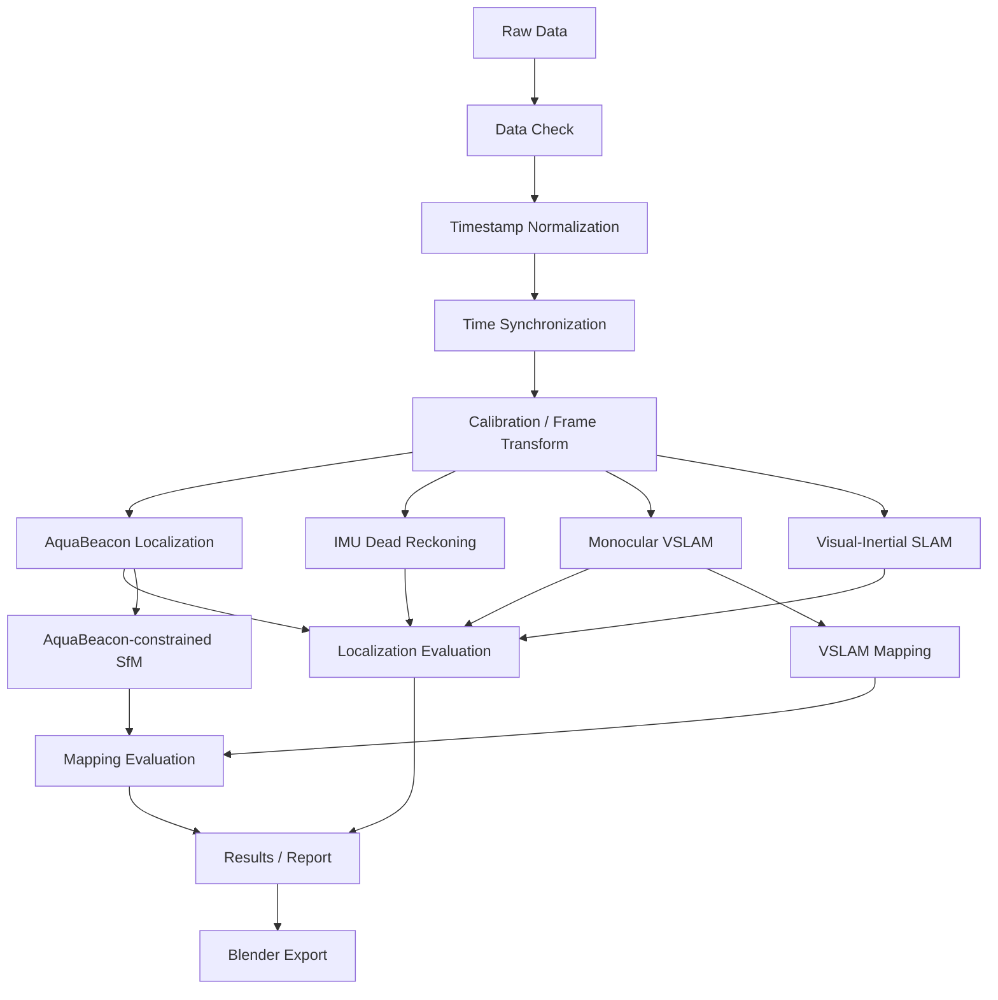

# AquaBeacon 実験データ解析システム仕様書

## 2026-10-31 別PCへの解析環境と校正データの配布

- 解析コード・テスト・設定・実験台帳・校正値を公開GitHubへ保存する。
  校正の根拠は`calibration/reference_data/`に選択保存し、元のrawと通常の結果は配布しない。
- チェッカーボードの検出交点（元画像座標、時刻、採否情報）と親子4姿勢のIMU抜粋を保持する。
  校正用抜粋は生CSVの一括公開ではなく、既存の校正結果から明示的に選んだ派生データである。
- manifestにコピー元パス・元SHA-256・配布SHA-256・サイズ・元解析HEADとdirty状態を残す。
  公開commitはGit履歴で追跡する。原動画からの再検出には元動画が必要と明記する。
- 校正JSONと抜粋はGitの改行変換を無効にし、Windows等のclone先でハッシュを保持する。
- `verify_calibration_bundle.py --refit`は校正値を上書きせず、整合性と数値再現性を検証する。
  カメラ内部行列差0.01 px以下・歪み係数差1e-4以下、親子軸行列差1e-8以下を受け入れる。
  これらは保存値の再現許容差であり、独立した真値に対する精度ではない。
- 新しい実験は既存の登録・原本配置規約を使う。取付回転は同一取付け、カメラ内部校正は
  撮影条件が適合する場合のみ再利用する。校正動画の時計offsetを別収録へ転用しない。
- 共通CLIとNGT専用処理を区別し、任意入力への全自動解析を保証しない。
  導入、外部依存、未同梱の入力は`docs/another_pc.md`に記載する。

受け入れ条件：

1. raw・results・隣接firmwareのない新規checkoutでパッケージ導入、CLI help、テスト、Lintが通る。
2. 同checkoutで校正manifestの全ファイルのSHA-256検証とカメラ・親子軸の再計算が通る。
3. 不足・改変された根拠ファイルは検証を失敗させる。
4. 公開対象に実験raw、全収録のログ、動画、生成地図、仮想環境、認証情報を含めない。
5. 新規実験の登録・配置、校正適用条件、専用処理の制約が別PC向け手順に記載されている。

## 2026-10-30改訂仕様：研究用2Dグラフと発表用映像

研究用は2Dを基本とし、必要なら3Dも用いる。ブラウザで細かく編集することを必須にする
対象は2Dグラフ。発表用は構図・光・文字・画質を優先し、3Dの映像に2Dエディタを課さない。
元の図のレイアウトや系列の意味を、編集UIに合わせて均一化しない。
本人が後でPowerPointへ貼り付けるため、PPTXは作成しない。2D図は単体で貼れる
PNG/SVG/PDF、3Dは映像とは別の簡潔な静止画を保存する。帯・説明パネル等のスライド装飾は
静止画へ加えず、軸・凡例・単位・必要な注記を残す。

- `prepare_ngt_replay_v2.py --experiment 20261028_ngt_004` は
  `wall_mapping/native120_restart` の既存位置拘束型結果から壁の9断片・94,455点を読み、
  `presentation_v2/data/` へ保存する。元の登録済みfloat64座標・RGB・点IDを全件保持。
  独立断片の重複は統合せず、230モデルと全33,564フレームの失敗・欠測台帳を残す。
  子機のみVSLAMの座標系・尺度へ親機観測を混ぜない。
- 各点の最終COLMAP trackに属する画像を元フレーム時刻へ対応づけ、異なる画像の
  2回目の観測時刻で表示する。1回目・最終時刻・観測数も残す。これは後処理の最終形状を
  観測順に再生する規約で、オンラインの点追加時刻や当時の推定形状ではない。
- 親子の位置は既存のm単位ENUと子機圧力深度を継承。位置や点の再推定・見栄え用の
  位置合わせは行わない。共通表示時刻は親動画1260〜1539.8秒、5Hzの1,400サンプル。
- 親子の `*_magnetic_attitude/attitude.csv` で `absolute_attitude_available` と
  `clock_valid` を満たすFRD→磁北NED四元数を使用する。NED→ENUはX/Y交換・Z反転。
  宣言した時刻変換を使い、姿勢のSLERPは隣接有効観測間0.1秒以内、最近傍対応は0.055秒以内。
  外挿は禁止し、対応方法と時間差を記録。精度検証フラグのfalseは今回の利用禁止を意味しない。
  磁気偏角は未適用で、真北姿勢や独立した姿勢精度とは呼ばない。
- CADは凍結 `cad_20261028`。親機は設定の+X前/-Y右/-Z下を適用。子機は設計軸の
  +Yドーム方向を前、+Xを右、+Zを上とする表示用の暫定対応。
  計測したFRD姿勢とCADへ合成した姿勢は別に保存し、子機のCAD対応は未校正と明記する。
  設計原点と測定中心、カメラ／ライト交換後の正確な位置は未校正。
- `render_ngt_replay_v2.py` はEevee・1プロセス・2スレッド・20分上限。
  位置＋姿勢、地図＋機体、地図のみの3版を `presentation_v2/render/` へ保存する。
  実寸の機体と姿勢確認の拡大枠を分ける。欠測した位置／姿勢は有効なものと見分けられる表示とし、
  無効な実機姿勢を中立姿勢で埋めない。描画キーフレームはCONSTANT、元サンプルを保持する。
  機体あり／なし地図は同じ点・時刻・カメラ、各1080p画像・MP4・編集用blendを保存する。
- 2Dエディタは初期レイアウト・凡例・縦横比を保ち、明示した項目のみ変更する。
  軸スケール、縦横比、主副目盛り、枠、凡例列／枠、サブプロット配置、注釈位置を追加する。
  特殊Artistは生成コード＋Figureによる編集を残し、MATLABの全機能互換とは表現しない。
  `open_ngt_research_figures.py --experiment <id>` は登録済み実験の既存2D図だけを一覧にする。
  自動一括再生成はしない。編集サーバーはloopback限定・30分無操作で終了する。
- 001の静止GNSS図のみ発表用の配置を追加する。元Figureの240点ずつの配列を保持し、
  全体の等縮尺図とPPKの±1 m拡大図を併記。平均位置をそれぞれ原点に置く元解析を継承し、
  平均位置の差や絶対精度とは扱わない。保存マスターを再読込して元配列一致とRMSを検算する。
  タイトル・注釈も共通2Dエディタで選択可能なTextとして保持。既存研究図は上書きしない。

受け入れ条件：全点・元位置・FRD姿勢の追跡可能性／座標変換と時刻・欠測の自動試験／
保存blendの再読込と位置・回転・可視点数の照合／2つの地図映像で時刻とカメラ一致／
3動画のデコード・代表フレームの目視／初期図と凡例の保全・設定保存/再読込・PNG/SVG/PDF／
テスト・lint・原データ保全／所有プロセス終了。実ブラウザ未確認の項目は結果へ明記する。

実画面確認（2026-10-30）：研究用エディタの標準loopback画面で、検証用コピーのxlim、
点サイズ、凡例列、補助目盛り、グリッド、幅ドラッグを変更し、保存・再読込・保存して終了を確認。
PNG/SVG/PDF出力と元配列の一致を照合した。記録は001/presentation_figures/editor_validation/。
Pythonから直接Figureを読み込む場合も、破棄済みのTk/Qt managerをAgg canvasへ分離してから
寸法を適用する。ブラウザエディタ以外のfile形式の素材入口は実画面未検証のまま区別する。

## 2026-10-30追加仕様：写真付き疎地図・実CADの発表素材・GNSS俯瞰

以下は改訂前の生成物の再現仕様。中立姿勢表示等は新版の規約へ適用しない。

- 004の既存子機単眼地図を `presentation_mapping/` へ別出力する。親機観測は使用しない。
  最大地図2の元7,614点を保持し、保存キーフレームの同じ地図座標系で写真を投影する。
  `CameraTrajectory` の再基準化座標を `KeyFrameTrajectory` の元地図座標へ混ぜない。
  5つの独立地図は接続せず、元PLYを保存する。元画像・姿勢・点群・rawは変更しない。
- 共通沖縄水中校正のMP4用Kを全画面1280×720へ拡縮、Dは保持し、SLAM設定との一致を検証する。
  64枚の原写真と歪み補正画像、GLB、OBJ/MTL、写真色付きPLY、scene.json、manifestを保存する。
  辺80px・深度比1.15・3D辺が地図90%半径の8%以下を条件に、投影像上のDelaunayで
  元の点だけを局所接続する。8pxセルの近接深度による遮蔽近似、無効な歪み補正境界の除外を明示。
  密な遮蔽検証、連続壁の補完、尺度合わせ、点座標の補間・平滑化は行わない。
- 地図は任意SLAM単位の疎な近似表面。全入力約280秒のうち、最大地図の保存キーフレームは
  子動画1171.445〜1183.974秒の約12.53秒。全フレーム追跡OK7.29%、最大地図保存姿勢4.47%。
  見た目の改善を再構成範囲や形状精度の改善と扱わない。点IDと生成時刻は保存されていない。
- オフラインHTMLは地図選択、写真面・点・軌跡切替、回転・移動・拡大、時刻のスライダーと数値入力、
  再生、表示設定保存/読込、PNG保存に対応。実ブラウザ描画とmock DOM/WebGL試験は区別する。
- `presentation_animation/` は写真面を撮影時刻順に表示する。点生成の履歴とは呼ばない。
  入力scene/GLBを凍結コピーし、原写真のテクスチャをblendへ埋め込む。0.5秒超の姿勢欠測は隠す。
  1080p静止画、720p/10fps/10秒動画、100表示サンプルと元時刻の対応、編集可能blendを保存する。
  見せる範囲は投影軸ごとの中央98%（7,446/7,614点）と注記し、全点・元メッシュは保持する。
- 実CADは `cad_20261028` 凍結GLBとrig.jsonのSHA256を照合する。現行設計の更新を自動反映しない。
  子機437・親機232のメッシュを使い、単眼地図との実寸対応がないため地図動画では別枠へ配置する。
  子機カメラ/ライトの本番交換、正確な取付変換未保存、測定中心未校正を明示する。
- `presentation_positions/` は既存 `position_visualization/scene_data.json` の表示座標を使う。
  m単位・全1,400サンプル・5Hz・CONSTANT補間。機体は実寸、回転は未計測の中立姿勢。
  CAD設計原点を推定アンテナ/光学位置へ置く仮定を注記し、部品のvisibility driverで欠測機体全体を隠す。
  元高度を変える処理ではなく既存の水面基準表示を継承。96サンプル/12fps/8秒のプレビューと
  全サンプルCSV、1080p静止画、全時刻blendを保存する。
- `gnss_overhead/` は001〜004を明示選択。既存RTK・採用PPKのinput_valid/有限値条件を保持し、
  20ms以内の一対一最近傍時刻で比較する。補間・新たな外れ値除去はせず融合で棄却された有効観測も保持する。
  等縮尺の東北図、平均差、原点まわりの水平差RMS円と平均差まわりのRMS円を示す。
  001の親動画240–480秒だけは各系列自身の平均を基準に静止散らばりを表示。
  円は信頼区間ではなく、RTKとPPKは相関する同じ移動局の解。独立真値誤差・絶対精度とは呼ばない。
- GSI航空写真は元のz18、約0.491m/配信画素を維持し高DPI/ベクトル軌跡・縮尺を追加する。
  `aerial_hires/` は静的な別ソース比較。現地のEsri World Imagery / Vantor GE01、
  2025-11-17撮影、原画像解像度0.46m、現地上限z19を確認し4タイルのみ合成する。
  配信約0.246m/画素を原画像解像度と混同しない。画像へ合わせる位置修正はしない。
  提供者の位置精度メタデータもGNSS真値には使わない。静的研究発表用の出典・利用条件を保持する。
- 新しいグラフは共通 `save_editable_figure` 経路でPNG/SVG/figure.pickle/plot.jsonを保存する。
  `results/20261028_ngt_000/presentation/` に入口、全リンクのハッシュ、検証と再生成コマンドをまとめる。
- `dense_photogrammetry/` は追加の子機のみ局所ステレオ検証。元Map2のカメラ姿勢と共通水中校正を
  640×360へ縮小し、実画像を整列、SGBMの左右一致を確認する。正深度・視差角0.5度以上・
  元画像有効領域・独立第三写真の5×5局所相関0.7以上・標準偏差3以上・平均輝度差20以下を要求する。
  2px格子の隣接有効点だけを深度比1.05以下で接続。SGBMの正則化は記録し、欠測補間・穴埋めはしない。
  初回前進4組の失敗を残し、横基線4組で269点・301面を得た。8組合計でも高密度連続モデルは未達。
  同じ地図の疎点との距離や第三写真との相関は整合指標で、独立精度ではない。各段階の除外数、
  元画像/測定視差/対応画素/三角測量点/支持フラグ/ソースハッシュを保存し、既存疎地図へ自動統合しない。

受け入れ条件：元座標/元画像/元点の整合・ハッシュ確認／各独立地図と失敗範囲の保持／
投影の回転・並進・歪み境界・三角形ゲート試験／実CAD階層と全位置/欠測のBlender照合・再読込／
映像のフレーム数・解像度・代表フレーム確認／GNSS対応とRMSの合成試験／
編集マスター保存/再読込・エクスポート／表示確認の方法と未検証項目を記録／テスト・lint／
タスク所有レンダラー・エンコーダーの終了。ブラウザアクセス不可の場合は実画面未確認を明記する。

## 2026-10-30追加仕様：子機地図・DR深度融合・VI-SLAM

- 子機のみという入力制限を維持し、001〜004を`--experiment`で明示選択する。
  中間入力は`data/interim/<id>/child_sensor_fusion/`、結果は
  `results/<id>/child_sensor_fusion/`、横断レポートとセンサ共通来歴は000配下。
  既存の単眼地図と失敗試行は保持する。
- 本体BNO085の新規加速度・ジャイロ、姿勢・磁気、子機圧力、カメラ姿勢・加速度を使う。
  UTC・親機の位置・姿勢・映像・親機依存の音響測距は使用しない。同期は既存の子機だけの
  `child_only_vslam/child_clock.json`。磁北姿勢は子機センサから再計算する。
- IMU→光学回転は003の子機原動画906.539〜933秒の単眼相対回転とIMU角速度で暫定推定し、
  933〜959.442秒を整合確認に使う。同じ実験での推定を独立した精度検証とは呼ばない。
  並進レバーアーム0、IMUノイズは試行仮定。校正区間の水面上・水中内部校正不一致も残す。
- VI-SLAMはORB-SLAM3のIMU_MONOCULAR。元画像の4フレームに1枚（30000/1001 Hz）と
  約100 Hzの子機本体IMUを使用する。001は本体記録と重ならず、カメラ四元数の差分角速度と
  カメラ加速度（約30 Hz）を用いる参考試行。補間で観測レートを水増ししない。
  003・004では`--camera-imu`を付けた別試行で、カメラ内蔵センサだけのVI-SLAMとも比較する。
  オフライン積分のため各画像時刻を挟む次の実測IMUサンプルまで渡し、ORB内部キューで保持する。
  初回の画像時刻までの入力方式、異常終了、未処理フレームも保存する。
- アダプタは全画像のtracking state・地図ID・慣性初期化フラグ・渡したIMU個数を保存。
  空地図でも正常に診断を保存する。地図ごとのPLYと光学カメラのキーフレーム姿勢を出力。
  ORBの`SaveTrajectoryEuRoC`のVI出力はIMU座標姿勢なので、光学姿勢と混同しない。
  慣性初期化成功、視覚追跡、最終地図の存続、プロセスの正常終了を別々に集計する。
- DRは磁北NEDとlocal_downの2種類で20 Hzへ変換し、比力を回転して重力を加算する。
  静止実験002の762〜767秒から加速度バイアスを推定し明示減算。初位置・初速度0を仮定。
  0.1秒超のIMU欠損は補間せず独立セグメントへリセット。静かなIMUだけからZUPTしない。
- 圧力は各試行の最初の値を基準に、密度997 kg/m³、重力9.80665 m/s²で相対下向き変位へ換算。
  温度も保存する。p/v/加速度バイアスのKalmanモデルへ各実測圧力を1回だけ更新する。
  深度σ=0.03 m、加速度σ=0.15 m/s²、bias walk=0.002 m/s²/√sはモデル仮定。
  深度残差は入力観測との整合であり、真値誤差ではない。水平ドリフトも示す。
- 単眼＋DR融合の候補は、磁北NEDへ回転した地図の上下成分と実測圧力を照合して尺度を試算。
  前60%で尺度・オフセット、後40%で整合確認。少なくとも8観測・各分割3観測、正の尺度、
  訓練深度幅5 cm以上、後半RMSE < max(5 cm, 全深度幅の30%)を暫定採用条件とする。
  不成立でも候補と理由を保存。採用時だけ、全フレーム連続追跡された0.5秒視覚速度を融合する。
  この尺度や慣性尺度を独立した位置精度の証明としない。
- 地図は個別の座標・尺度を保持したオフライン3D HTMLとJSON、各実験のPNG/SVGおよび
  共通編集マスターで納品する。点のない面や地図間接続を作らない。3D表示は回転・移動・倍率、
  点の色・大きさ・透明度、軌跡の色・太さ、図寸法の変更・設定保存/再読込・PNG出力に対応。
  ブラウザ実画面検証とJSロジック試験は区別する。
- 実行は最大2コンテナ、各CPU4・RAM4 GiB、40分上限。終了時に作業所有プロセスを停止する。

受け入れ条件：子機だけの入力来歴と設定を記録／全試行と未処理・失敗を保存／
慣性初期化と追跡を区別／欠損を跨がないDR・深度融合の合成試験／尺度不採用理由を保存／
全独立地図と編集マスターを保存／表示・設定の検証方法と限界を明記／全テスト・lint／
各実験レポートとプロセス終了確認。精度向上やVI-SLAM成功そのものを完了条件にはしない。

## 2026-10-30追加仕様：長田高校の子機のみ単眼VSLAM

- `run_ngt_child_vslam.py` と `evaluate_ngt_child_vslam.py` は `--experiment` を繰り返して
  001〜004を明示選択する。000は全収録の時計・比較結果の保存先で、4試行と重複実行しない。
- 入力は子機0186原MP4の該当区間全フレーム（120000/1001 fps、1920×1080から1280×720へ
  全画面縮小）とする。SLAMは純単眼で、子機姿勢もSLAMの推定入力には加えない。
  中間画像は `data/interim/<id>/child_only_vslam/<run>/`、結果は
  `results/<id>/child_only_vslam/`。rawと既存SLAM結果を変更しない。
- 沖縄水中校正を今後の親機・子機の共通既定とする（ユーザー指定）。
  `calibration/camera_defaults.json` から原典を参照し、原MP4の内部行列を2/3倍、
  歪み係数を保持して使用する。校正ファイル名のparentは来歴であり、今回の親機観測入力ではない。
  暫定校正の限界を保持する。空中映像へ水中モデルを使った場合は条件不一致を明示する。
- 長田高校実験の親機画像・IMU・姿勢・GNSS・音響距離・融合軌跡は使用しない。
  既存の子機区間CSVから `video_time_s` の区間定義だけを引き継ぐ。
  カメラ―子機IMU時計は子機の角速度だけから
  `acquired_s = offset_s + time_scale * source_video_s` を再推定し、親機同期列やUTCは使わない。
- ORB入力時刻は `1e18 + video_PTS * 1e9` の合成ns。19桁ファイル名の既存出力パッチに
  対応するためのオフセットでありUTCではない。旧パッチの `utc_ns` ヘッダーもこの実行では合成ns。
  `frames.csv` に原動画フレーム番号・PTS・画像SHA-256を保存し、LF改行で時刻列を渡す。
- 評価は全入力フレームのtracking state、最大地図への保存率、地図数・点数、1秒/5秒の
  相対回転角の大きさの差を用いる。子機磁北NED・local_down・カメラ内IMUを区別する。
  `absolute_attitude_available` を使い、精度未検証フラグだけでは除外しない。
  子機83304本体IMUが001と重ならない場合、磁北姿勢比較は欠損のまま残す。
- SLERPは0.1秒以内の有効サンプル間だけ。追跡喪失・姿勢未保存・参照欠損を跨ぐ回転差を作らない。
  固定光学―機体回転が未校正なので、この差は回転角の**大きさ**の一致性であり、
  全SO(3)誤差・真北精度ではない。位置GTと単眼尺度がないためATE/RPE[m]は未算出と明示する。
- 実行・抽出はPID、開始/終了、目的、所有者、タイムアウトを記録する。DockerコンテナにCPU4・
  メモリ4GiB制限、実験の同時実行は最大2とし、終了後に所有コンテナの消滅を確認する。
  解析図は共通のブラウザ編集マスター・SVG・PNGを保存する。
- `--clahe` は同一フレーム・同一時刻でLAB L成分CLAHE（clipLimit=3、8×8、JPEG95）を施す
  別run。元画像試行を上書きしない。今回002で追加試行し、失敗も保存する。
  `child_vslam_media_review.json` に目視した水中/水面上のサンプルと保守的な確認窓を記録する。
  003で水面上の追跡が成立しても水中性能へ昇格しない。境界付近は未分類とする。
- 空地図で既存EuRoC出力が異常終了するため、`docker/orbslam3/finish_empty_map.py` で
  診断CSVをflushし、キーフレーム0の場合は空軌跡を正常保存する。修正版バイナリは
  `data/interim/orbslam3_bin/mono_euroc_empty_safe`。既存バイナリは保持し、SHA-256と
  実行前の失敗ログも記録する。SLAM推定器本体は変更しない。

受け入れ条件：4試行の元フレーム対応と欠測を保存／子機だけの時計証拠と入力来歴／
tracking lostと最大地図保存欠損を区別／位置・絶対姿勢精度の未評価を明示／
回転差の固定座標回転不変性とギャップ拒否の合成テスト／テスト・lint／
実行終了・代表画像・編集可能グラフの確認／各実験レポートと横断比較の保存。

> **ステータス**: 確定  
> **作成日**: 2026-09-22  
> **読者**: 実装者・解析担当者・AIエージェント

本書は、AquaBeaconの実験データ解析基盤に対する実装契約である。受け入れ条件を満たさない機能は完了扱いにしない。

---

## 1. 概要

### 一言コンセプト
親機・子機・Spresense IMU・2台のカメラ動画を統合し、データ確認、時刻同期、位置推定、比較評価、位置拘束型マッピング、発表用可視化までを一貫して実行する後処理解析基盤。

### 対象データ
- 親機 CSV
- 子機 CSV
- Spresense IMU CSV
- 親機カメラ動画
- 子機カメラ動画

### 主な解析段階
1. データ品質確認
2. 時刻同期
3. 位置推定
4. 位置推定比較
5. AquaBeacon位置拘束型マッピング
6. 単眼VSLAMマッピングとの比較
7. 評価用図・Blender向け発表用データ生成

---

## 2. 仕様確定状況

| 分類 | 件数 | 内容 | 扱い |
|---|---:|---|---|
| blocker | 0 | なし | 実装開始可 |
| assumption | 4 | CSV列名はconfigで対応、録画開始時刻が取得可能、各IMU/カメラは剛体固定、解析は後処理 | 実データ確認時に更新可 |
| later | 7 | GUI、リアルタイム化、高度なIMU融合、自動Blenderレンダリング、クラウド処理、複数実験ダッシュボード、論文図版完全自動化 | MVP外 |

### 確定した前提
- Ground Truthは原則取得できない。
- 静止状態のばらつき、ドリフト、閉路誤差、手法間差、推定継続率等を主評価とする。
- IMU単独位置推定はDead Reckoning（二重積分）をbaselineとする。
- 比較対象に単眼VSLAMとVisual-Inertial SLAMを含める。
- 単眼VSLAMは軌跡と3Dモデルの両方で比較する。
- 内部座標系は右手系ENUとする。
- マッピング基本実装はCOLMAPとする。
- Blenderは発表用可視化専用であり、正式な数値評価には使わない。

---

## 3. 入力データ仕様

### 3.1 親機CSV
想定フィールド:
- timestamp
- GPS時刻
- latitude / longitude / altitude
- acoustic TX/RX関連情報
- 本体IMU情報（存在する場合）
- 状態フラグ

実列名はconfigでマッピング可能とする。

### 3.2 子機CSV
想定フィールド:
- timestamp
- RTC時刻
- acoustic RX timestamp / TOF関連情報
- depth / pressure（存在する場合）
- 本体IMU情報
- 状態フラグ

### 3.3 Spresense IMU CSV
想定フィールド:
- timestamp
- acceleration x/y/z
- angular velocity x/y/z
- quaternion w/x/y/z
- GPS時刻
- optional: magnetic field / temperature

### 3.4 親機カメラ動画
用途:
- 子機ライト検出
- 方位角・仰角推定
- カメラ内蔵IMU情報抽出
- 時刻同期補助
- 親機姿勢推定補助

既存の動画からQuaternion等を抽出するロジックを再利用する。

### 3.5 子機カメラ動画
用途:
- 水中マッピング
- 単眼VSLAM
- VI-SLAM
- SfM / Photogrammetry
- カメラ内蔵IMU情報抽出
- 時刻同期補助

---

## 4. 時刻同期仕様

### 4.1 基本同期
| 機器 | 同期方法 |
|---|---|
| 親機 | GPS PPS |
| 子機 | RTC + 有線同期 |
| Spresense | GPS時刻 |
| 親機カメラ | 録画開始時刻 |
| 子機カメラ | 録画開始時刻 |

### 4.2 共通時間軸
全データを `seconds from experiment epoch` に正規化する。

推奨epoch:
- 親機GPS基準時刻、または
- 実験開始時刻

内部表現はUnix timeまたはfloat64秒を許可するが、プロジェクト内で統一する。

実装上の共通列:
- `sync_utc_us`: UTC Unix epochの整数マイクロ秒
- `sync_utc_iso`: 同一時刻のISO 8601表現
- `experiment_time_s`: C_MAINの対象区間開始を0秒とするfloat64秒

C_MAINの実験区間は `C_MAIN_IMU_100Hz_<番号>.csv` の `utc_us` 最小・最大で定義する。
Spresenseは、対象区間と重なる `G<番号>.CSV` を先に選び、同番号の `I<番号>.CSV` を使う。
`G` の `received_mono_us` と `utc_s + nav_usec` の線形回帰を、同番号の `G/I` 共通時計へ適用する。

カメラの粗同期はQuickTime `creation_time` を使い、C_MAIN区間との共通部分だけを切り出す。
一般的なMP4再多重化で保持できないDJI `djmd` は、LRFから姿勢・加速度等を別CSVへ抽出する。
切り出し動画が映像・音声のみであること、元ファイル内オフセット、要求区間はmanifestへ記録する。

### 4.3 IMU相互相関による微調整
親機・子機それぞれについて、本体IMUとカメラIMUの角速度ノルムまたは加速度ノルムを比較し、相互相関最大となる時間差 `Δt` を推定する。

必要なら時間オフセットだけでなく線形ドリフトも診断する。

実データの機器対応:
- `C_MAIN IMU ↔ C_MAIN_CAM`
- `SONY Spresense IMU ↔ P_MAIN_CAM`（SONYはP_MAIN取付）

粗同期後の加速度ノルムを30 Hz共通格子へ補間し、1秒移動平均を除いた波形で±5秒を探索する。
全重複区間のピークに加え、動きのある複数窓で同じoffsetが再現するか確認する。相関が弱い、
または競合ピークが近い場合は自動適用せずwarningとする。適用した補正は元時刻を残した別列・別CSVへ保存する。

品質確認では、行数、対象期間、サンプリング周期、時刻逆行、重複、3倍超の時間ギャップ、
連番欠落、空欄、NaN/Infを記録する。CRC等の識別子は数値異常判定の対象外とする。

### 4.4 実験前同期・校正動作
各実験開始前に以下を推奨する。
1. 20秒静止
2. yaw +方向
3. yaw -方向
4. yaw +方向
5. pitch +方向
6. pitch -方向
7. roll +方向
8. roll -方向
9. 10秒静止
10. 実験開始

各動作間に1〜2秒静止を入れる。

目的:
- IMUバイアス確認
- 重力方向確認
- カメラ/本体IMUの時刻オフセット推定
- 軸方向確認
- 初期姿勢確認

---

## 5. 座標系

内部座標系は右手系ENU:
- X = East
- Y = North
- Z = Up

管理するframe:
- World / ENU
- Parent Body
- Parent Camera
- Parent IMU
- Spresense IMU
- Child Body
- Child Camera
- Child IMU

固定相対位置・姿勢はSE(3) extrinsicとして `calibration/` に保存する。

---

## 6. 校正パラメータ

Git管理対象:
```text
calibration/
├── README.md
├── parent_camera.yaml
├── child_camera.yaml
├── parent_imu.yaml
├── child_imu.yaml
└── extrinsics.yaml
```

最低限管理するもの:
- カメラ内部パラメータ
- 歪みパラメータ
- IMU軸定義
- Parent Body ↔ Parent Camera
- Parent Body ↔ Parent IMU / Spresense
- Child Body ↔ Child Camera
- Child Body ↔ Child IMU

---

## 7. 全体処理フロー



---

## 8. MVP-1 データ品質確認

### 目的
後段解析に入る前に、入力データの健全性を自動確認する。

### 入力
5系統の入力データ、experiment metadata、sensor config。

### 処理
- ファイル存在確認
- CSV読込可否
- 動画読込可否
- 必須列存在確認
- timestamp単調性
- timestamp重複
- NaN / Inf
- 欠損率
- 開始/終了時刻
- サンプリング周期統計
- 大きな時刻ジャンプ

サンプリング周期は mean / median / std / min / max を計算する。

### 出力
```text
results/<experiment_id>/data_quality/
├── sensor_summary.csv
├── missing_data.csv
├── timestamp_summary.csv
├── timeline.png
├── sampling_interval.png
├── sync_check.png
└── report.md
```

### 正常系受け入れ条件
- [ ] 5系統の入力を認識できる。
- [ ] 必須列と任意列を識別できる。
- [ ] 欠損率とサンプリング周期を算出できる。
- [ ] 全センサのタイムラインを可視化できる。

### 異常系・境界値
- [ ] 必須列欠損時は対象処理を停止し、理由をreportへ残す。
- [ ] 任意列欠損では全処理を停止しない。
- [ ] 動画欠損時も動画非依存処理は継続可能とする。
- [ ] NaN/Infを黙って補正しない。

---

## 9. MVP-2 時刻同期

### 目的
異なる時計で記録された全データを共通時間軸へ整列する。

### 入力
各センサtimestamp、GPS PPS / RTC同期情報、カメラ録画開始時刻、本体IMU、カメラIMU。

### 処理
- 各時計→experiment epoch変換
- カメラ開始時刻による粗同期
- IMU相互相関による微調整
- 必要に応じ線形clock drift診断

### 出力
- 同期済みtimestamp
- センサごとのoffset推定値
- 相関係数
- sync diagnostic plot
- warning flags

MVP時刻合わせの保存先:
```text
data/interim/<experiment_id>/
├── c_main/
├── spresense/
├── camera_video/
└── camera_telemetry/

results/<experiment_id>/synchronization/
├── manifest.json
├── summary.md
└── refined/
    ├── imu_offsets.csv
    ├── sensor_quality.csv
    ├── column_quality.csv
    ├── timeline.png
    ├── sync_diagnostics.png
    ├── sampling_intervals.png
    ├── analysis_summary.json
    └── report.md
```

### 正常系受け入れ条件
- [ ] 全センサを同一時間軸で参照できる。
- [ ] IMU相互相関による時間offsetを出力できる。
- [ ] 補正前後の同期状態を図示できる。

### 異常系・境界値
- [ ] 相関ピークが曖昧な場合は自動確定せずwarningとする。
- [ ] センサ間に重複時間帯がない場合は該当同期をfailedとする。
- [ ] 補間した区間を追跡可能にする。

---

## 10. MVP-3 AquaBeacon位置推定

### 実験機体の形状参照と外部校正

2026-09-22実験の親機・子機は、それぞれ兄弟ディレクトリ
`mechanical/assemblies/parent_simple` と
`mechanical/assemblies/child_simple_assembly` を形状参照とする。
取付面の座標系・寸法・原典ハッシュは
`calibration/experiment_body_geometry_20260922.json` と
`docs/experiment_body_geometry.md` に記録する。
子機の `mechanical/assemblies/child_interior` と親機の
`mechanical/assemblies/parent_interior_p1` を内装の形状参照とする。
実験時の子機C-MAINはカメラ取付面側、親機SpresenseはP-MAINと同じ側の反対角で
SDカードが外向き。親機内装は設計モデルから変更されているため、
`parent_interior_p1` の基板位置を実験時の外部校正値としない。
両機とも取付穴・座面から光学中心、IMU、GPSアンテナ、圧力センサ、ライト、
音響素子の中心を暗黙に補完しない。実装位置と姿勢が確認できるまでは
カメラ・基板・他センサ間の並進レバーアーム補正を適用しない。

受け入れ条件: 取付面とセンサ測定点を区別して記録できること。
実験時の内装変更が反映されていないモデルを補正値として使用しないこと。
採用前に外装と内装を重ねた3Dシーンを実験ID単位の結果フォルダへ保存し、
基板の側、Spresenseの角とSD口の向き、カメラ取付面を実機と照合する。

### 今後の実験用CAD配置スナップショット（cad_20261027）

`parent_hand_service` と `parent_exterior`、`child_horizontal_plate_frame` と
`child_interior` を今後の実験機体として別途準備する。2026-09-22の機体設定・
解析出力は変更しない。正本はmechanicalの各 `placement.json` と各部品のSTL。
数値配置を `calibration/rigs/<rig_id>.json` に保存し、原典SHA-256、Git SHA・変更状態を
記録する。原典更新を検出したら同じIDへの再採取を拒否し、新しいIDを使う。

座標は列ベクトル、`p_body = T_body_component @ p_component`。CADのmmから
body frameのmへ並進とメッシュを一度だけ変換する。OpenSCADのopsは外側順、
rotateはRz Ry Rx。鏡像・scaleは部品形状用であり、校正用SE(3)へ流用しない。
親機bodyはparent_exteriorの箱底中心で+Z上。内装を(-105,-115,0) mm移動する。
子機bodyは横置き外装の原点、+X右・+Yドーム・+Z上、チューブ軸Z138 mm。
内装をRx(-90°)と(0,-100,138) mmで変換する。両変換は共通の箱／チューブ部品から
算出する。筒内の実装ロール角・実組立との一致は別途確認する。

カメラ、Spresense、親子IMU・磁気、親子TD04Aを個別に列挙する。
CADの取付点、基板原点、チップXYの基板面への投影、仮包絡中心と、
センサー測定中心・測定軸を区別する。未確定の `T_body_sensor` と
`measurement_center_body_m` は `null`。`sensor_transform()` は未確認の外部変換を
拒否する。TD04A本体と音響中心は現行CADに無く、固定穴列中点のみを記録する。

実験前の派生物は `data/interim/cad/<rig_id>/`（GLB・配置JSON・CSV・manifest）、
表示確認は `blender/output/<rig_id>/`（.blend、全体GLB、PNG、manifest）に置く。
メッシュ・.blendはGitへ追加しない。glTFはY-upへ変換し、Blender読込後はCADと
同じZ-up・m。部品単位の材質・名前と親子bodyの独立rootを保つ。
実験への明示紐付け時は `results/<experiment_id>/cad_geometry/` に配置スナップショット・
manifest・reportを保存する。これは自動補正・既存解析の再実行を伴わない。
詳細と必須の実機確認は `docs/cad_rig.md` に記す。

受け入れ条件:
- [x] 4つのCAD配置と共通部品から親子のbody frameを再現でき、原典更新を検出する。
- [x] カメラ、IMU、磁気、Spresense、TD04Aの確認根拠と未確定点を個別に記録する。
- [x] 未測定中心の自動補完をせず、未確認extrinsicの解析利用を拒否する。
- [x] GLBとBlenderで元CADの形状・部品色を表示し、外観と内部配置を確認できる。
- [x] Blender読込後の全ノードの原点・外形が数値データと1 µm以内で一致する。
- [x] 既存実験・raw・旧校正を書き換えず、今後の実験へ明示選択で紐付けできる。

検証日2026-10-27。詳細は `docs/cad_rig.md` の検証記録を参照。

### ToF実験区間の前処理

P_MAINの生 `P_MAIN_HEALTH_RANGE_*.csv` は
`sync_utc_us=utc_anchor_epoch_us+mono_us-utc_anchor_mono_us` でUTCに変換する。
`mono_us <= utc_valid_until_us` を検証する。時刻が逆行した場合はUTC順に安定ソートし、
元のCSV行番号と逆行件数・最大幅を記録する。有効ToF判定と持続区間選択は
C_MAINと同じ条件を使い、区間内の無効行も `tof_valid=0` で残す。
`data/processed/<date>_pmain_<suffix>/tof_window/p_main/` にCSVを保存し、
元CSVのSHA-256、Git SHA、config/calibrationのSHA-256、UTC窓を
`results/<date>_pmain_<suffix>/preprocessing/manifest.json` に記録する。
既存C_MAIN ToF窓との交差はUTCで判定し、交差するP_MAIN行だけを当該実験の
`tof_window/p_main/` に追加する。機器のファイル番号は対応付けに使用しない。

受け入れ条件: 3つのP_MAINログから持続有効区間を切り出し、C_MAINとの重複をUTCで
識別でき、出力の全行が元CSVと時刻変換式へ追跡できる。

同期済み `data/interim/<experiment_id>/` から、`C_MAIN_HEALTH_RANGE` の
`tof_us > 0` かつ `range_state ∈ {2,3}` を有効とする。単発の起動時測定を避けるため、
連続5行以上の最初の有効行を開始とし、最後の有効行に続く最初の無効行の時刻を排他的終了とする。
区間内の無効ToF行は残し、`tof_valid` 列で識別する。

センサCSVは `sync_utc_us`、カメラCSVは相互相関補正後の `refined_sync_utc_us` で
同じUTC区間 `[start,end)` に切り出す。`window_time_s=(utc_us-start)/1e6` を追加する。
出力は `data/processed/<experiment_id>/tof_window/` に置き、C_MAIN動画の表示回転は
0度に設定する。動画はstream copyのため、先頭フレームが要求時刻と一致しない可能性を
manifestに明記する。正確なフレーム時刻には補正済みカメラCSVを使う。
`results/<experiment_id>/preprocessing/manifest.json` に区間、元データ、Git SHA、
config/calibrationのSHA-256、動画オフセットを保存する。

受け入れ条件:
- [ ] 起動時の単発ToFを除き、持続する有効区間を選択できる。
- [ ] 全CSVが共通UTC窓と区間内秒数を持ち、無効ToF行を追跡できる。
- [ ] C_MAIN動画が横表示で、動画・CSVの入力と切り出し条件を追跡できる。

### 入力
- 音響距離 `r`
- 親機カメラによる子機ライトの方位角・仰角またはcamera ray
- 親機姿勢
- 親機位置
- calibration / extrinsics

### 音響距離
基本式: `r = c * TOF`

C_MAINの比較解析では `temp_c`、仮定塩分35‰、圧力換算深度を入力とする
Medwin (1975) の海水音速式を各HEALTH_RANGE行に適用する。P_MAIN ToFは
独立したP_MAIN実験ログから `shot_seq` 一致かつUTC差1秒以内で対応付け、
対応するC_MAINの温度・深度を使って同じ音速式で換算する。
対応するP_MAINログがない実験は欠測と記録し、番号だけで結び付けない。
結果は実験ID単位で `results/<experiment_id>/tof_depth_comparison/` に保存し、
両入力・configのSHA-256、Git commit SHA、使用条件を追跡する。
P_MAINと対応する実験では深度とP_MAIN ToF距離だけを示す
`pressure_vs_p_main.png` も出力し、ToF系列の凡例は `ToF range` とする。
式と制約は [tof_sound_speed.md](tof_sound_speed.md) を参照。

必要に応じ以下を補正:
- TX/RX固定遅延
- 回路遅延
- ケーブル遅延
- 音速

### 光学方向
画像座標 → undistort → normalized camera coordinate → camera ray を得る。

`P_MAIN_CAM` を親機カメラとして、`data/processed/<experiment_id>/tof_window/`
のproxy動画から子機ライトを検出する。白い高輝度領域、局所コントラスト、
周囲の水色、オレンジ色筐体との近さ、前後フレームの連続性を併用する。
0.5秒間隔の動画相対時刻、画像左上原点のpixel座標、検出状態、診断量を
`results/<experiment_id>/light_detection/parent_light.csv` に保存する。
自動座標は `candidate_unreviewed` とし、目視確認した10秒間隔の点だけを
`reviewed_light.csv` の `visually_confirmed` とする。
欠損は補間せず `not_detected` とする。stream copyの先頭ずれがあるため、
この時刻をUTCへ自動変換しない。

カメラ相対の方位角は右正、仰角は上正、単位radとする。
水中・防水ケース装着状態の内部校正値と歪み校正値が未取得のため、
現状の角度列は欠損とする。内部パラメータ `fx, fy, cx, cy` が与えられた場合のみ
暫定的にpin-holeモデルで角度を計算し、歪み未補正とmanifestに明記する。
正式な光学rayには水中で同じ防水ケースとStandard FOVを用いた校正が必要。
2026-09-24の水中チェッカーボード動画から得た1920×1080用の暫定候補は
`calibration/parent_camera_underwater_20260924_provisional.json` に分離して保存する。
40 mmマス間隔と親機・子機共通のカメラ・設定はユーザー確認済み。
対応`.LRF`の1280×720画像からも直接推定し、校正動画のMP4とproxyの画角一致を確認した。
既存動画が再び利用可能になったら、その撮影設定を照合し、歪み補正を含めて
角度・位置推定を再計算する。過去の結果は再計算前のままとする。

校正前の角度試算は、独立した `calibration/parent_camera_provisional.json` に
記録した仮定（水平画角90°、正方画素、主点は1280×720画像中心、歪み無視）から
pin-hole内部パラメータ `fx=fy=640 px, cx=640 px, cy=360 px` を導く。
`results/<experiment_id>/light_detection/provisional_light_angles.csv` に
右正方位角・上正仰角をradとdegで出す。`angle_status` は
`hypothetical_uncalibrated` とし、`predicted` / `untracked` は空欄。
`provisional_angle_manifest.json` に仮定・入力追跡CSV・動画・config・Git SHAを記録する。
この値は防水ケース水中校正前のシナリオ値であり、実測値や真値誤差とは扱わない。

親機姿勢を適用した試算は、切り出しP_MAIN動画先頭を元動画に画素照合して
`window_time_s` へ対応付け、`parent_fused_attitude.csv` のQuaternionをSLERP補間する。
仮の光学軸→IMU軸回転を `calibration/parent_camera_imu_provisional.json` に記録し、
カメラ光線を親機の局所重力基準へ回す。水平相対方位角は最初の融合姿勢の
光軸水平投影を0とし、仰角は重力上向きに対して求める。
`attitude_corrected_light_angles.csv` の角度はradとdegで出力し、
`attitude_angle_manifest.json` に同期情報、両方の仮定、入力ハッシュ、Git SHAを残す。
姿勢・ライト角度の欠損区間には補間や外挿による角度を出さない。
これはカメラ相対角度の測定誤差を低減した証拠ではなく、画角・取付回転・
絶対水平方位が未校正の条件付き重力基準角度である。

角度図は `angle_before_after.png` とし、映像相対時刻を共通x軸として
補正前のカメラ相対方位角・仰角と補正後の局所方位角・重力基準仰角を
2列×2行に分ける。観測がある点だけを描き、欠損を線でつながない。
局所方位角の±180°での折り返しと左右の座標系の違いを図中に明記する。
`angle_plot_manifest.json` に入力角度CSV・校正仮定のハッシュ、Git SHAを記録する。

目視確認済み `reviewed_light.csv` を起点にした追跡結果を
`tracked_light.csv` に保存する。EKFの状態は画像上の位置・速度・
白色発光領域の対数面積で、面積観測は指数関数の非線形モデルとする。
観測候補は予測分布に対するMahalanobis距離でゲートし、前後の確認点から
大きく外れる候補を除外する。観測欠損は最大1.5秒、かつモデル上の
位置標準偏差が45 px以下の間だけ予測値を出し、それ以降は `untracked` とする。
確認点・観測更新・予測・未追跡を
それぞれ `anchor` / `observed` / `reacquired` / `predicted` / `untracked` で区別する。
予測のみの点からは角度を算出しない。
10秒ごとの確認画像を `tracking_review.jpg`、確認点とは別に注釈した画像との
比較を `tracking_validation.csv` に保存する。30 px以内の一致率と画面外の
誤出力数を記録するが、これらをGround Truth精度とは呼ばない。

受け入れ条件:
- [ ] 親機P_MAIN映像で子機ライトの画像座標を出し、目視で誤検出を確認する。
- [ ] 検出不能サンプルを明示し、誤検出を有効角度として扱わない。
- [ ] 校正値がある場合にcamera-relative角度を計算し、ない場合は角度欠損を明示する。
- [ ] EKFが近傍の実ライト候補を選び、離れた反射候補を拒否する。
- [ ] 欠損予測と未追跡区間を明示し、確認済み点の座標を保持する。
- [ ] 仮画角の角度は別CSVに出し、仮定と追跡入力を追跡できる。
- [ ] 融合姿勢と映像の時刻を対応付け、姿勢欠損を明示して重力基準角度を別CSVに出す。
- [ ] 光学軸→IMU取付回転と画角の仮定を出力から追跡できる。
- [ ] 3実験の補正前後グラフを生成し、角度の基準と欠損表示を目視確認する。

### 位置変換
`p_child_camera = r * d`

その後、Camera → Parent Body → ENUへ変換し、親機ENU位置を加算して子機位置を得る。

### 出力
`results/<experiment_id>/localization/aquabeacon.csv`

最低限の列:
- timestamp
- x_m, y_m, z_m
- quaternionまたはroll/pitch/yaw
- range_m
- azimuth/elevationまたはray
- quality flags

### 正常系受け入れ条件
- [ ] 有効なrange + optical ray + parent poseから子機ENU位置を算出できる。
- [ ] 入力に使った補正値を追跡できる。
- [ ] 無効データはquality flagで識別できる。

### 異常系・境界値
- [ ] range欠損時に偽の位置を生成しない。
- [ ] ライト検出不能時は欠損として扱う。
- [ ] frame transform不足時は実行を停止し、必要なcalibrationを明示する。

---

## 11. MVP-3b IMU Dead Reckoning

### 目的
比較baselineとしてIMU単独位置推定を実装する。

### 処理
1. gyro bias補正
2. accel bias補正
3. 姿勢推定/既存quaternion利用
4. 重力除去
5. World frame変換
6. acceleration積分→velocity
7. velocity積分→position

### 出力
`results/<experiment_id>/localization/parent_imu.csv` と各センサ姿勢CSV。

#### 2026-09-23 実データへの初期実装

- 入力: `data/processed/<experiment_id>/tof_window/` のP_MAIN/C_MAINカメラ
  refined telemetry、SONY `I*.CSV`、`C_MAIN_IMU_100Hz_*.csv`。
- 共通時刻: カメラ `refined_sync_utc_us`、SONY/C_MAIN `sync_utc_us`。
  親機積分はP_MAINカメラの約30 Hz標本時刻。SONY約1 kHz加速度を各標本区間で平均する。
- 親機姿勢: P_MAINカメラQuaternionを正規化して利用。SONY→カメラの固定回転は
  重複区間の角速度に対するWahba/SVD適合で実験ごとに推定する。SONY姿勢は
  カメラ姿勢とこの回転の合成であり独立推定ではない。
- 子機姿勢: C_MAIN本体BNOとC_MAINカメラのQuaternionを別々のセンサframeで出力する。
  校正済みbody/camera extrinsicがないため本体姿勢への統合は保留する。
- カメラQuaternionで回転した静的加速度はWorld -Zを向くという実データの観察に従い、
  重力 `9.80665 m/s²` を+Zへ加算する。SONY加速度も推定取付回転で同frameへ変換する。
- 初期位置・速度=0、加速度/角速度バイアス=0。3軌跡（P_MAINカメラ単独、SONY単独、
  等重み平均）を台形則で積分する。静止拘束、閉路補正、ドリフト補正は適用しない。
- 座標系は「重力整列したカメラの局所World」であり、水平方位の東/北対応は未検証。
  P_MAINカメラIMUと親機本体原点のlever armも未校正。正式なENU親機位置には
  yaw基準と外部校正が必要。
- 出力: `results/<experiment_id>/localization/parent_imu.csv`、
  `parent_camera_attitude.csv`、`parent_sony_attitude.csv`、
  `child_body_attitude.csv`、`child_camera_attitude.csv`、`parent_imu_xy.png`、
  `imu_manifest.json`、`imu_report.md`。入力/設定SHA-256、Git SHA、推定取付回転、
  重力・初期条件・補正方針はmanifestに保存する。
- C_MAIN本体CSVに時刻逆行があっても姿勢行は元順序のまま保持し、件数をmanifestへ記録する。
  Ground Truth不在のため、終端変位とセンサ間差は精度指標とは呼ばない。

#### 2026-09-23 姿勢融合と3D確認の追加

- SONY→P_MAINカメラの軸回転を角速度の3軸変化から推定する。SONY角速度を30 Hzカメラ区間ごとに
  平均して予測Quaternionを積分し、各カメラQuaternionへ時定数0.5秒の球面補間で補正する。
  `parent_fused_attitude.csv` と `parent_imu.csv` の `parent_fused_q*` に保存する。
- 角速度適合時に±0.1秒を1/120秒刻みで探索し、残差RMSが10%以上改善した場合のみ残留
  IMU時刻offsetを適用する。補正前後の品質と適用offsetはmanifestへ記録し、元CSVは変更しない。
- 診断用にSONY角速度のみの積分姿勢を `parent_sony_gyro_attitude.csv` に保存する。
  融合姿勢とカメラ姿勢の角度差、SONY単独終端角度差をmanifestへ記録する。
- 融合姿勢で平均加速度をWorldへ回した未補正デッドレコニングを
  `parent_imu.csv` の `fused_*` 列へ追加する。絶対位置推定とは扱わない。
- 子機本体IMU→C_MAINカメラの軸回転も角速度から推定し、初期姿勢のゲージを合わせた
  `child_body_aligned_attitude.csv` を保存する。これは物理的な取付外部校正ではない。
  時刻ギャップ>0.1秒を含むカメラframeでは本体姿勢を欠損として記録する。
- `parent_attitude_3d.html` にカメラ・融合・SONY角速度のみ、`child_attitude_3d.html` に
  カメラ・本体IMUを3Dで同期再生する。視点回転と時刻スクラブに対応する。
- 受け入れ条件: 3軸合成データで取付回転を復元でき、融合がgyroバイアス由来の姿勢ドリフトを
  制限する。3実験で角速度適合品質、姿勢差、欠損数、出力HTMLを検証する。

#### 2026-09-23 子機姿勢融合・SONY GPS水平位置

- 子機本体BNO Quaternionを、角速度から推定した本体→カメラ固定回転と初期姿勢ゲージで
  カメラQuaternionの座標へ合わせる。両者の差が5°以下なら等重みでslerp融合、5〜20°では
  本体の重みを線形に0へ減らす。20°以上、または本体時刻ギャップ>0.1秒ではカメラのみ。
  `child_fused_attitude.csv` の各行に融合Quaternion・差・重み・状態を保存し、子機3D図にも表示する。
- SONY Spresense `G*.CSV` のfix>=3・衛星数>=7の測位を使用。WGS84 ECEF→ENU変換の原点は
  各実験の最初の有効測位。`parent_gps_observations.csv` に元緯度・経度・高度、ENU、品質、
  segmentを保存する。約1 HzのGPS測位は、同じsegmentかつ隣接時間<=2秒の間だけ
  `parent_gps_position.csv` のカメラ時刻へ水平線形補間する。補間時刻の高度は欠損とする。
- 孤立したGPS位置ジャンプは、移動速度>2 m/sかつ前後の速度<0.75 m/sを診断条件とし、
  segmentを分割して跨る補間をしない。023の約3.4 m/sジャンプはこの条件に該当する。
  元測位は除去せず、状態と分割根拠を残す。
- 親機カメラCSV内のGPS値は各実験で一定のため位置更新に使わない。SONY GPSはアンテナ位置であり、
  親機本体・カメラへのlever armは未校正。カメラWorldの水平方位とENUの変換も未検証のため、
  IMU水平加速度をGPS位置に混ぜない。GPS提供の水平位置と未補正IMU積分は別座標・別指標で示す。
- 受け入れ条件: 子機融合Quaternion・重み・状態が時系列で追跡できる。合成GPSジャンプを跨いだ
  位置を生成せず、元測位・補間位置・品質・原点・入力SHA-256・Git SHAを保存できる。

### 受け入れ条件
- [ ] 初期姿勢と初期位置を設定できる。
- [ ] 位置・速度・姿勢を時系列で出力できる。
- [ ] ドリフトを隠す補正を初期baselineへ勝手に追加しない。

---

## 12. MVP-3c 単眼VSLAM

### 入力
子機カメラ動画。

元動画を使う場合は`120000/1001 fps`のテレメトリ対応区間を間引かず入力し、
30 HzカメラテレメトリのUTC時刻を4フレームごとのアンカーとして中間時刻を線形補間する。
`proxy`の画像`i`と元動画の画像`4i`の対応を複数位置で検証し、根拠を実験別に保存する。
UTCが確定できない冒頭・末尾フレームは除外数をmanifestへ記録する。
採用する元動画は1280×720へ縮小して同解像度の水中校正を適用する。
カラー実行では3チャンネルBGR画像（JPEG品質95）をSLAM入力として保存する。
ORB-SLAM3の単眼モードはカラーを受け取り、特徴点抽出では内部的に輝度へ変換する。
成果物の特徴点動画は元の色を保持し、白黒版とは別名で保存する。
画像を3Dへ貼り付けた版は最大Atlas地図の保存姿勢から24枚を選択して出力する。
画像平面は各カメラのT_world_cameraと可視点の中央値深度に置く可視化であり、
表面形状の推定結果とは扱わない。表面版は校正による歪み補正後の画像へMapPointを投影し、
画像空間Delaunayの三角形にテクスチャを与える。80 px超の画像辺、深度比1.2超、
地図点の90%半径の8%超の3D辺を除外し、疎点群の穴は残す。
投影対象はカメラ前方かつ画角内の点であり、遮蔽判定は未実施と明記する。
HTMLは画像・形状を埋め込み、ネット接続なしで回転・拡大・画像切替・点群表示ができる。
GLBはSLAM世界座標を保持し、HTMLの初期視点のみ撮影方向に合わせる。

水中チェッカーボードから直接求めた1280×720 proxy用の内部行列・歪みを
`calibration/child_orbslam3_underwater_trial_<番号>.yaml` に転記してORB-SLAM3単眼モードへ渡す。
校正動画は親子機共通カメラ・同一設定として記録された撮影であり、実験時の子機動画と
同一画角であることは未照合なので暫定候補として扱う。観測入力は子機カメラだけとし、
親機の動画・姿勢・位置は入力しない。試行ごとに設定・校正元・入力のSHA-256とGit SHAを残す。

### 出力
- camera trajectory
- tracking status
- scale情報（得られる場合）
- map / sparse point cloud等
- `results/<experiment_id>/vislam_depth/report.md` と同じディレクトリに、
  VSLAM実行の後処理動画、代表フレーム、姿勢保存区間図、最大地図の3D画像、
  Atlasの地図別MapPoint ASCII PLYを保存する。地図間座標は結合しない。
- `camera_trajectory_status.csv`（全入力フレームのUTC ns、saved/not_saved、
  姿勢が保存された場合のみSLAM局所座標とquaternion）
- `coverage_summary.json`（保存姿勢の対応率と欠損連続区間）
- `TrackedFrameSummary.csv`（各入力フレームのtracking state、検出特徴点数、
  3D地図点に対応した特徴点数）
- `TrackedFeatures.csv`（ORB-SLAM3が追跡に使った特徴点座標と対応MapPoint ID。
  対応点は全件、未対応の検出点は10点に1点を可視化用に保存）
- 同じ3D MapPoint IDを連続フレームで観測した対応線と特徴点を示す元レート動画・代表画像。
  表示マーカーは混雑防止のため間引けるが、SLAM入力と動画フレームは間引かない。
- 同じレポートディレクトリに`textured_map_color_120fps.html`、表面版の
  `textured_map_color_120fps.glb`、画像平面版の`image_planes_color_120fps.glb`、
  入力・方式・ハッシュを記録する`textured_map_manifest.json`を保存する。

単眼の並進は未確定のSLAM単位であり、mや絶対位置として扱わない。
複数地図の作成・リセットが起きた場合、地図間の座標連続性は保証しない。
ORB-SLAM3のEuRoC軌跡保存は最大の地図だけを含むため、`not_saved`には他地図で
追跡されたフレームも含まれ得る。`not_saved`を正確なtracking lost判定としない。

### 受け入れ条件
- [x] カメラ軌跡を全入力フレームのUTC基準CSVへ変換できる。
- [x] 120 fps実行ではORB-SLAM3のフレーム別tracking stateから追跡喪失区間を記録する。
  既存30 fps実行の保存姿勢欠損は別指標として残す。
- [x] 失敗を黙って除外しない。
- [x] 各実験の`vislam_depth/report.md`と同じディレクトリへ動画・画像・地図別PLYを保存し、
  元入力・設定・校正・Git SHA・各成果物SHA-256を追跡できる。
- [x] 120 fps元動画のテレメトリ対応区間を間引かずSLAMへ渡し、
  3実験の出力動画がそれぞれ入力枚数と一致することと`120000/1001 fps`をffprobeで確認した。
- [x] ORB-SLAM3本体の特徴点と連続フレームの同一MapPoint対応を
  3実験の代表画像、対応線画像、動画フレームで確認した。
- [x] カラー入力で3実験のSLAMを再実行し、3チャンネル画像・動画の色保持、
  入力と動画のフレーム数一致、カラー実行の点群と追跡状態を確認する。
- [x] 3系列の画像貼り付けHTMLでカラー表示・回転・画像切替を確認し、
  GLBのテクスチャ埋め込み、座標・UV投影、自動テスト、成果物ハッシュを検証する。

---

## 13. MVP-3d Visual-Inertial SLAM

### 入力
子機カメラ動画 + 子機本体IMUまたはカメラIMU。

現行の実行基盤はORB-SLAM3の単眼慣性モード。`data/processed/<experiment_id>/tof_window/`
からEuRoC形式へ変換し、子機本体IMU 100 Hzを使用する。画像とIMUはUTC nsへ統一する。
IMUとカメラの残差時刻補正は実験ごとに明示し、022は既存の角速度照合結果に基づき
IMU時刻へ-0.025秒を適用する。IMU終端より後のカメラフレームは出力せず件数を記録する。
stream copy後の動画先頭フレームとカメラテレメトリ `camera_frame` の対応は映像照合で検証し、
実験metadataへ記録する。未検証の対応を推測して本解析を走らせない。
水中カメラ内部校正、camera→IMU SE(3)、IMUノイズの測定値が揃うまでは
正式な比較軌跡として採用しない。暫定値を全て明示した短区間の実行試験は認め、
`test_only` として実験ID配下に保存する。
特徴点の切り分けでは元画像ORB、CLAHE画像ORB、CLAHE画像SIFTの隣接画像対応数と
暫定内部行列によるEssential RANSAC内点数を同一サンプルで比較し、実験ID別に保存する。
CLAHE画像をORB-SLAM3へ入力する場合は、元画像を保持し、変換のclip limitとtile grid、
使用画像範囲をmanifestへ残す。子機融合姿勢を使う試験では、融合quaternionの差分から
カメラ姿勢座標系で角速度を計算し、元IMU時刻へ補間したEuRoC IMUを別ファイルに保存する。
加速度は子機本体IMUを既存の暫定回転で同座標系に移す。ORB-SLAM3には絶対姿勢観測を
直接入力しておらず、これを姿勢拘束つきSLAMとは呼ばない。画像光学軸との対応も未校正。
元IMU、融合姿勢、座標変換、合成IMUのSHA-256とGit SHAをmanifestに記録する。
圧力ログは別系列として保存し、ORB-SLAM3に直接入力しない。深度補正は軌跡取得後の工程で、
水面圧力基準・水密度・センサ位置を明示した上で適用する。
暫定試験では圧力最初のログ値を基準とし、隣接圧力サンプル間が1秒以下の時だけ
画像時刻へ線形補間する。慣性初期化後のSLAM世界座標+Z上を仮定して鉛直位置を
圧力相対深度で置換し、元のSLAM位置・補正位置・欠損件数・仮定を別途保存する。

### 出力
VI-SLAM trajectory、tracking status、必要なmap情報。

### 受け入れ条件
- [x] カメラとIMUの同期済み入力を生成できる。
- [ ] 軌跡を共通フォーマットへ変換できる。
- [x] 使用したIMU源をmetadataへ保存する。
- [x] 特徴点診断と融合姿勢由来IMUの作成方法・入力ハッシュを記録する。

---

### 2026-09-23 ToF・仮ライト角度・親機GPS位置による親子機位置試算

`scripts/estimate_parent_child_positions.py` は022/023/024の実験ごとに
`results/<experiment_id>/relative_position/parent_child_position.csv` と `manifest.json` を出す。
入力は `attitude_corrected_light_angles.csv` の条件付き局所角度、音速補正済みToF、
SONY GPS水平位置、前処理manifest。角度CSVは親機融合姿勢を反映済みである。
元動画と切り出し動画の先頭フレームを照合して、stream copyによる先頭時刻のずれを補正する。
ライト角度が観測済みかつ有効ToFが±0.75秒以内にある場合に限り、片道ToF距離×
単位視線ベクトルで親機カメラ光学中心から子機ライトへの3D相対座標を計算する。
カメラ座標は+x右、+y下、+z前。欠損・採否・時刻差・元ToFは各行に残す。

親機固定の重力基準試算には角度CSVの局所方位角・重力基準仰角を使う。光学座標とIMU座標の
取付回転は仮値であり物理校正値ではない。SONY GPSアンテナのENU東・北位置は
同じ区間内だけ補間し、仮に重力基準座標の水平+x/+yを東/北と見なして子機の水平位置へ加える。
真の水平方位、GPSアンテナから親機原点、子機ライトから音響トランスデューサの位置差は
未校正である。子機の確定した絶対水平位置・高度は出力できない。
GPS高度は不安定なため使用しない。親機IMU二重積分位置もドリフトが大きく使用しない。
全結果を仮定付き試算として表示し、Ground Truth精度と呼ばない。

受け入れ条件: 合成視線の軸・符号、ToF有効性と時刻許容幅、姿勢・GPSギャップを
テストで確認する。3実験の出力行数と距離ベクトル長を確認し、manifestに入力SHA-256・
カメラ仮定・Git SHAを残す。画像・GPSの未校正部分を最終レポートに明記する。

### 2026-09-23 子機搭載IMUデッドレコニングとの比較

`scripts/compare_child_imu_dead_reckoning.py` はC_MAIN本体IMUの `ax,ay,az` [m/s²] と
Quaternionを用い、測定加速度を子機の重力基準座標へ回転して +z 方向の
9.80665 m/s²を引き、台形積分で速度・位置を得る。最初の通常ToF＋ライト共通時刻から
初期位置0、初期速度0、バイアス補正なしで開始する。元CSVに残る非単調時刻行は
入力順を保ったまま積分対象から除き、除外数をmanifestに記録する。

各実験の `relative_position/child_imu_comparison.csv` に共通時刻の両3D変位、
各変位のノルム、IMU速度ノルム、変位ノルム差、ToF品質フラグを保存する。
子機IMUの水平方位と親機カメラ重力基準の水平方位は未校正であり、
親機固定仮定も必要。したがって3Dベクトルを同じENU方向へ重ねず、
ノルム差をGround Truthの位置誤差と呼ばない。manifestに入力SHA-256、Git SHA、
重力・初期条件・非単調時刻行の処理を残す。

受け入れ条件: 合成静止・等加速度で重力除去と積分を検証し、非単調時刻を
追跡可能に除外する。3実験の共通時刻行が出力され、未補正ドリフトを明示する。

### 2026-09-23 ToF・ライト・子機IMU・圧力の条件付き融合

`scripts/fuse_relative_position.py` は `attitude_corrected_light_angles.csv` の局所角度と
ToFから親機の局所重力基準3D位置を作る。角度CSVの画角・取付回転は仮値である。
子機本体IMUのQuaternionで加速度を子機重力基準へ回し、重力を引く。
子機世界と親機世界の水平方位は未知であるため、低周波加速度の一致度が0.4未満なら
水平IMU加速度は使用しない。鉛直IMU加速度は観測間の運動拘束に使う。

親機カメラは水面下約0.03 mと仮定する。`data/interim` のC_MAIN圧力について、
開始60秒中央値より8 mbar以上の上昇が7点中5点で続き、30秒以内に30 mbar以上の
上昇がある最初の時刻を入水開始とする。開始からその10秒前までの中央値を水面圧として
`(pressure_mbar-surface_pressure_mbar)*100/(1025*9.80665)` mに換算する。
ユーザーが示した信頼度に従い、圧力深度を鉛直の主観測に採用する。
圧力センサと子機ライトの高さ差は未測定で、暫定的に0 mと置く。圧力への
平滑化重み0.03 mは測定済み絶対誤差ではない。ToF×ライト角度の水平成分は
別の観測として使う。両者が幾何的に食い違う時刻でも圧力を鉛直位置に優先し、
`depth_range_geometry_conflict` にフラグを残す。この場合、融合3Dベクトル長を
ToF斜距離と同一視しない。
比較表示の観測座標 `pressure_referenced_observation_*` は親機カメラ原点、+z上の
座標系で、水平x/yをToF＋ライト、鉛直zを `parent_camera_depth_m - pressure_depth_m`
とする。融合座標も同じ座標系とする。仮角度のみで得た `optical_z_up_m` は別の
診断列とし、3D表示の観測点には使わない。
子機ライトと子機カメラの約0.20 mの離隔は方向未特定のため座標補正せず、
光学観測ノイズ0.25 mの中で条件として扱う。音響受信点とのレバーアームも未校正。
設置寸法の概数と採用閾値は `calibration/relative_fusion_provisional.json` に置く。

位置は光学・IMU加速度・弱い速度・圧力因子を持つIRLSバッチ平滑化で出す。
2秒を超える光学観測欠損または圧力深度欠損は出力を抑止する。実験ごとに
`relative_position/fused_position.csv`、`pressure_depth_immersion.csv`、
`pressure_immersion_reference.json`、`fused_position_manifest.json` を保存し、
各行の観測・融合座標・深度・状態・最近傍観測時刻、各入力SHA-256、Git SHA、
圧力優先方針・水平IMUの採否、伏せた光学観測への一致度を記録する。
圧力優先では伏せた光学3D観測との一致が悪化しうる。これは絶対精度ではない。
既存の対話型3D表示は `scripts/refresh_fused_visualization.py` に表示HTMLのパスを渡し、
このCSVの最新軌跡と圧力採否を埋め込む。

受け入れ条件: 合成加速度・入水圧力基準・圧力鉛直優先・新角度入力・欠測補間・外れ値抑制のテスト、3実験の
出力検証、伏せた光学観測による比較、未校正条件とデータ不整合の報告。

### 2026-09-25 水中内部校正を適用した親子機姿勢・位置の再推定

`scripts/estimate_calibrated_positions.py` は022/023/024の既存ライト追跡座標に、
`parent_camera_underwater_20260924_provisional.json` の1280×720 proxy直接校正
（内部行列とOpenCV歪み係数）を適用する。`cv2.undistortPoints` の正規化視線を
親機融合Quaternionと仮の光学→IMU取付回転で局所重力基準へ変換する。
姿勢欠損、未追跡点、予測だけの点は角度を欠損とする。

有効ToFと±0.75秒以内で一致した視線に距離を掛け、親機カメラ光学中心から
子機ライトまでの条件付き相対位置を作る。GPSは親機アンテナの水平観測として
別列に保持する。既存の圧力優先IRLS融合を校正後角度で再実行し、子機IMUの
鉛直運動拘束と圧力深度を利用する。出力は実験IDごとの
`results/<experiment_id>/calibrated_estimate/` に分離し、各入力ハッシュとGit SHAを保存する。
各実験の同じフォルダに `report.md`、融合位置グラフ、親機GPS・IMU診断図、
親子機の姿勢3D表示を置き、姿勢CSVと親機GPS CSVへのリンクをレポートに記載する。

2026-09-22映像と校正映像の撮影モード一致は独立画像照合で未確認。
光学軸→IMU軸回転、GPSアンテナ・カメラ・ライト・圧力センサ等のbody frame内
位置も未測定。実験機体モデルの取付面・設計時の内装配置からレバーアームを
推定して適用しない。絶対ENU座標やbody原点位置の確定値として扱わない。
子機BNO085の `sensor_id=8` はGame Rotation Vector、`sensor_id=3` は磁気観測として
別々に記録されている。既存の子機融合Quaternionは磁気補正済み方位ではない。
`scripts/diagnose_child_magnetometer.py` は磁気強度とGame Rotation Vectorの
重力基準へ回した水平磁場方向を、各実験の `calibrated_estimate/` に診断図・manifestとして
保存する。磁気校正品質、取付方向、親機方位基準が未確認の間は磁気から
子機の絶対方位や親子機共通yawを設定しない。
受け入れ条件: 3実験の姿勢、相対位置、融合位置を出力する。映像サイズ、
Quaternion時間範囲、ToF時刻差、圧力欠損を確認し、旧結果とは別に保持する。

## 14. MVP-4 位置推定比較

### 比較対象
- AquaBeacon
- IMU Dead Reckoning
- Monocular VSLAM
- Visual-Inertial SLAM

### Ground Truthの扱い
独立Ground Truthがないため、真値誤差と表現しない。

静止区間では平均位置からのばらつきを静止安定性指標として算出する。

主指標:
- static RMSE / std
- distance from initial point
- trajectory length
- loop closure error（可能な場合）
- tracking / estimation availability
- 手法間trajectory difference
- VSLAM scale estimate

### Alignment
- SE(3): scaleを変更せず、回転・並進のみ
- Sim(3): 診断用として回転・並進・scaleを最適化

scale自体を評価結果として保存する。

### 出力
```text
localization/
├── aquabeacon.csv
├── imu.csv
├── mono_vslam.csv
├── vi_slam.csv
├── metrics.csv
├── static_analysis.csv
├── trajectory_2d.png
├── trajectory_3d.png
└── drift.png
```

### 受け入れ条件
- [ ] 4方式を同一World frameまたは明示的alignment後に表示できる。
- [ ] static RMSE/stdを計算できる。
- [ ] trajectory lengthと推定継続率を出力できる。
- [ ] Ground Truth不在時にaccuracyという誤表記をしない。

---

### 14.1 長田高校プールの光学音響位置評価 2026年10月30日

`scripts/evaluate_ngt_position.py` は002・003・004を `--experiment` の繰返しで
明示指定する。`config/20261028_ngt/position_evaluation.json` を設定元とし、
沖縄水中内部校正の共通ローダー `load_camera_intrinsics` をP_MAIN_CAM/proxy/1280×720で使う。
旧海解析の光学→IMU仮回転・塩分35‰・水面気圧1013.25 mbarを自動流用しない。

光学右下前→カメラIMUは暫定離散対応(-Z,+Y,+X)。本番同期で得たカメラIMU→
Spresense回転と親機軸校正011を合成してFRDへ、保存済み磁北NED姿勢で世界へ回す。
光線の単位長を保ったまま本番profile7の `1500*(tof_us+55)*1e-6` を掛ける。
光学と音響の中心は同一点と仮定するが、校正済みbody原点とは呼ばない。
同じrunの155〜205秒の画像運動による軸監査も保存し、その低い適合性を残す。

range全イベントの最近傍を選んでからvalid判定する。許容時間差はrange0.6秒・
光学0.12秒、磁北姿勢は0.25秒以内のSLERP括弧と元の利用可能フラグを確認する。
無効イベントを飛び越えた補間、外挿、距離外れ値の黙示除去をしない。
1400秒と1500秒の明示的な遮蔽レビューセルはそれぞれ前後2.5秒を除外し、
除外前後のフラグと理由を保存する。5秒ごとの代表画像レビューは全フレームの同一性保証ではない。

`results/<id>/position_evaluation/` に全5 Hzセル、音響イベント時の位置、
欠測一覧、条件付き距離/角度bin、metrics、manifestと編集可能図を保存する。
静止統計は音響イベント単位の母標準偏差・平均中心RMS・95%半径。
継続率は全時間の5 Hzセルを分母にし、近傍rangeの再利用を独立測定点に数えない。
磁北相対位置、北を主張しないカメラ局所重力座標、カメラ固定座標を別列にする。
GNSS合成は `child_*_declination0_m` 等の明示列名で偏角0°/レバーアーム0の参考座標。
GNSS採用元切替えの飛びを保持し、観測折れ線長を実移動長と断定しない。

`report_ngt_position_evaluation.py` は計画書と対応したレポートと純水音速感度分析を作る。
温度は本番temp_cを水路温度と仮定した比較のみとし主距離を変更しない。
真値なしのRMSE、距離限界、約25mの真値スケールは作らない。

受け入れ条件:
- [x] 002〜004の全時間・無効イベント・遮蔽理由がCSVで追跡できる。
- [x] 有効位置のノルムと採用測距が一致し、角度/座標/単位と仮定が明示される。
- [x] 静止の53イベントと5 Hz時間継続率の分母を区別し、欠測をまたぐ折れ線長を数えない。
- [x] 共通のブラウザ編集形式と入力/コード/設定/校正/Gitの来歴を保存する。
- [x] 合成光線・欠測・イベント対応のテスト、Lint、図の目視、計画項目対応の確認を記録する。

検証: `verify_ngt_position_evaluation.py --experiment 20261028_ngt_000`。191 tests passed、
Ruff合格、12図の編集マスター・入力SHA・位置ノルム・欠測分母を確認。
今回の編集確認は共通エディタの保存/再読込/PNG・SVG・PDF出力をAPI経由で実施。
詳細は `results/20261028_ngt_000/position_evaluation/verification.json`。

## 15. MVP-5 AquaBeacon位置拘束型マッピング

### 基本実装
COLMAPを基本とする。

### 処理
1. 子機動画からフレーム抽出
2. feature extraction
3. feature matching
4. 各フレームへAquaBeacon位置を対応付け
5. SfM / Bundle Adjustment
6. dense reconstruction
7. point cloud
8. mesh
9. texture（必要な場合）

可能であればorientation priorも利用する。

### 出力
```text
mapping/aquabeacon/
├── sparse/
├── dense/
└── mesh/
```

### 受け入れ条件
- [ ] 画像timestampとAquaBeacon位置を対応付けられる。
- [ ] position priorを使った再構成を実行できる。
- [ ] point cloudまたはmeshを保存できる。
- [ ] COLMAPログを保存し、失敗理由を追跡できる。

---

### 15.1 長田高校の同時移動区間の壁

`evaluate_ngt_wall.py --experiment 20261028_ngt_004` は親機原動画1415〜1540秒に
対応する子機LRFの右側壁を使用する。全同時移動1260〜1540秒からの選択範囲を明示する。
2 Hzと独立ディレクトリの5 Hzを比較し、CLAHE処理前後の画像・実PTS・マスクを保存する。
COLMAP 4.2.1はCPU2スレッド、特徴抽出/照合600秒、各mapper240秒で制限する。
水中内部校正は固定し、画像のみとAquaBeacon位置priorありを同一条件で比較する。
後者の水平位置は偏角0/中心一致仮定、鉛直は圧力深度で、経験的sigmaは1/1/0.3m。
欠測位置priorを補完しない。独立真値として再構成を評価するためには使わない。

登録画像の重複を除いた集合を数え、50点未満を退化診断として分ける。この閾値以上でも形状の正確さを保証しない。
壁を平面に拘束せず、再構成後に平面残差とスパン比を診断する。
単眼の任意尺度、prior尺度、実測寸法との差を分離する。実測壁寸法のない誤差値はnull。
失敗・未登録画像・ログと点群はすべて実験ID下に保持し、実行中の別チャットのVSLAMは変更しない。
`report_ngt_wall.py` は単眼VSLAM004の完了済みsummaryもハッシュ付きで引用し、
全280秒/約120fps/全画面と、壁125秒/2・5Hz/ROIの分母の違いを明示する。

受け入れ条件:
- [x] 全抽出画像の原本時刻と、位置priorの利用可否・元CSVを追跡できる。
- [x] priorあり/なしの点群・失敗・登録画像・尺度を別出力へ保存する。
- [x] 退化モデル、未知スケール、未知の寸法誤差を小さな再投影残差から成功へ昇格しない。
- [x] 2 Hzと5 Hzの試行条件、処理時間、上限、PIDと終了を記録する。

### 15.2 長田高校の位置と壁地図の表示追加 2026年10月30日

`visualize_ngt_positions.py --experiment <002|003|004の完全ID>` は評価済み5 Hz CSVを読み、
`results/<id>/position_visualization/` に親機のみ・子機のみ・重ね合わせ水平軌跡、
座標時系列、3D図、表示CSV/JSON、単独HTMLを出力する。元評価の数値は変更しない。
水平は最初の有効親機位置からの平行移動、鉛直は親機0・子機−relative_downの水面基準表示。
GNSSの元高度、磁気偏角0°、中心一致の仮定と表示用高さを区別する。
欠測・記録時刻の飛びで線を分断し、GNSS跳びそのものは残す。

HTMLは外部ライブラリ・ネットワーク不要。全体/上/横/親子拡大、時刻スライダーと数値入力、
再生、回転/移動/拡大、設定JSON保存/再読込を持つ。静的図は共通の編集可能保存形式を使う。
004の `map_visualization/` は保存済み5 Hz点群を表示。位置priorの4断片を共通座標のまま
配置し、各断片・画像のみの独立尺度・退化モデルを切り替える。追加alignment・点除去・面補完はしない。
位置拘束入力は625画像中436画像で、水平は推定位置、鉛直は圧力深度。拘束を完全固定と呼ばない。

Blenderは `create_ngt_visualizations.py`。親子の簡略模型・観測線・軌跡を1フレーム0.2秒で
CONSTANT補間し、欠測時は子機と線を非表示。実機CADや未校正の姿勢・中心を再現したと呼ばない。
壁は全体と4つの拡大シーンを作り、点を八面体の表示記号にする。正式評価にBlenderは使わない。

受け入れ条件:
- [x] 元CSVの水平差と親子距離を保ち、無効行を表示上も欠測として保持する。
- [x] 親機と子機の個別/重ね合わせ図、時系列、3Dと編集マスターを保存する。
- [x] HTMLのデータ/操作を検証し、ブラウザ実画面確認の実施可否を区別して記録する。
- [x] Blenderの有効フレーム位置と欠測時非表示、出力画像を確認する。
- [x] 壁4断片の共通位置prior座標を保ち、任意尺度地図と退化モデルを明示する。
- [x] 入力・生成コード・Git・表示条件を追跡し、task所有プロセスの終了を確認する。

検証記録は `results/20261028_ngt_000/position_visualization/verification.json`。
保存したBlenderを再読込し、全2,450フレームと半フレーム時点の位置・欠測表示を検査した。
静的図10枚の編集マスター、設定保存/再読込、PNG/SVG/PDF出力を確認した。
ブラウザのfile URL制限によりHTMLの実画面操作は未確認で、模擬DOMの操作検証と区別する。

### 15.3 全ネイティブフレームと独立再開による壁マッピング

2026年10月30日の追加依頼により、単眼SLAMと同じ004の33,564枚を
`wall_mapping/native120_restart/` で処理する。子機のみのSLAM baselineは変更しない。
既存のMP4由来1280×720 JPEGを全件ハッシュ照合し、壁の切出しPNGをinterimへ保存。
切出し範囲はx640:1280、y36:684。主点を(-640,-36)平行移動し、焦点距離と歪みは保持する。
壁SIFTの有効領域は元画像x832:1260、y36:684に限定。COLMAPの主点妥当性条件を満たすため
切出し範囲には光学中心を含める。SIFT first_octave=0、peak_threshold=0.001、最大4 threads、時間上限を明示する。

全画像で特徴抽出後、25特徴以上のフレーム対を時間差1/6/24/60/120フレームで対応探索する。
初期化失敗が後半へ伝播しないよう20秒窓・15秒刻みで独立にCOLMAPを開始する。
窓の末尾と失敗区間を含め全フレームが少なくとも1つの窓に入ることを検証する。
窓ごと最大10モデル・120秒を設定し、上限到達の可能性を出力へ記録する。
壁が見える時間帯で10モデルに達した窓15〜18は、同じ画像・対応・位置・120秒上限のまま、
最大200モデルで追加試行する。`extended_restarts/` に原試行と分離して保存し、
最終表示は追加試行を採用する。結果の優劣による選り分けをせず、原試行との対照も残す。

位置priorは既存の推定水平位置と圧力深度。隣接する有限5 Hz行間だけで補間し、欠測を外挿しない。
最適化に入れる位置拘束は元の5 Hz時間セル当たり最も近い有効フレーム1枚に制限する。
画像の高頻度化だけで補間した位置を独立観測として重複加算しない。
priorは標準偏差1/1/0.3 mの弱い拘束であり、固定カメラ姿勢や真値ではない。
各断片に元の5 Hz時間セルで6枚以上の位置対応があればSim(3)で共通座標へ登録する。
Huber損失の反復重み付き適合（切替1 m、最大50反復）を使い、位置飛びの影響を抑える。
各対応の重み・収束状態と全対応の残差を保存し、元位置を削除・改変しない。
中心化したカメラ位置と入力位置の第2/第1特異値比がともに0.001以上であることを要求し、
重み付き特異値比も同条件で確認し、直線移動による回転・尺度の不定性が残る地図を配置成功と呼ばない。
適合残差は内部整合性とし、元局所モデルと配置後モデルを両方保持する。
50点未満の構造を退化診断として別保存する。地図間の重複点や穴を暗黙に統合・補完しない。

表示用JSON/HTML/Blenderでは地図当たり最大5,000点程度へ決定的に間引く。
地図の主表示は登録画像の中央値が親動画1415秒以降のモデルとし、壁確認前の点群候補を壁の復元成功と呼ばない。
Blenderには、地図だけの表示に加え、同じ水平原点に親機z=0表示と子機の圧力深度軌跡を重ねたシーンを設ける。
全点のCOLMAP/PLYはinterimへ保持し、表示間引きと評価用点数を区別する。
各入力フレームの特徴数・位置可用性・試行窓・登録成否をCSVに保存。
125秒の壁範囲と全280秒の分母を併記し、前回LRF/CLAHEとの条件差を明示する。

受け入れ条件:
- [x] 単眼SLAMと同じ33,564枚を照合し、全画像を特徴抽出・成否台帳に含める。
- [x] 後半の窓を独立に試行し、前半失敗・位置欠測・時間上限を省略しない。
- [x] 元局所地図と位置登録後の地図、適合残差、退化条件を追跡できる。
- [x] 編集可能な成立範囲図・地図表示・Blenderを検証し、実画面未確認を区別する。
- [x] テスト、lint、入力ハッシュ、元データ不変、所有プロセス終了を記録する。

検証記録は `results/20261028_ngt_004/wall_mapping/native120_restart/validation.md`。
主表示9断片・延べ94,455点、壁時間帯の形状登録率30.45%、共通位置座標への登録率15.34%。
重複時間窓を含み、25 mの連続壁面完成や絶対精度の合格を示す条件ではない。

### 15.4 研究発表用レポートと実映像による成立・欠測の監査

取得000の`research_report/`へMarkdown本文・映像照合編・図・短編・根拠台帳をまとめ、
002/003/004にも入口を保存する。位置評価は全5 Hzセル、地図評価は全33,564画像を分母にし、
壁時間帯125秒と同時移動全280秒を区別する。成功例だけを抽出して成立率を計算しない。
位置の不成立は光学・測距・姿勢の排他的な組合せ、地図は未登録・局所形状・共通座標配置に分ける。
50点以上という処理条件を形状精度の証明としない。未登録には計算上限の影響が残る。

既存の時計対応で親子のPTSを合わせ、12事例の72枚と計161秒・12 fpsの同期短編を保存する。
短編の表示頻度をマッピングの119.88 fpsと混同しない。元画素・画像縦横比を保持し、
元フレーム番号・実時刻・抽出画像のSHA256を記録する。代表画像の目視による所見と、
連続動画を全編視聴した判定は区別し、映像の事実・ログ・推論・未確定事項を別記する。

親機LRFの符号化画像1280×720に対し、OpenCV既定の表示回転後は720×1280だった。
3フレームで90°時計回り回転の画素一致を確認した。旧光点は表示画素のまま1280×720用Kへ
与えられていた。表示画素を`(y_d,719-x_d)`へ戻し、歪み補正後の光線を表示基底へ戻して
旧光線との差を調べる。これは感度監査であり、新しい機体extrinsic・世界位置の校正ではない。
旧可用性フラグは記録として使えるが、位置ばらつき・角度・軌跡・prior依存地図の尺度は再評価を要する。
旧priorは最適化中にも入るため、地図の最後の回転・尺度合わせだけでは解消しない。
15.1〜15.3等の既存座標依存出力の解釈には本監査の留保を適用する。

新図は単体で貼れるPNG/SVGと共通編集マスターを持ち、設定を保存・再読込してPDFも出力する。
局所地図例は全点を主成分軸へ回した2投影と元画像の対応を表示し、メートル尺度を確定しない。
元点・回転基底・生成コード・設定・校正・Git SHAを保存する。

受け入れ条件（検証結果は`research_report/validation.md`）:
- 全評価セル・全入力画像の状態を区間台帳へ損失なく復元でき、末尾と孤立セルを保持する。
- 72枚の出典、親子時刻、縦横比、12短編のフレーム数・fps・デコードを確認する。
- 映像で確かめた事実と原因の推論を分離し、全状態と計算制限、座標不整合を本文に示す。
- 2D編集の保存・再読込・PNG/SVG/PDF出力で元の値と欠測が変わらない。
- テスト・lint・入力ハッシュ・raw不変・Markdownリンク・所有プロセス終了を記録する。

## 16. MVP-5b 単眼VSLAMマッピング比較

AquaBeacon位置priorを使用しない比較結果を生成する。

評価候補:
- registered images
- failed images
- reconstructed area
- point count
- point density
- reprojection error
- model scale
- disconnected components
- processing time
- 二重化/歪み/地形連続性/テクスチャ品質

既知物体・scale bar・既知距離がある場合は長さ差・形状差も追加する。

### 受け入れ条件
- [ ] AquaBeacon拘束型と比較対象の再構成を別ディレクトリへ保存できる。
- [ ] 共通指標を `mapping_metrics.csv` へ出力できる。
- [ ] Ground Truthがない定性評価と定量評価を区別する。

---

## 17. MVP-6 自動結果出力・レポート

### 結果構造
```text
results/<experiment_id>/
├── data_quality/
├── synchronization/
├── localization/
├── mapping/
├── visualization/
└── report/
```

### summary.md最低項目
- experiment ID
- 使用データ
- Git commit SHA
- config
- calibration version
- analysis date
- software version
- synchronization結果
- sensor data quality
- localization metrics
- mapping metrics
- warnings
- failed processes
- output paths

### 受け入れ条件
- [ ] experiment ID単位で結果を自動整理できる。
- [ ] 解析条件を結果から再現できる。
- [ ] 途中失敗があっても取得済み結果を保持する。

---

## 18. MVP-7 Blender Export

Blenderは発表用可視化専用とする。

2026-09-25の親子機シーンは `blender/create_pose_scene.py` で生成する。
入力は各実験の `calibrated_estimate/fused_position.csv`、親子機の融合姿勢CSV、
親機の暫定光学軸→IMU軸回転。出力は同じ実験結果フォルダの
`pose_trajectory.blend`、`blender_preview.png`、`blender_scene_manifest.json`。
親機カメラを固定原点として子機の相対軌跡、両機の姿勢proxy、距離線を表示する。
位置欠損区間は子機と距離線を非表示にし、軌跡も分断する。
子機の姿勢は親機と水平ゲージが揃っていないため、最初の子機姿勢に対する相対回転を
任意の初期向きで表示する。形状は概略proxyであり、実測の機体やセンサ位置ではない。
受け入れ条件: 022/023/024のシーンと静止画を生成し、目視で姿勢・軌跡・欠損表示を確認する。

### Blender入力候補
- trajectory CSV
- camera pose
- Parent / Child position
- PLY point cloud
- OBJ / PLY mesh

### 想定可視化
1. 親機と子機の3D配置
2. 音響距離線
3. 親機カメラ→子機ライト視線
4. AquaBeacon推定位置の時系列表示
5. 4方式の軌跡比較
6. 3D map生成アニメーション
7. AquaBeacon Mapping vs VSLAM Mapping

### 受け入れ条件
- [ ] 軌跡とposeをBlender読込可能な形式で出力できる。
- [ ] 数値評価と発表演出を混同しない。

---

## 19. GitHub / データ管理

### Gitで管理する
- source code
- scripts
- tests
- Markdown docs
- YAML config
- calibration parameters
- experiment metadata
- small sample data
- lightweight metrics / figures
- Blender scripts / lightweight templates

### Gitで管理しない
- 元動画
- 本番生CSV
- 抽出フレーム
- 中間CSV
- COLMAP workspace/database
- dense point cloud
- 大容量mesh
- Blender cache/render動画

### raw保護
`data/raw/` への書込は禁止。生成物は `data/interim/`, `data/processed/`, `results/` に保存する。

### 19.1 複数取得実験の分離（2026-10-27）

新規の原本は取り込み担当者が `data/raw/<experiment_id>/<機器名>/` へ配置し、以降は変更しない。
機器名は `C_MAIN`, `P_MAIN`, `Spresense`, `P_MAIN_CAM`, `C_MAIN_CAM`。
別日・別試行は異なるexperiment IDとし、C_MAIN/P_MAINのログ番号をID末尾から推測しない。
中間・処理済みは `data/interim/<id>/`, `data/processed/<id>/`、結果は従来どおり
`results/<id>/<analysis_name>/`。新規SLAM等の中間生成物は実験ID配下に方式・run名を付ける。
既存の平置きrawと方式先頭のORB-SLAM配置は参照互換のため移動しない。
詳細な配置と所属一覧は [../data/README.md](../data/README.md)、
台帳schemaは [../experiments/README.md](../experiments/README.md) を正典とする。

`init-experiment` は台帳と実験別の出力フォルダだけを作り、rawには触れず、既存ID・出力を拒否する。
`list-experiments` / `show-experiment` は登録済み実験と不足参照を表示する。
台帳はrepository相対パスで原本、実ログsuffix、設定、校正を明示する。
リポジトリ外のパスや、台帳・出力先を別の場所へ向けるsymlink/junctionは拒否する。
校正参照の登録は自動適用ではなく、実際に使ったパラメータは各解析manifestに記録する。

主CLIの `sync-raw`, `analyze-sync`, `preprocess-tof`, `localize-imu`, `detect-lights`,
`track-lights` は、`--experiment <id>`、従来の `--session`、または明示的な
`--all-experiments` のいずれかを必須とする。
`--experiment` はその台帳の1実験だけに固定し、root上書きや他sessionとの併用を拒否する。
数値suffixが複数日に一致する場合は完全IDを要求し、複数指定の一部が存在しない場合も処理前に停止する。
対象列挙は必要なセンササブフォルダを持つ実験だけとし、SLAM/CAD共通資産やP_MAIN単独実験を
C_MAINの前処理・姿勢推定へ渡さない。
主CLIで登録実験の処理が成功すると、各解析フォルダに `experiment_context_<command>.json` を保存する。
commandはハイフンをアンダースコアへ変換する。同一フォルダの検出・追跡も別snapshotを保持する。
台帳snapshot・台帳SHA-256・登録設定/校正のSHA-256・Git SHAを記録し、宣言と実使用値を区別する。

`scripts/extract_p_main_tof.py --experiment <id>` は台帳の `p_main_suffix` の1ファイルだけを読み、
同実験の `tof_window/p_main/` へ出力する。C_MAINも登録した実験は同実験の前処理ToF窓との
UTC重複を必須とし、親機単独の台帳は親機自身の有効ToF窓を使う。
結果は `results/<id>/p_main_preprocessing/` とし、C_MAIN前処理manifestや他実験を更新しない。
従来の全実験へのUTC結合は明示的な `--all-experiments` の場合に限定する。

受け入れ条件:
- [x] 既存の7実験（C_MAIN 3、P_MAIN 3、カメラ校正1）が台帳から参照でき、不足原本が分かる。
- [x] 同日の新規2実験で同じログ番号を使っても出力先が分離され、初期化はrawと既存出力を変更しない。
- [x] 対象省略、重複suffix、指定対象の一部欠損、登録実験とroot上書きの併用を拒否する。
- [x] 同期はログ番号と異なる登録IDで出力でき、対象外の実験とrawの内容を変更しない。
- [x] C_MAIN向け一括処理はSLAM等の共通資産とP_MAIN単独実験を除外する。
- [x] 登録設定・校正の欠損を処理前に検出し、成功時には台帳snapshotと参照ハッシュを残す。
- [x] 登録P_MAIN抽出は指定source/experimentだけに出力し、既存C_MAIN manifestと他実験を変更しない。
- [x] 新規実験配下のraw/interim/processedと動画・SLAM生成物がGit除外対象のままである。

検証: `tests/test_experiments.py`, `tests/test_extract_p_main_tof.py` と全体pytest・Ruff。
実データの再解析や既存動画・SLAM・Blender出力の再生成はこの配置変更では行わない。
2026-10-27確認: `python -m pytest -q -p no:cacheprovider` は117件成功、
`python -m ruff check .` は成功。台帳7件の参照検査、実フォルダの候補列挙
（interim/processedともC_MAIN 022・023・024のみ）、Git除外5パスと台帳の管理可否も確認した。
数値処理の試験は一時ディレクトリの合成データで行い、既存の原本・解析結果は変更していない。

### Experiment ID
`YYYYMMDD_location_NNN`

例: `20260921_pool_001`

### Git LFS
本番実験動画や大容量点群の常用先にはしない。必要なら固定3D assetや小型バイナリテンプレートへ限定する。

---

## 20. 推奨リポジトリ構成

```text
aquabeacon-analysis/
├── README.md
├── AGENTS.md
├── .gitignore
├── docs/
│   ├── README.md
│   └── spec.md
├── config/
│   ├── default.yaml
│   ├── sensors.yaml
│   └── calibration.example.yaml
├── calibration/
├── experiments/
├── src/aquabeacon_analysis/
├── scripts/
├── tests/
├── data/
│   ├── README.md
│   ├── sample/
│   ├── raw/
│   ├── interim/
│   └── processed/
├── results/
└── blender/
```

---

## 21. 異常系共通方針

- CSV必須列欠損: 該当処理停止 + 明示的error
- 任意列欠損: warning + 実行可能処理は継続
- 動画欠損: 動画非依存処理は継続
- GPS欠損: local ENUで処理可能なら継続
- IMU欠損: IMU非依存処理は継続
- VSLAM tracking loss: 失敗区間を結果として保存
- COLMAP失敗: log保存、status=failed
- 同期不確実: 自動補正を強制せずwarning

---

## 22. 非機能要件

| 項目 | 要件 |
|---|---|
| 再現性 | experiment ID、commit SHA、config、calibrationを結果へ記録 |
| データ保全 | rawデータは読み取り専用として扱う |
| 単位 | 内部: 時間s、距離m、角度radを原則とする |
| トレーサビリティ | 補間・外れ値除去・補正を追跡可能にする |
| 実行環境 | ローカルPC、Python 3.11+を基本 |
| 大容量データ | Git管理外 |

---

## 23. 検証戦略

| 受け入れ条件 | 検証方法 | 自動/手動 |
|---|---|---|
| CSV必須列・timestamp検証 | unit test + sample data | 自動 |
| IMU時間offset推定 | 合成shift付き波形で一致確認 | 自動 |
| frame transform | 既知姿勢・既知座標ケース | 自動 |
| AquaBeacon位置推定 | 合成range/ray/pose | 自動 |
| IMU積分 | 合成静止・一定加速度 | 自動 |
| 4方式CSV共通形式 | schema test | 自動 |
| trajectory図 | sampleで生成確認 | 自動+目視 |
| VSLAM/VI-SLAM連携 | sample動画/既存出力 | 手動含む |
| COLMAP処理 | 小型sample dataset | 手動含む |
| Blender export | Blender import確認 | 手動 |

### 完了の定義
- [ ] 該当受け入れ条件がすべて合格
- [ ] tests green
- [ ] lint green
- [ ] 手動確認項目を記録
- [ ] docsが最新実装と一致

---

## 24. 実装優先順位

1. Repository setup
2. Data loader
3. Data quality checker
4. Timestamp normalization
5. IMU synchronization
6. Coordinate transform
7. AquaBeacon localization
8. IMU Dead Reckoning
9. Monocular VSLAM integration
10. VI-SLAM integration
11. Localization evaluation
12. COLMAP integration
13. Mapping evaluation
14. Automatic report
15. Blender export

---

## 25. スコープ外 / later

- リアルタイム動作
- 解析全体のGUI / Web dashboard（下記の静的グラフ編集画面は対象に含む）
- 自動操縦制御との統合
- 高度なIMU fusion / EKF / factor graph
- neural SLAM
- cloud processing
- 完全自動Blender rendering
- 学術論文図版の完全自動生成

---

## 26. 解消済みblocker

- [x] 保存形式: CSV + 動画
- [x] 基本時刻同期方法
- [x] Ground Truth原則なし
- [x] IMU積分・VI-SLAM比較を実施
- [x] 単眼VSLAMの軌跡と3Dモデルを比較
- [x] 座標系はENU
- [x] マッピングはCOLMAP基本
- [x] 結果ディレクトリをexperiment ID単位で管理
- [x] GitHubで動画・生データ・巨大生成物を管理しない

## 27. 編集可能な研究グラフ

2026-10-30の改訂により、新規・再生成する2次元の定量グラフは本人がブラウザで
外観を編集し、保存後も続きを編集できる状態で納品する。研究用の3次元グラフも許可するが、
同じ編集UIは必須にしない。既存図の一括再生成は含めない。発表用の3D図・動画は
元プロジェクトによる調整と画質を優先する。以下の2026-10-27検証記録は当時の機能の記録。

### 保存と再現

- 共通処理 `save_editable_figure` は従来の画像に加え、テキストを残すSVG、
  描画データ・Artist・軸・注釈を保持する `.figure.pickle`、生成情報 `.plot.json` を
  同じ結果フォルダへ保存する。2DのMatplotlib保存処理はこの関数を使う。
- `.plot.json` にschema version、Python/Matplotlibバージョン、Git SHA、生成コマンド、
  生成UTC、masterのSHA-256、画像保存オプションを記録する。
  config/calibration・入力ファイルの根拠は従来の解析manifestと生成コードを保持する。
- 編集設定は元図を変更しない `.style.json`。編集後は `.edited.png/.svg/.pdf` に保存。
  元のPNG/masterは上書きしない。再生成でもstyleは保持するが、軸・系列の添字で参照するため、
  系列追加・削除・並べ替え後は本人が対応を確認する。
- pickleは信頼できるローカル生成物だけを同じMatplotlib環境で読み込む。
  バージョンをまたぐ永続互換形式ではないため、長期再現には生成コードと入力を残す。
  大きなmasterは既存のresults除外規則に従いGitへ追加しない。

### ブラウザ編集

標準ライブラリのサーバーを127.0.0.1の自動選択ポートに限って起動する。
起動コマンドはREADMEとAGENTS.mdを参照。ブラウザへのプレビューはSVGで描画する。
単一リクエストずつ処理し、元図から再構築して見た目の変更だけを適用する。

- 図の幅・高さ・DPI・背景・全体タイトル・フォント名・文字サイズ。
- 数値項目はスライダーと直接入力を併設する。表示範囲（xlim / ylim）を独立した欄に置き、
  最小値・最大値を調整する。スライダーの操作中も入力部品を作り直さず、フォーカスを保つ。
- 図の右端・下端・右下のハンドルで幅・高さをドラッグ変更し、離すとMatplotlibで再描画する。
  キーボードと数値入力でも同じ寸法を設定できる。inch・cmで寸法を表示し、保存画像にも反映する。
  寸法を明示変更した場合はbbox_inchesによる自動トリミングを外し、指定の画像寸法を保つ。
- サブプロットごとのタイトル、X/Y/Z軸ラベル・範囲、軸と目盛りの文字サイズ、
  X/Y目盛り間隔と文字の回転、グリッド、凡例の表示・位置・文字サイズ。
- 線の名前・色・線種・太さ、点の形・直径・塗り・縁の色と太さ、透明度と表示。
- 散布図の点の面積（pt²）・形・色・縁・透明度、塗り領域や棒の色・縁・太さ、
  注釈の文章・色・文字サイズ。色や点サイズが配列の図は、本人が指定した場合だけ一律値へ変える。
- 3D図の仰角・方位角は既存の任意機能として保持。2Dと同等の調整を必須にしない。
  データの再解析や元の計測値・欠損の書換えは行わない。
- 保存・再読込、現在のPNG/SVG/PDFダウンロード、生成時へのリセット、保存して終了。
  リセットも保存するまではディスクの保存済み設定を保つ。
- 一般的なLine2D・Collection・Patch・Textを対象とする。画像ヒートマップ等の
  特殊Artist固有の設定は生成コードで保持し、必要時に共通エディタへ対応を追加する。

### 受け入れ条件・検証

- [x] 全13か所のMatplotlib出力が共通保存処理を通る（AST検査）。
- [x] 線・散布図・塗り領域と3D図を保存し、編集してPNG/SVG/PDFへ出力できる。
- [x] 日本語ラベル、色、線幅、点サイズ、凡例と目盛り間隔の変更を保存・再読込できる。
- [x] 編集前後で元の描画値・NaN欠損・masterのバイト列が変わらない。
- [x] 不正な色・過大な画像・過密な目盛りはエラーにして直前の編集状態を保つ。
- [x] 不要なpyplotウィンドウやmanagerを編集のたびに蓄積しない。
- [x] ブラウザHTTP経路の取得・編集・保存・出力、書込みトークンの検査が通る。
- [x] ブラウザの実画面で日本語ラベル、線幅・散布図サイズの変更と保存・再読込を確認する。

自動検証は `tests/test_editable_plots.py`、全体の実行コマンドはAGENTS.mdに従う。
手動確認は実験の評価値ではない合成データで行い、結果をこの節へ記録する。

手動確認（2026-10-27）: 合成波形を使い、横軸「経過時間 (s)」、縦軸「振幅 (a.u.)」、
線幅3 pt、散布図80 pt²へ変更して保存・再読込を確認。1280px幅でグラフと編集欄を
目視確認し、390px幅で縦並び表示と横溢れなしを確認した。画面記録はローカルの
`.codex_tmp/plot_editor_qa/browser-desktop.jpg`。検証用サーバー・タブは終了した。

追加検証（2026-10-27、スライダー・寸法編集）:

- [x] 線幅スライダーの操作と隣の数値入力が同期し、図に反映される。
- [x] 右端と下端のドラッグで幅・高さを個別に変更できる。
- [x] xlim / ylimの編集と寸法を保存・再読込して保持できる。
- [x] 指定したinch × DPIとPNGピクセル寸法が一致する（自動テスト）。
- [x] 同一値・非有限の軸範囲を拒否して直前の表示を保持する（自動テスト）。

合成データで線幅3.1 pt、xlim=[0, 8]、ylim=[-1.5, 1.5]を指定し、
幅8 inchから約7.17 inch、高さ4.5 inchから4 inchへドラッグ変更して確認した。
画面記録は `.codex_tmp/plot_editor_slider_qa/browser-slider.jpg`。

等倍表示の2D軌跡図でも、明示したxlim / ylimが描画時に変更されないよう、
軸の物理サイズを調整して縦横比を満たす。軌跡の値は変更しない（自動テストで確認）。

検証後、保存して終了の完了表示を待ってタブを閉じ、検証用サーバーの終了を確認した。
全127テストとLintが合格。HTTP確認で一度発生したWindowsの接続中断は、
対象テストの単独再実行と全件再実行で再現しなかった。

追加仕様（2026-10-27、フォント指定）:

- 折りたたみの外に「フォント・文字サイズ」を常時表示する。フォントはMatplotlibが
  このPCで検出済みの候補を `/fonts` で取得して選ぶ。外部からフォントを取得しない。
- 全体の文字サイズを一括指定でき、図全体タイトルと選択中のグラフのタイトル・
  軸ラベル・目盛り・凡例は個別サイズを指定できる。個別指定を優先し、他の表示値も同期する。
- フォント・文字サイズはstyleへ保存し、PNG/SVG/PDFと再読込後の表示へ反映する。
  見つからないフォントと1〜144 ptの範囲外はエラーとし、直前の設定を保つ。
- [x] 一括サイズと個別サイズ、フォントを保存・再読込し、各Textと書き出しに反映する（自動）。
- [x] フォント候補APIと不正な指定を検証する（自動）。
- [x] ブラウザの専用欄でフォントと文字サイズを選び、再読込と表示を確認する。

手動確認: 合成データでMeiryo、全体14 pt、タイトル18 pt、軸ラベル16 pt、
目盛り・凡例12 ptへ変更し、保存・再読込と日本語表示を確認。全132テストとLint合格。
画面記録は `.codex_tmp/plot_editor_font_qa/browser-font.jpg`。
保存して終了の完了を待って検証用タブを閉じた。


## 28. 2026-10-28 学校プール取得データ

### 入力と登録

原本 `data/raw/ngtHighSchoolExperiment1/` を読み取り専用で共有参照する。
`20261028_ngt_000` は全収録・校正監査。001は親動画240–480秒、002は1050–1110秒、
003は1110–1260秒、004は1260–1540秒で、すべて半開区間[start,end)。
対象ログは保存UTCとboot/sessionから親11071・子83304・Spresense I00009/I00010を選定。
子機の前日候補ログも保存時刻・静止姿勢を監査し、日付だけで校正を適用しない。
ファームウェアのAQ binary / AQSBIN01 readerを使いCRCと末尾を厳密検証。
reader・rawのSHA-256、双方のGit SHA、行数、元の単位・時計を保存する。
新規コードは明示した実験だけを処理し、data/rawへ出力しない。

### 同期・切出し

DJI LRFのdjmd PTS、四元数、加速度を保存。四元数の差分を角速度へ変換し、
親Spresense・子BNO085の角速度ノルムと照合する。creation_timeは探索中心だけに使う。
±25秒の粗探索後、5ms刻みで複数の独立した動作窓を評価。相関0.9以上、
3軸回転の相関0.85以上・特異値比0.01以上の窓からoffsetとdriftを推定する。
3軸Wahba変換はカメラIMUと本体IMU間の対応で、光学軸やCADの機体軸ではない。

`UTC_s = utc_at_video_zero_s + time_scale * video_time_s` を共通時計にする。
CSVへ `sync_utc_us`、`experiment_time_s`、`parent_video_time_s`、
`synchronization_basis` を追加し、元時刻・元計測列を保持する。
healthの時計アンカーは有効期間内だけ使用し、時刻不明行を黙って補完しない。
SHOTのtx/rxはともに子機時計。ToFへ親子時計の差を再適用しない。

出力は `data/interim/<id>/synchronized/{parent,child,spresence}/`。
映像・音声は元1080p/119.88fpsを無再圧縮で切出し、djmdは別CSVとして保存する。
MP4編集リストの復号用prerollを含むためcontainer durationと表示stream durationを区別。
時計driftはCSVとmanifestに保持し、動画を再サンプリングしない。
子カメラは001の先頭48.09秒が未収録。子83304センサも001を覆わず、欠測のまま保存する。

### GNSS評価

NAV-PVTのUTC validity・fix validity・fix_type>=3を評価対象にし、無効行も原CSVに保持。
RTKLIB EX2.5.1のRINEX変換と後処理を使用する。RTCMの1005座標とMSM観測を明示保存。
混在MSM4/7の直接変換、MSM7のみ、整数固定on/off等の感度比較を保存する。
今回の最終PPKはMSM7で追尾切れLLIを保持し、整数固定offのGPS/Galileo解。
記録された基準局座標は独立した真値ではなく、アンテナ高・位相中心・レバーアームは未校正。

静止RMSは各方式の平均まわりの水平/3D残差。RTKとPPKはUTC差20ms以内で対応させ、
品質別内訳・解なし時刻も記録する。方式間差を真値誤差と呼ばない。
経路図は共通ENU原点を用いる。RTKとPPKを独立な観測として二重融合しない。

### センサフュージョンと未観測成分

親子とも機体ジャイロをカメラIMU軸へ変換して予測し、カメラ四元数で時定数0.5秒の
相補補正を行う。0.1秒超のIMUギャップを跨がない。出力はローカルカメラ姿勢。
BNOゲーム四元数は初期合わせ後の比較値とし、共有ジャイロの独立性を仮定して再平均しない。
親機4姿勢の候補には5度閾値を超える8.42度の不整合があるため校正済みFRDとして採用しない。
子機はユーザー申告の前日成功を記録しつつ、保存変換・4姿勢マーカーを特定できないため未適用。

親位置はGNSS位置の等速KalmanモデルにIMU静穏度を反映。既知静止240–480秒かつ
IMU静穏時だけゼロ速度拘束、3秒超の観測喪失で状態を破棄。RTK主解とPPK代替解を別出力。
共分散は仮定したモデル値であり、精度保証ではない。
子深度は840–900秒の圧力中央値1031.199951mbar、密度997kg/m³、g=9.80665m/s²を
明記して換算し、IMU静穏度で動作雑音を切り替える。圧力勾配も小さい場合だけ鉛直速度ゼロ。
音響はprofile7の保存値1500m/s・offset -55usを再現し、全状態を保持する。
state2/3の有限距離も式適用候補であり、直接波・成功した測位と認定しない。
光点候補の同一性・水中内部標定・センサ測定中心が未確定のため、子の絶対XYZはNaN。
別中心の圧力深度と音響距離から水平距離を捏造せず、未観測理由をCSVへ記録する。

### CAD参照と受け入れ条件

四つのassemblyはユーザー指定どおり。旧cad_20261027の原典更新を検出したため、
新cad_20261028（669部品・9センサー参照点）を採取し将来の可視化へ保存する。
子機ライト部品も構成モデルに含む。設計取付点は測定中心・実機姿勢ではない。

- 88個の同期CSVの全行が登録区間内で、元計測列と除外/時刻不明数を保持する。
- 8本の切出し動画の最初の表示フレームが元動画の指定時刻と完全一致し、表示時間差は1フレーム以内。
- 同期の複数窓・棄却窓・drift・符号をmanifestと編集可能な図で確認する。
- RTK/PPKの入力CRC、品質、欠測、後処理設定と元解を保持し、真値なしの評価を明示する。
- 子機の不明な校正/方位/XYZを欠測として残し、親子フュージョンの適用範囲を説明する。
- 新規グラフはPNG/SVG/figure.pickle/plot.jsonを併置し、既存ブラウザ編集経路を使用する。
- テスト、Lint、図の目視、原本ハッシュ再確認、一時プロセス終了を記録する。

### 航空写真上のNGT親機軌跡（2026-10-29）

`plot_ngt_aerial_tracks.py --experiment 20261028_ngt_000` は登録001〜004の既存融合CSVを参照。各 `results/<id>/aerial/` に図、SVG、編集master、plot.json、tracks.csv、manifest、reportを保存。原本・融合値は変更しない。

受け入れ条件：
- RTK・PPK別パネルで観測とGNSS＋親機IMU静穏判定融合を比較。加速度積分INSと表現しない。
- GNSS解析と同じ最初の有効RTK観測をENU原点に、WGS84 ECEF経由で緯度経度へ戻しEPSG:3857へ配置。表示軸は原点緯度cosで縮尺補正。4区間共通範囲、写真への手動位置合わせなし。
- 無効観測をマスク、3秒超ギャップと融合再初期化を接続しない。棄却有効観測は観測系列に保持。品質・採否・予測状態をCSVで保持。
- 地理院seamlessphoto zoom18を逐次取得、20秒timeout、最大36タイル。URL・SHA256・キャッシュ・生成UTC・出典を保持。写真を真値や当日画像と扱わない。
- CAD cad_20261028は設計参照。未校正ENU方位・レバーアームは適用せずアンテナ位置を表示。
- ENU逆変換・線分割テスト、全体pytest/ruff、4図目視、各masterの編集・SVG/PDF出力確認をverification.jsonへ記録。標準ブラウザエディタで編集を継続する。

### NGT GNSS品質表示とFixed優先選択（2026-10-29）

`select_ngt_gnss.py --experiment 20261028_ngt_000` は全収録000と登録区間001〜004に、RTK・PPK品質と採用元の時系列グラフを保存。001〜004には航空写真の選択軌跡を追加する。保存先は `results/<id>/gnss_selection/`。既存融合CSVと原本を変更しない。

受け入れ条件：
- UTC差20ms以内で1対1対応。時刻の和集合を使いPPK単独・RTK単独も保持。重複・非単調・非有限時刻、許容幅に対して曖昧な高頻度列はエラー。位置・品質を補間しない。対応時刻はRTK基準、採用観測の実時刻も保持する。
- RTKはUTC/fix有効、fix_type 3/4、有限ENU。carrier=2 Fixed、1 Float、0はdifferentialでDGPS/Single。PPKはQ=1 Fixed、2 Float、4 DGPS、5 Single。その他無効または未対応。MissingとInvalidを分離して表示。
- Fixed > Float > DGPS > Singleの順位で採用。片方Fixedならその解、両方同順位（両方Fixed含む）は最終PPK。両方無効はNaN。同順位PPK優先は運用規則であり精度保証ではない。
- 最終PPKは整数固定offのまま。過去の不適切なFixed解への差し替えや品質コードの変更はしない。
- 採用元・元コード・採用理由・実時刻・対応時刻差・方式間水平差・切替フラグ・切替前後水平差をselected_positions.csvへ保存。切替前後差には移動を含む。全収録で連続判定し区間へ切り出すため、区間先頭の切替は直前区間との比較である。
- 採用座標を平均化せず、切替オフセット補正や平滑化をしない。航空写真の線は切替・無効・3秒超ギャップで分割。既存IMU併用結果とは別のGNSS選択系列として明示。
- 入力・コード・背景図のSHA256、Git SHA、規則・集計をmanifestへ保存。標準の編集可能図を使い、PNG/SVG/master/plot.jsonを保存する。
- 優先順位、無効Fixed、両方Fixed、両方無効、未対応コード、時刻ずれと片側欠測をテスト。全体pytest/ruff、出力目視、編集後保存・再読込と画像/PDF/SVG出力を検証する。

### NGT 神戸中央GEONET基準局PPK（2026-10-29）

利用者指定により、20261028_ngt_000の新PPK基準局に国土地理院「神戸中央」950356を採用する。兵庫県局APIから実験地点距離を比較し、稼働中の約3.2km局を選択。取得元はterras.gsi.go.jp、2026-10-28 UTC05時台、GRJE RINEX3.02。既存の受信RTCM由来結果と区別し、新しい成果物へリンクする。

受け入れ条件：
- `ppk_ngt_geonet.py --experiment 20261028_ngt_000` で公式フォーム取得と3実行を再現。取得元・HTTPリクエスト・UTC・SHA256をinterimのdownload_manifestへ保持。原本を編集しない。ダウンロードは逐次、45秒timeout・1応答30MB上限、展開60MB上限、basenameへ限定。
- 基準局OBSヘッダーと実エポックの実験時刻被覆・30秒周期・GPST→UTC 18秒を確認。基準座標はモデル概略ヘッダー座標であり、測量成果・当日日々座標・地殻変動補正済みと表現しない。
- 1秒移動局・30秒基準局の異なる周期を明示。基準局観測の1秒補間生成をしない。RTKLIB age上限15秒、各出力ageを保持。30秒出力の比較はage0秒であることを実出力で確認。
- AR continuous/Float off/AR30秒比較の3実行。kinematic combined、navsys73(G/E/J)、L1/L2/L5枠、仰角15°、ratio3、lock5、base header座標。120秒timeout、逐次実行、PID記録・終了確認。Fixedを正解認定しない。
- `data/interim/<id>/gnss_geonet_950356/`へ元データ、config・command・ログを保持。`config/20261028_ngt/geonet_950356.json`へ新基準局を明示。全体および001〜004の `results/<id>/ppk_geonet_950356/`に主AR・Float・30秒CSV、品質優先選択CSV・編集可能図・manifest/summary/reportを保存。
- RTKとの品質優先選択は既存の20ms対応・Fixed > Float > DGPS > Single・同順位PPK規則を使用。切替・欠測で航空写真の線を分割。新PPKは既存のIMU併用融合CSVへ暗黙適用しない。
- 入力ハッシュ・Git SHA・基準局機種/座標/周期・新旧の限界を追跡できること。全体テスト・Lint・品質図と航空写真図目視・編集保存/再読込を検証してverification.jsonへ記録。

### 近隣5基準局PPK比較と採用記録（2026-10-29）

`compare_ngt_ppk_bases.py --experiment 20261028_ngt_000` は兵庫県の稼働GEONET局を距離順で検索し、神戸中央950356・三木A241259・淡路950359・明石A221245・神戸北950351の5局を比較する。国土地理院05時台UTCのRINEX3.02観測・GRJE放送暦を取得。30秒間隔の基準局観測と約1秒移動局を使う。神戸中央の既存取得物はハッシュ付きで再利用。

受け入れ条件：
- 各局AR continuousのcombined/forward/backwardとcombined Floatを比較。ratio=3、lock=5、15°、GPS/Galileo/QZSS、kinematic。同じ4条件をmisc-timeinterp=on・maxage=30で追加し、計40条件。補間OFFはmaxage=15。原本を補間・書き換えず、RTKLIB内部の基準局残差補間の有無を記録する。
- 全局逐次、1実行120秒、PID・開始時刻・コマンド・所有者を記録。終了を確認し、適合するキャッシュのみ再利用。ダウンロードはtimeout45秒、圧縮応答30MB、展開ファイル60MBを上限にする。URL・取得UTC・ハッシュを保持し、入力原本と異なるinterimの実験ID配下に保存。
- 全静止区間240–480秒の228点以上、水平と3Dの平均まわりRMSがともに従来以下を採用の最低条件とする。AR候補は前後両方向Fixedの共通時刻30点以上、水平0.2m・鉛直0.4m以内の一致率90%以上も要求。これは保守的なスクリーニングで、真値精度の保証ではない。通過候補があれば水平RMS、3D RMS順で候補を選ぶ。採用の実適用は下流再計算の完了と区別して記録する。
- Fixed点だけで散布を計算せず、全静止点・前半後半・Fixedのみの内訳を別保存。評価区間240–1540秒の欠測・Fixed・1.1秒以内の隣接点水平差・2m超件数を保持。前後比較は同じ観測に依存し、独立した真値と扱わない。
- `results/<id>/ppk_base_comparison/` にPNG/SVG/figure.pickle/plot.json、品質図、採用PPK CSV、reportを保存。000に全条件manifest・comparison.csv・adoption.json、configにppk_adoption.jsonを保存。既存の解析は履歴として保持。
- 今回は全40条件を検査した結果、従来MSM7・AR offを採用維持。GEONET Fixedは未採用候補。基準局RINEXモデル座標、ANTEX未適用、アンテナ測定中心未校正、座標エポック未補正という制限を明示する。
- 自動テストで静止窓・平均まわりRMS・前後Fixed共通時刻と不一致・採用判定を確認。全体pytest/ruff、全図の目視、編集保存再読込とPNG/SVG/PDF出力、入力ハッシュ・出力件数・解析プロセス終了を確認しverification.jsonへ記録する。

## 子機軸校正003の再利用準備（2026-10-29）

校正監査は `20261029_child_axis_003` に分離し、原本は共有参照のみ。`scripts/audit_child_axis_calibration.py` はマーカー参照ファイルの存在、区間とdrop増分、カメラテレメトリ、入力/config/reader/生成コードのSHA256とGit SHAを記録する。数値回転を生成・自動適用しない。event7/mask15は旧body_alignmentの対応外のため意味確認が必要。29567追加後、数値解析は `calibrate_child_axes.py` で別実行する。drop増分276は保持し、100Hz IMU全姿勢区間の連番・時刻連続性を直接確認した。

実機はユーザー確認によりカメラと水中ライトの位置がCADと逆。本番000〜004にも `calibration/child_mount_20261028_actual.json` を参照し、IMU回転のみ検証して別校正JSONへ保存し、カメラ・ライトの未検証変換はnull。位置交換を回転180度へ置換しない。将来の数値適用は機体・取付・校正履歴・静止性・方向残差・欠落検証を通過し、使用manifestに明記した場合のみ。クリップ間で時計変換を再利用しない。

受け入れ確認：原本不変、別実験出力、欠損の明示、位置交換記録、来歴保存、未検証変換の不適用。4姿勢の静止性と方向残差5°ゲートは通過（最大2.612°）。BNOゲーム四元数を機体FRDへ変換するAPIと明示対象のCSV出力を追加。世界yawは任意。カメラ後半相関0.713のためカメラ時計とextrinsicは未採用。開始event7の取り扱いは明示的なオフライン4姿勢解釈であり、firmwareへインポート可能とはしない。

### 校正区間だけの動画・センサ切り出しと磁気方位

`clip_child_calibration.py` は姿勢変化3区間の角速度ノルム相関で時刻差を求め、BODY_CAPTURE開始・完了マーカー内だけを原本動画・IMU・カメラ・BNOイベント・HEALTHから抽出する。原本時刻・値を保持し、clip_time_s等を付加。マーカー外の動作を校正へ混ぜない。カメラIMU回転は独立動作で検証する。今回の時刻差455.782秒、動画範囲5.396183〜107.762721秒。カメラ内IMUの回転であって光学extrinsicではなく、時計はクリップ限定。

磁気方位候補は傾斜補正した磁場と前方水平射影から磁北時計回りに計算する。鉛直前方ではNaN。一定biasは姿勢1〜3で学習、姿勢4で検証し、相対磁場差5%・水平角差5°を採否基準として記録。今回は10.95%・19.11°で不採用。absolute_heading_valid=false、true_heading_degは空欄。候補を検証済み絶対方位として使わない。

受け入れ：切出区間と時刻式がmanifestに明示、原本SHA256保持、4姿勢CSV保存、映像の寸法・長さと代表フレーム確認、独立カメラ検証通過、磁気不採用と欠損/鉛直不可観測の明示。絶対方位取得の要求は現データでは未達。

### 長田高校プール子機の再利用可能な姿勢（2026-10-29）

`python scripts/estimate_ngt_child_attitude.py --experiment 20261028_ngt_000 --calibration calibration/20261029_child_axis_003_imu_frd.json`。`--experiment`を繰り返して001〜004も明示選択できる。校正を再推定せず登録済みJSONを使用する。

出力は`data/processed/<id>/child_attitude/attitude.csv`とmanifest、レポート・編集可能な図は`results/<id>/child_attitude/`。FRD→local_down四元数はwxyz、`R_local_body = diag(1,-1,-1) @ R_game_sensor @ R_body_sensor.T`。local xはBNOゲーム世界のx、local yはゲーム世界の-y、zは下で、北基準ではない。ZYXのroll/pitch/yawをradで保存。roll右下がり正、pitch機首上げ正。前方水平成分1e-6未満ではroll/yaw空欄。

元のindex/acquired_us/utc_us/utc_source/fresh_maskを保持する。UTC有効条件は1e15µs超、既存の親機動画アフィン時計からparent_video_time_sを計算。区間は既存台帳の親機動画範囲をUTCへ変換した半開区間で選ぶ。全体000はUTCなしの行も保持する。experiment_time_sは000では親機動画開始UTC、区間では各区間開始UTCからの秒数。四元数と磁気の最終freshからの経過秒を出力。attitude_usableは正規化可能な四元数かつ更新後0.1秒以内を意味し、精度保証ではない。欠損の補間や北基準への補正はしない。

磁気候補は傾斜補正した磁北時計回りのdegreeで、四元数・磁気の保持時間が0.1秒以内かつ前方水平成分と磁場の可観測条件を満たす場合だけ保存。校正独立検証が不合格なのでabsolute_heading_validは全行false、true_heading_degは空欄。完全な絶対姿勢としては未確定。下流解析はattitude_usableとclock_validを確認し、新規四元数だけを使う場合はfresh_mask & 1で選択する。

受け入れ条件：既知FRD姿勢で符号と回転方向を検証／ゼロ四元数と鉛直前方を欠損扱い／rawとdecode済CSVのSHA256一致／全体の行数保持／各区間のUTC境界と行数照合／北基準不採用フラグの保持／校正・入力・コード・台帳・Git SHAをmanifestへ記録／PNGに加え共通ブラウザ編集マスターとSVGを保存。図は無効値・0.1秒超の記録ギャップ・±180°折返しで線を切る（CSVは保持）。

## 親機軸校正011（2026-10-29）

`20261029_parent_axis_011` を明示選択し、BODY_CAPTURE_00011、HEALTH44386、Spresense I00013/T00013、カメラ0025を使う。parent_session=2323944385で対応付ける。GNSS同期UTCがないため共通の端末時刻ラベルをHEALTHアンカーで逆変換し、Spresense受信単調時計→親機単調時計を推定する。端末時刻を絶対UTCとして認定しない。受信遅延は未測定、RTC区間は同一起動内の時計式を外挿。マーカーのsample_sequenceはキャッシュ値のため同時刻サンプルへ直結しない。

姿勢変化3区間でカメラ時刻を照合し、4姿勢は全てマーカー内から取得。IMU→FRDは残差5°ゲート、静止性、分散、サンプル連続性を確認。カメラ回転は独立区間の角速度で検証。磁気センサは別の軸変換を必要とし、Spresense回転を代用しない。今回は磁気の姿勢整合5%ゲート不合格のため絶対方位は出さない。

出力は校正JSON、同区間動画、原本列を保持したIMU/カメラ/磁気/HEALTH CSV、4姿勢CSV、任意カメラ世界に対するbodyFRD四元数CSV。原本不変・入力/config/code/readerのSHA256・Git SHAを保持。動画時刻は今回のクリップ限定、回転は同一取付け条件で再利用。既存本番出力を自動で一括更新しない。

受け入れ：全IログCRC・連番、session一致、静止4姿勢残差、校正範囲内の同期、独立回転検証、動画寸法/fps/長さ/代表フレーム、CSV時刻範囲、磁気不採用の明示を確認。絶対方位の取得は未達。

### 磁北基準の暫定絶対姿勢（2026-10-30）

ユーザー指定により、独立精度検証の合否を利用条件とせず磁北基準の姿勢を出力できる。上記CLIに`--magnetic-heading`を加える。出力先は`data/processed/<id>/child_magnetic_attitude/`と`results/<id>/child_magnetic_attitude/`で、従来の相対姿勢出力と区別する。

`heading_magnetic_deg`は磁北0・東90・南180・西270°。`magnetic_ned_qw/qx/qy/qz`は機体FRDから磁北NEDへのwxyz四元数で、`Rz(heading) Ry(pitch) Rx(roll)`から算出。`absolute_attitude_available`は数値・鮮度・可観測性の条件を満たす行でtrue。下流はこの列で暫定絶対姿勢を選択できる。`heading_accuracy_validated=false`と既存互換列`absolute_heading_valid=false`は独立検証未達を示し、今回の推定値の使用を禁止しない。前節の「北基準不採用」は検証済み結果への昇格についてのみ維持し、本モードでは未検証の推定値として使用する。

真北偏角・磁気bias・平滑化・補間は適用しない。true_heading_degは空欄。精度による除外はせず、既存の数値不能・鮮度・鉛直前方条件のみ保持する。受け入れ条件：既知の東西南北・傾き・任意ゲームyaw・センサ取付回転から磁北NEDを復元／欠損保持／算出済みheadingと出力四元数の前方水平角一致／単位四元数／全行と区間境界保持／元データと校正のハッシュ追跡／共通編集可能グラフ保存。

### 親機のCAD・実機方向に基づく磁北姿勢（2026-10-30）

`python scripts/estimate_ngt_parent_attitude.py --experiment 20261028_ngt_000 --calibration calibration/20261028_parent_lis3mdl_cad_axes.json`。001〜004も--experimentの繰返しで明示選択する。台帳へ参照登録した軸校正011と別磁気センサ用の取付設定を使用。出力は`data/processed/<id>/parent_magnetic_attitude/attitude.csv`とmanifest、レポート・編集可能グラフは`results/<id>/parent_magnetic_attitude/`。

ユーザー確認：親機前方はGNSS受信基板→Spresense、LIS3MDL基板のX方向はGNSS受信基板を向く。CADの直交基準に対応させてFRD=(CAD +X,-Y,-Z)、磁気XYZ=(CAD +X,+Y,+Z)。基板上面はCADどおり上向きと仮定する。実測角度がないため、部品中心を結ぶ斜線を測定軸へ昇格せず直交取付けを仮定。EAGLEのX矢印は基板+Y、Yは基板-Xで、元CAD配置の向きは実機情報と180°異なる。ユーザー情報を優先し面内反転を別設定へ明記する。測定中心・原CADは変更しない。`m_FRD=[mx,-my,-mz]`であり、Spresense回転を磁気へ流用しない。

姿勢の傾きは軸校正011のSpresense→FRDと本番10月28日のカメラ/Spresense動作回転を合成して算出。カメラ世界+Z下を本番の比力中央値で確認。磁気のutc_read_usへ0.1秒以内のブラケットでSLERPし、カメラ範囲外では同期済み100Hz平均Spresense加速度（同じ最大ギャップで線形補間）から瞬時傾きを求める。動的加速度は除去せずtilt_sourceで区別。外挿せず、どちらの傾きも得られない行は欠損。校正011の時計を本番へ流用しない。

磁気入力は記録されたcorrected_x/y/z [µT]、calibration_generation=1。追加bias補正なし。invalid・hardware_overrunは欠損、時刻・元値・品質を保持する。世界へ回した磁場の水平角を打ち消し、FRD→磁北NEDのmagnetic_ned_qw/qx/qy/qzとheading_magnetic_degを保存。磁北0・東90・南180・西270°、roll/pitchはrad。水平磁場1µT以下・前方水平射影0.1以下では方位を欠損にする。absolute_attitude_availableが利用可否、heading_accuracy_validatedはfalse。精度ゲートは使わず、真北偏角は未適用。time_uncertainty_usとutc_sourceを保持し、今回新たなUTC精度保証はしない。

受け入れ条件：別磁気軸・任意world yaw・既知傾きから磁北NEDを復元／加速度fallbackの符号確認／SLERPのギャップ・外挿防止／入力CSV・磁気rawハッシュ照合／全行保持・区間index一致／四元数単位長・方位と一致／原磁気をNEDへ回した水平成分が北を向く／CAD・基板資料・校正・入力・コードの追跡／編集可能グラフを保存。欠損理由の数をレポートへ記録。
