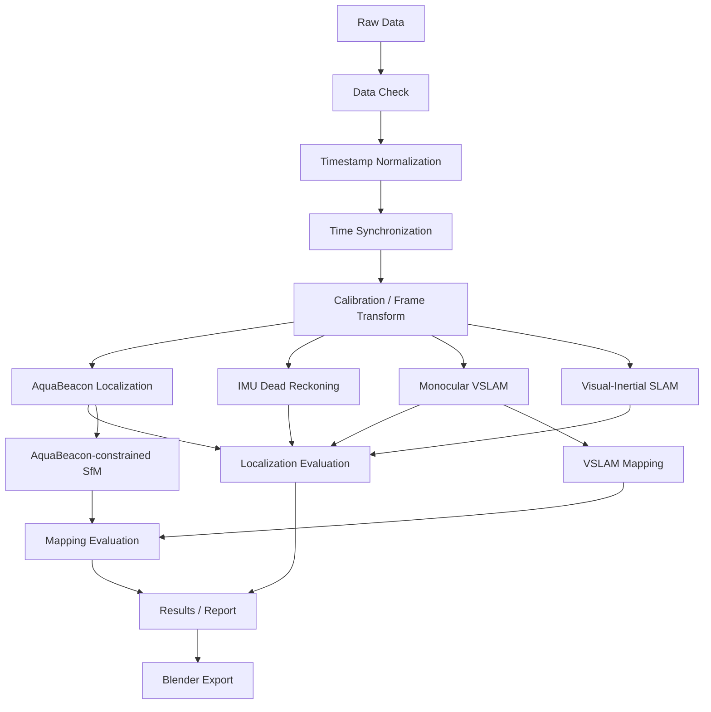

# AquaBeacon 実験データ解析システム仕様書

> **ステータス**: 確定  
> **作成日**: 2026-09-22  
> **読者**: 実装者・解析担当者・AIエージェント

本書は、AquaBeaconの実験データ解析基盤に対する実装契約である。受け入れ条件を満たさない機能は完了扱いにしない。

---

## 1. 概要

### 一言コンセプト
親機・子機・Spresense IMU・2台のカメラ動画を統合し、データ確認、時刻同期、位置推定、比較評価、位置拘束型マッピング、発表用可視化までを一貫して実行する後処理解析基盤。

### 対象データ
- 親機 CSV
- 子機 CSV
- Spresense IMU CSV
- 親機カメラ動画
- 子機カメラ動画

### 主な解析段階
1. データ品質確認
2. 時刻同期
3. 位置推定
4. 位置推定比較
5. AquaBeacon位置拘束型マッピング
6. 単眼VSLAMマッピングとの比較
7. 評価用図・Blender向け発表用データ生成

---

## 2. 仕様確定状況

| 分類 | 件数 | 内容 | 扱い |
|---|---:|---|---|
| blocker | 0 | なし | 実装開始可 |
| assumption | 4 | CSV列名はconfigで対応、録画開始時刻が取得可能、各IMU/カメラは剛体固定、解析は後処理 | 実データ確認時に更新可 |
| later | 7 | GUI、リアルタイム化、高度なIMU融合、自動Blenderレンダリング、クラウド処理、複数実験ダッシュボード、論文図版完全自動化 | MVP外 |

### 確定した前提
- Ground Truthは原則取得できない。
- 静止状態のばらつき、ドリフト、閉路誤差、手法間差、推定継続率等を主評価とする。
- IMU単独位置推定はDead Reckoning（二重積分）をbaselineとする。
- 比較対象に単眼VSLAMとVisual-Inertial SLAMを含める。
- 単眼VSLAMは軌跡と3Dモデルの両方で比較する。
- 内部座標系は右手系ENUとする。
- マッピング基本実装はCOLMAPとする。
- Blenderは発表用可視化専用であり、正式な数値評価には使わない。

---

## 3. 入力データ仕様

### 3.1 親機CSV
想定フィールド:
- timestamp
- GPS時刻
- latitude / longitude / altitude
- acoustic TX/RX関連情報
- 本体IMU情報（存在する場合）
- 状態フラグ

実列名はconfigでマッピング可能とする。

### 3.2 子機CSV
想定フィールド:
- timestamp
- RTC時刻
- acoustic RX timestamp / TOF関連情報
- depth / pressure（存在する場合）
- 本体IMU情報
- 状態フラグ

### 3.3 Spresense IMU CSV
想定フィールド:
- timestamp
- acceleration x/y/z
- angular velocity x/y/z
- quaternion w/x/y/z
- GPS時刻
- optional: magnetic field / temperature

### 3.4 親機カメラ動画
用途:
- 子機ライト検出
- 方位角・仰角推定
- カメラ内蔵IMU情報抽出
- 時刻同期補助
- 親機姿勢推定補助

既存の動画からQuaternion等を抽出するロジックを再利用する。

### 3.5 子機カメラ動画
用途:
- 水中マッピング
- 単眼VSLAM
- VI-SLAM
- SfM / Photogrammetry
- カメラ内蔵IMU情報抽出
- 時刻同期補助

---

## 4. 時刻同期仕様

### 4.1 基本同期
| 機器 | 同期方法 |
|---|---|
| 親機 | GPS PPS |
| 子機 | RTC + 有線同期 |
| Spresense | GPS時刻 |
| 親機カメラ | 録画開始時刻 |
| 子機カメラ | 録画開始時刻 |

### 4.2 共通時間軸
全データを `seconds from experiment epoch` に正規化する。

推奨epoch:
- 親機GPS基準時刻、または
- 実験開始時刻

内部表現はUnix timeまたはfloat64秒を許可するが、プロジェクト内で統一する。

実装上の共通列:
- `sync_utc_us`: UTC Unix epochの整数マイクロ秒
- `sync_utc_iso`: 同一時刻のISO 8601表現
- `experiment_time_s`: C_MAINの対象区間開始を0秒とするfloat64秒

C_MAINの実験区間は `C_MAIN_IMU_100Hz_<番号>.csv` の `utc_us` 最小・最大で定義する。
Spresenseは、対象区間と重なる `G<番号>.CSV` を先に選び、同番号の `I<番号>.CSV` を使う。
`G` の `received_mono_us` と `utc_s + nav_usec` の線形回帰を、同番号の `G/I` 共通時計へ適用する。

カメラの粗同期はQuickTime `creation_time` を使い、C_MAIN区間との共通部分だけを切り出す。
一般的なMP4再多重化で保持できないDJI `djmd` は、LRFから姿勢・加速度等を別CSVへ抽出する。
切り出し動画が映像・音声のみであること、元ファイル内オフセット、要求区間はmanifestへ記録する。

### 4.3 IMU相互相関による微調整
親機・子機それぞれについて、本体IMUとカメラIMUの角速度ノルムまたは加速度ノルムを比較し、相互相関最大となる時間差 `Δt` を推定する。

必要なら時間オフセットだけでなく線形ドリフトも診断する。

実データの機器対応:
- `C_MAIN IMU ↔ C_MAIN_CAM`
- `SONY Spresense IMU ↔ P_MAIN_CAM`（SONYはP_MAIN取付）

粗同期後の加速度ノルムを30 Hz共通格子へ補間し、1秒移動平均を除いた波形で±5秒を探索する。
全重複区間のピークに加え、動きのある複数窓で同じoffsetが再現するか確認する。相関が弱い、
または競合ピークが近い場合は自動適用せずwarningとする。適用した補正は元時刻を残した別列・別CSVへ保存する。

品質確認では、行数、対象期間、サンプリング周期、時刻逆行、重複、3倍超の時間ギャップ、
連番欠落、空欄、NaN/Infを記録する。CRC等の識別子は数値異常判定の対象外とする。

### 4.4 実験前同期・校正動作
各実験開始前に以下を推奨する。
1. 20秒静止
2. yaw +方向
3. yaw -方向
4. yaw +方向
5. pitch +方向
6. pitch -方向
7. roll +方向
8. roll -方向
9. 10秒静止
10. 実験開始

各動作間に1〜2秒静止を入れる。

目的:
- IMUバイアス確認
- 重力方向確認
- カメラ/本体IMUの時刻オフセット推定
- 軸方向確認
- 初期姿勢確認

---

## 5. 座標系

内部座標系は右手系ENU:
- X = East
- Y = North
- Z = Up

管理するframe:
- World / ENU
- Parent Body
- Parent Camera
- Parent IMU
- Spresense IMU
- Child Body
- Child Camera
- Child IMU

固定相対位置・姿勢はSE(3) extrinsicとして `calibration/` に保存する。

---

## 6. 校正パラメータ

Git管理対象:
```text
calibration/
├── README.md
├── parent_camera.yaml
├── child_camera.yaml
├── parent_imu.yaml
├── child_imu.yaml
└── extrinsics.yaml
```

最低限管理するもの:
- カメラ内部パラメータ
- 歪みパラメータ
- IMU軸定義
- Parent Body ↔ Parent Camera
- Parent Body ↔ Parent IMU / Spresense
- Child Body ↔ Child Camera
- Child Body ↔ Child IMU

---

## 7. 全体処理フロー



---

## 8. MVP-1 データ品質確認

### 目的
後段解析に入る前に、入力データの健全性を自動確認する。

### 入力
5系統の入力データ、experiment metadata、sensor config。

### 処理
- ファイル存在確認
- CSV読込可否
- 動画読込可否
- 必須列存在確認
- timestamp単調性
- timestamp重複
- NaN / Inf
- 欠損率
- 開始/終了時刻
- サンプリング周期統計
- 大きな時刻ジャンプ

サンプリング周期は mean / median / std / min / max を計算する。

### 出力
```text
results/<experiment_id>/data_quality/
├── sensor_summary.csv
├── missing_data.csv
├── timestamp_summary.csv
├── timeline.png
├── sampling_interval.png
├── sync_check.png
└── report.md
```

### 正常系受け入れ条件
- [ ] 5系統の入力を認識できる。
- [ ] 必須列と任意列を識別できる。
- [ ] 欠損率とサンプリング周期を算出できる。
- [ ] 全センサのタイムラインを可視化できる。

### 異常系・境界値
- [ ] 必須列欠損時は対象処理を停止し、理由をreportへ残す。
- [ ] 任意列欠損では全処理を停止しない。
- [ ] 動画欠損時も動画非依存処理は継続可能とする。
- [ ] NaN/Infを黙って補正しない。

---

## 9. MVP-2 時刻同期

### 目的
異なる時計で記録された全データを共通時間軸へ整列する。

### 入力
各センサtimestamp、GPS PPS / RTC同期情報、カメラ録画開始時刻、本体IMU、カメラIMU。

### 処理
- 各時計→experiment epoch変換
- カメラ開始時刻による粗同期
- IMU相互相関による微調整
- 必要に応じ線形clock drift診断

### 出力
- 同期済みtimestamp
- センサごとのoffset推定値
- 相関係数
- sync diagnostic plot
- warning flags

MVP時刻合わせの保存先:
```text
data/interim/<experiment_id>/
├── c_main/
├── spresense/
├── camera_video/
└── camera_telemetry/

results/<experiment_id>/synchronization/
├── manifest.json
├── summary.md
└── refined/
    ├── imu_offsets.csv
    ├── sensor_quality.csv
    ├── column_quality.csv
    ├── timeline.png
    ├── sync_diagnostics.png
    ├── sampling_intervals.png
    ├── analysis_summary.json
    └── report.md
```

### 正常系受け入れ条件
- [ ] 全センサを同一時間軸で参照できる。
- [ ] IMU相互相関による時間offsetを出力できる。
- [ ] 補正前後の同期状態を図示できる。

### 異常系・境界値
- [ ] 相関ピークが曖昧な場合は自動確定せずwarningとする。
- [ ] センサ間に重複時間帯がない場合は該当同期をfailedとする。
- [ ] 補間した区間を追跡可能にする。

---

## 10. MVP-3 AquaBeacon位置推定

### 実験機体の形状参照と外部校正

2026-09-22実験の親機・子機は、それぞれ兄弟ディレクトリ
`mechanical/assemblies/parent_simple` と
`mechanical/assemblies/child_simple_assembly` を形状参照とする。
取付面の座標系・寸法・原典ハッシュは
`calibration/experiment_body_geometry_20260922.json` と
`docs/experiment_body_geometry.md` に記録する。
子機の `mechanical/assemblies/child_interior` と親機の
`mechanical/assemblies/parent_interior_p1` を内装の形状参照とする。
実験時の子機C-MAINはカメラ取付面側、親機SpresenseはP-MAINと同じ側の反対角で
SDカードが外向き。親機内装は設計モデルから変更されているため、
`parent_interior_p1` の基板位置を実験時の外部校正値としない。
両機とも取付穴・座面から光学中心、IMU、GPSアンテナ、圧力センサ、ライト、
音響素子の中心を暗黙に補完しない。実装位置と姿勢が確認できるまでは
カメラ・基板・他センサ間の並進レバーアーム補正を適用しない。

受け入れ条件: 取付面とセンサ測定点を区別して記録できること。
実験時の内装変更が反映されていないモデルを補正値として使用しないこと。
採用前に外装と内装を重ねた3Dシーンを実験ID単位の結果フォルダへ保存し、
基板の側、Spresenseの角とSD口の向き、カメラ取付面を実機と照合する。

### ToF実験区間の前処理

P_MAINの生 `P_MAIN_HEALTH_RANGE_*.csv` は
`sync_utc_us=utc_anchor_epoch_us+mono_us-utc_anchor_mono_us` でUTCに変換する。
`mono_us <= utc_valid_until_us` を検証する。時刻が逆行した場合はUTC順に安定ソートし、
元のCSV行番号と逆行件数・最大幅を記録する。有効ToF判定と持続区間選択は
C_MAINと同じ条件を使い、区間内の無効行も `tof_valid=0` で残す。
`data/processed/<date>_pmain_<suffix>/tof_window/p_main/` にCSVを保存し、
元CSVのSHA-256、Git SHA、config/calibrationのSHA-256、UTC窓を
`results/<date>_pmain_<suffix>/preprocessing/manifest.json` に記録する。
既存C_MAIN ToF窓との交差はUTCで判定し、交差するP_MAIN行だけを当該実験の
`tof_window/p_main/` に追加する。機器のファイル番号は対応付けに使用しない。

受け入れ条件: 3つのP_MAINログから持続有効区間を切り出し、C_MAINとの重複をUTCで
識別でき、出力の全行が元CSVと時刻変換式へ追跡できる。

同期済み `data/interim/<experiment_id>/` から、`C_MAIN_HEALTH_RANGE` の
`tof_us > 0` かつ `range_state ∈ {2,3}` を有効とする。単発の起動時測定を避けるため、
連続5行以上の最初の有効行を開始とし、最後の有効行に続く最初の無効行の時刻を排他的終了とする。
区間内の無効ToF行は残し、`tof_valid` 列で識別する。

センサCSVは `sync_utc_us`、カメラCSVは相互相関補正後の `refined_sync_utc_us` で
同じUTC区間 `[start,end)` に切り出す。`window_time_s=(utc_us-start)/1e6` を追加する。
出力は `data/processed/<experiment_id>/tof_window/` に置き、C_MAIN動画の表示回転は
0度に設定する。動画はstream copyのため、先頭フレームが要求時刻と一致しない可能性を
manifestに明記する。正確なフレーム時刻には補正済みカメラCSVを使う。
`results/<experiment_id>/preprocessing/manifest.json` に区間、元データ、Git SHA、
config/calibrationのSHA-256、動画オフセットを保存する。

受け入れ条件:
- [ ] 起動時の単発ToFを除き、持続する有効区間を選択できる。
- [ ] 全CSVが共通UTC窓と区間内秒数を持ち、無効ToF行を追跡できる。
- [ ] C_MAIN動画が横表示で、動画・CSVの入力と切り出し条件を追跡できる。

### 入力
- 音響距離 `r`
- 親機カメラによる子機ライトの方位角・仰角またはcamera ray
- 親機姿勢
- 親機位置
- calibration / extrinsics

### 音響距離
基本式: `r = c * TOF`

C_MAINの比較解析では `temp_c`、仮定塩分35‰、圧力換算深度を入力とする
Medwin (1975) の海水音速式を各HEALTH_RANGE行に適用する。P_MAIN ToFは
独立したP_MAIN実験ログから `shot_seq` 一致かつUTC差1秒以内で対応付け、
対応するC_MAINの温度・深度を使って同じ音速式で換算する。
対応するP_MAINログがない実験は欠測と記録し、番号だけで結び付けない。
結果は実験ID単位で `results/<experiment_id>/tof_depth_comparison/` に保存し、
両入力・configのSHA-256、Git commit SHA、使用条件を追跡する。
P_MAINと対応する実験では深度とP_MAIN ToF距離だけを示す
`pressure_vs_p_main.png` も出力し、ToF系列の凡例は `ToF range` とする。
式と制約は [tof_sound_speed.md](tof_sound_speed.md) を参照。

必要に応じ以下を補正:
- TX/RX固定遅延
- 回路遅延
- ケーブル遅延
- 音速

### 光学方向
画像座標 → undistort → normalized camera coordinate → camera ray を得る。

`P_MAIN_CAM` を親機カメラとして、`data/processed/<experiment_id>/tof_window/`
のproxy動画から子機ライトを検出する。白い高輝度領域、局所コントラスト、
周囲の水色、オレンジ色筐体との近さ、前後フレームの連続性を併用する。
0.5秒間隔の動画相対時刻、画像左上原点のpixel座標、検出状態、診断量を
`results/<experiment_id>/light_detection/parent_light.csv` に保存する。
自動座標は `candidate_unreviewed` とし、目視確認した10秒間隔の点だけを
`reviewed_light.csv` の `visually_confirmed` とする。
欠損は補間せず `not_detected` とする。stream copyの先頭ずれがあるため、
この時刻をUTCへ自動変換しない。

カメラ相対の方位角は右正、仰角は上正、単位radとする。
水中・防水ケース装着状態の内部校正値と歪み校正値が未取得のため、
現状の角度列は欠損とする。内部パラメータ `fx, fy, cx, cy` が与えられた場合のみ
暫定的にpin-holeモデルで角度を計算し、歪み未補正とmanifestに明記する。
正式な光学rayには水中で同じ防水ケースとStandard FOVを用いた校正が必要。
2026-09-24の水中チェッカーボード動画から得た1920×1080用の暫定候補は
`calibration/parent_camera_underwater_20260924_provisional.json` に分離して保存する。
40 mmマス間隔と親機・子機共通のカメラ・設定はユーザー確認済み。
対応`.LRF`の1280×720画像からも直接推定し、校正動画のMP4とproxyの画角一致を確認した。
既存動画が再び利用可能になったら、その撮影設定を照合し、歪み補正を含めて
角度・位置推定を再計算する。過去の結果は再計算前のままとする。

校正前の角度試算は、独立した `calibration/parent_camera_provisional.json` に
記録した仮定（水平画角90°、正方画素、主点は1280×720画像中心、歪み無視）から
pin-hole内部パラメータ `fx=fy=640 px, cx=640 px, cy=360 px` を導く。
`results/<experiment_id>/light_detection/provisional_light_angles.csv` に
右正方位角・上正仰角をradとdegで出す。`angle_status` は
`hypothetical_uncalibrated` とし、`predicted` / `untracked` は空欄。
`provisional_angle_manifest.json` に仮定・入力追跡CSV・動画・config・Git SHAを記録する。
この値は防水ケース水中校正前のシナリオ値であり、実測値や真値誤差とは扱わない。

親機姿勢を適用した試算は、切り出しP_MAIN動画先頭を元動画に画素照合して
`window_time_s` へ対応付け、`parent_fused_attitude.csv` のQuaternionをSLERP補間する。
仮の光学軸→IMU軸回転を `calibration/parent_camera_imu_provisional.json` に記録し、
カメラ光線を親機の局所重力基準へ回す。水平相対方位角は最初の融合姿勢の
光軸水平投影を0とし、仰角は重力上向きに対して求める。
`attitude_corrected_light_angles.csv` の角度はradとdegで出力し、
`attitude_angle_manifest.json` に同期情報、両方の仮定、入力ハッシュ、Git SHAを残す。
姿勢・ライト角度の欠損区間には補間や外挿による角度を出さない。
これはカメラ相対角度の測定誤差を低減した証拠ではなく、画角・取付回転・
絶対水平方位が未校正の条件付き重力基準角度である。

角度図は `angle_before_after.png` とし、映像相対時刻を共通x軸として
補正前のカメラ相対方位角・仰角と補正後の局所方位角・重力基準仰角を
2列×2行に分ける。観測がある点だけを描き、欠損を線でつながない。
局所方位角の±180°での折り返しと左右の座標系の違いを図中に明記する。
`angle_plot_manifest.json` に入力角度CSV・校正仮定のハッシュ、Git SHAを記録する。

目視確認済み `reviewed_light.csv` を起点にした追跡結果を
`tracked_light.csv` に保存する。EKFの状態は画像上の位置・速度・
白色発光領域の対数面積で、面積観測は指数関数の非線形モデルとする。
観測候補は予測分布に対するMahalanobis距離でゲートし、前後の確認点から
大きく外れる候補を除外する。観測欠損は最大1.5秒、かつモデル上の
位置標準偏差が45 px以下の間だけ予測値を出し、それ以降は `untracked` とする。
確認点・観測更新・予測・未追跡を
それぞれ `anchor` / `observed` / `reacquired` / `predicted` / `untracked` で区別する。
予測のみの点からは角度を算出しない。
10秒ごとの確認画像を `tracking_review.jpg`、確認点とは別に注釈した画像との
比較を `tracking_validation.csv` に保存する。30 px以内の一致率と画面外の
誤出力数を記録するが、これらをGround Truth精度とは呼ばない。

受け入れ条件:
- [ ] 親機P_MAIN映像で子機ライトの画像座標を出し、目視で誤検出を確認する。
- [ ] 検出不能サンプルを明示し、誤検出を有効角度として扱わない。
- [ ] 校正値がある場合にcamera-relative角度を計算し、ない場合は角度欠損を明示する。
- [ ] EKFが近傍の実ライト候補を選び、離れた反射候補を拒否する。
- [ ] 欠損予測と未追跡区間を明示し、確認済み点の座標を保持する。
- [ ] 仮画角の角度は別CSVに出し、仮定と追跡入力を追跡できる。
- [ ] 融合姿勢と映像の時刻を対応付け、姿勢欠損を明示して重力基準角度を別CSVに出す。
- [ ] 光学軸→IMU取付回転と画角の仮定を出力から追跡できる。
- [ ] 3実験の補正前後グラフを生成し、角度の基準と欠損表示を目視確認する。

### 位置変換
`p_child_camera = r * d`

その後、Camera → Parent Body → ENUへ変換し、親機ENU位置を加算して子機位置を得る。

### 出力
`results/<experiment_id>/localization/aquabeacon.csv`

最低限の列:
- timestamp
- x_m, y_m, z_m
- quaternionまたはroll/pitch/yaw
- range_m
- azimuth/elevationまたはray
- quality flags

### 正常系受け入れ条件
- [ ] 有効なrange + optical ray + parent poseから子機ENU位置を算出できる。
- [ ] 入力に使った補正値を追跡できる。
- [ ] 無効データはquality flagで識別できる。

### 異常系・境界値
- [ ] range欠損時に偽の位置を生成しない。
- [ ] ライト検出不能時は欠損として扱う。
- [ ] frame transform不足時は実行を停止し、必要なcalibrationを明示する。

---

## 11. MVP-3b IMU Dead Reckoning

### 目的
比較baselineとしてIMU単独位置推定を実装する。

### 処理
1. gyro bias補正
2. accel bias補正
3. 姿勢推定/既存quaternion利用
4. 重力除去
5. World frame変換
6. acceleration積分→velocity
7. velocity積分→position

### 出力
`results/<experiment_id>/localization/parent_imu.csv` と各センサ姿勢CSV。

#### 2026-09-23 実データへの初期実装

- 入力: `data/processed/<experiment_id>/tof_window/` のP_MAIN/C_MAINカメラ
  refined telemetry、SONY `I*.CSV`、`C_MAIN_IMU_100Hz_*.csv`。
- 共通時刻: カメラ `refined_sync_utc_us`、SONY/C_MAIN `sync_utc_us`。
  親機積分はP_MAINカメラの約30 Hz標本時刻。SONY約1 kHz加速度を各標本区間で平均する。
- 親機姿勢: P_MAINカメラQuaternionを正規化して利用。SONY→カメラの固定回転は
  重複区間の角速度に対するWahba/SVD適合で実験ごとに推定する。SONY姿勢は
  カメラ姿勢とこの回転の合成であり独立推定ではない。
- 子機姿勢: C_MAIN本体BNOとC_MAINカメラのQuaternionを別々のセンサframeで出力する。
  校正済みbody/camera extrinsicがないため本体姿勢への統合は保留する。
- カメラQuaternionで回転した静的加速度はWorld -Zを向くという実データの観察に従い、
  重力 `9.80665 m/s²` を+Zへ加算する。SONY加速度も推定取付回転で同frameへ変換する。
- 初期位置・速度=0、加速度/角速度バイアス=0。3軌跡（P_MAINカメラ単独、SONY単独、
  等重み平均）を台形則で積分する。静止拘束、閉路補正、ドリフト補正は適用しない。
- 座標系は「重力整列したカメラの局所World」であり、水平方位の東/北対応は未検証。
  P_MAINカメラIMUと親機本体原点のlever armも未校正。正式なENU親機位置には
  yaw基準と外部校正が必要。
- 出力: `results/<experiment_id>/localization/parent_imu.csv`、
  `parent_camera_attitude.csv`、`parent_sony_attitude.csv`、
  `child_body_attitude.csv`、`child_camera_attitude.csv`、`parent_imu_xy.png`、
  `imu_manifest.json`、`imu_report.md`。入力/設定SHA-256、Git SHA、推定取付回転、
  重力・初期条件・補正方針はmanifestに保存する。
- C_MAIN本体CSVに時刻逆行があっても姿勢行は元順序のまま保持し、件数をmanifestへ記録する。
  Ground Truth不在のため、終端変位とセンサ間差は精度指標とは呼ばない。

#### 2026-09-23 姿勢融合と3D確認の追加

- SONY→P_MAINカメラの軸回転を角速度の3軸変化から推定する。SONY角速度を30 Hzカメラ区間ごとに
  平均して予測Quaternionを積分し、各カメラQuaternionへ時定数0.5秒の球面補間で補正する。
  `parent_fused_attitude.csv` と `parent_imu.csv` の `parent_fused_q*` に保存する。
- 角速度適合時に±0.1秒を1/120秒刻みで探索し、残差RMSが10%以上改善した場合のみ残留
  IMU時刻offsetを適用する。補正前後の品質と適用offsetはmanifestへ記録し、元CSVは変更しない。
- 診断用にSONY角速度のみの積分姿勢を `parent_sony_gyro_attitude.csv` に保存する。
  融合姿勢とカメラ姿勢の角度差、SONY単独終端角度差をmanifestへ記録する。
- 融合姿勢で平均加速度をWorldへ回した未補正デッドレコニングを
  `parent_imu.csv` の `fused_*` 列へ追加する。絶対位置推定とは扱わない。
- 子機本体IMU→C_MAINカメラの軸回転も角速度から推定し、初期姿勢のゲージを合わせた
  `child_body_aligned_attitude.csv` を保存する。これは物理的な取付外部校正ではない。
  時刻ギャップ>0.1秒を含むカメラframeでは本体姿勢を欠損として記録する。
- `parent_attitude_3d.html` にカメラ・融合・SONY角速度のみ、`child_attitude_3d.html` に
  カメラ・本体IMUを3Dで同期再生する。視点回転と時刻スクラブに対応する。
- 受け入れ条件: 3軸合成データで取付回転を復元でき、融合がgyroバイアス由来の姿勢ドリフトを
  制限する。3実験で角速度適合品質、姿勢差、欠損数、出力HTMLを検証する。

#### 2026-09-23 子機姿勢融合・SONY GPS水平位置

- 子機本体BNO Quaternionを、角速度から推定した本体→カメラ固定回転と初期姿勢ゲージで
  カメラQuaternionの座標へ合わせる。両者の差が5°以下なら等重みでslerp融合、5〜20°では
  本体の重みを線形に0へ減らす。20°以上、または本体時刻ギャップ>0.1秒ではカメラのみ。
  `child_fused_attitude.csv` の各行に融合Quaternion・差・重み・状態を保存し、子機3D図にも表示する。
- SONY Spresense `G*.CSV` のfix>=3・衛星数>=7の測位を使用。WGS84 ECEF→ENU変換の原点は
  各実験の最初の有効測位。`parent_gps_observations.csv` に元緯度・経度・高度、ENU、品質、
  segmentを保存する。約1 HzのGPS測位は、同じsegmentかつ隣接時間<=2秒の間だけ
  `parent_gps_position.csv` のカメラ時刻へ水平線形補間する。補間時刻の高度は欠損とする。
- 孤立したGPS位置ジャンプは、移動速度>2 m/sかつ前後の速度<0.75 m/sを診断条件とし、
  segmentを分割して跨る補間をしない。023の約3.4 m/sジャンプはこの条件に該当する。
  元測位は除去せず、状態と分割根拠を残す。
- 親機カメラCSV内のGPS値は各実験で一定のため位置更新に使わない。SONY GPSはアンテナ位置であり、
  親機本体・カメラへのlever armは未校正。カメラWorldの水平方位とENUの変換も未検証のため、
  IMU水平加速度をGPS位置に混ぜない。GPS提供の水平位置と未補正IMU積分は別座標・別指標で示す。
- 受け入れ条件: 子機融合Quaternion・重み・状態が時系列で追跡できる。合成GPSジャンプを跨いだ
  位置を生成せず、元測位・補間位置・品質・原点・入力SHA-256・Git SHAを保存できる。

### 受け入れ条件
- [ ] 初期姿勢と初期位置を設定できる。
- [ ] 位置・速度・姿勢を時系列で出力できる。
- [ ] ドリフトを隠す補正を初期baselineへ勝手に追加しない。

---

## 12. MVP-3c 単眼VSLAM

### 入力
子機カメラ動画。

元動画を使う場合は`120000/1001 fps`のテレメトリ対応区間を間引かず入力し、
30 HzカメラテレメトリのUTC時刻を4フレームごとのアンカーとして中間時刻を線形補間する。
`proxy`の画像`i`と元動画の画像`4i`の対応を複数位置で検証し、根拠を実験別に保存する。
UTCが確定できない冒頭・末尾フレームは除外数をmanifestへ記録する。
採用する元動画は1280×720へ縮小して同解像度の水中校正を適用する。
カラー実行では3チャンネルBGR画像（JPEG品質95）をSLAM入力として保存する。
ORB-SLAM3の単眼モードはカラーを受け取り、特徴点抽出では内部的に輝度へ変換する。
成果物の特徴点動画は元の色を保持し、白黒版とは別名で保存する。
画像を3Dへ貼り付けた版は最大Atlas地図の保存姿勢から24枚を選択して出力する。
画像平面は各カメラのT_world_cameraと可視点の中央値深度に置く可視化であり、
表面形状の推定結果とは扱わない。表面版は校正による歪み補正後の画像へMapPointを投影し、
画像空間Delaunayの三角形にテクスチャを与える。80 px超の画像辺、深度比1.2超、
地図点の90%半径の8%超の3D辺を除外し、疎点群の穴は残す。
投影対象はカメラ前方かつ画角内の点であり、遮蔽判定は未実施と明記する。
HTMLは画像・形状を埋め込み、ネット接続なしで回転・拡大・画像切替・点群表示ができる。
GLBはSLAM世界座標を保持し、HTMLの初期視点のみ撮影方向に合わせる。

水中チェッカーボードから直接求めた1280×720 proxy用の内部行列・歪みを
`calibration/child_orbslam3_underwater_trial_<番号>.yaml` に転記してORB-SLAM3単眼モードへ渡す。
校正動画は親子機共通カメラ・同一設定として記録された撮影であり、実験時の子機動画と
同一画角であることは未照合なので暫定候補として扱う。観測入力は子機カメラだけとし、
親機の動画・姿勢・位置は入力しない。試行ごとに設定・校正元・入力のSHA-256とGit SHAを残す。

### 出力
- camera trajectory
- tracking status
- scale情報（得られる場合）
- map / sparse point cloud等
- `results/<experiment_id>/vislam_depth/report.md` と同じディレクトリに、
  VSLAM実行の後処理動画、代表フレーム、姿勢保存区間図、最大地図の3D画像、
  Atlasの地図別MapPoint ASCII PLYを保存する。地図間座標は結合しない。
- `camera_trajectory_status.csv`（全入力フレームのUTC ns、saved/not_saved、
  姿勢が保存された場合のみSLAM局所座標とquaternion）
- `coverage_summary.json`（保存姿勢の対応率と欠損連続区間）
- `TrackedFrameSummary.csv`（各入力フレームのtracking state、検出特徴点数、
  3D地図点に対応した特徴点数）
- `TrackedFeatures.csv`（ORB-SLAM3が追跡に使った特徴点座標と対応MapPoint ID。
  対応点は全件、未対応の検出点は10点に1点を可視化用に保存）
- 同じ3D MapPoint IDを連続フレームで観測した対応線と特徴点を示す元レート動画・代表画像。
  表示マーカーは混雑防止のため間引けるが、SLAM入力と動画フレームは間引かない。
- 同じレポートディレクトリに`textured_map_color_120fps.html`、表面版の
  `textured_map_color_120fps.glb`、画像平面版の`image_planes_color_120fps.glb`、
  入力・方式・ハッシュを記録する`textured_map_manifest.json`を保存する。

単眼の並進は未確定のSLAM単位であり、mや絶対位置として扱わない。
複数地図の作成・リセットが起きた場合、地図間の座標連続性は保証しない。
ORB-SLAM3のEuRoC軌跡保存は最大の地図だけを含むため、`not_saved`には他地図で
追跡されたフレームも含まれ得る。`not_saved`を正確なtracking lost判定としない。

### 受け入れ条件
- [x] カメラ軌跡を全入力フレームのUTC基準CSVへ変換できる。
- [x] 120 fps実行ではORB-SLAM3のフレーム別tracking stateから追跡喪失区間を記録する。
  既存30 fps実行の保存姿勢欠損は別指標として残す。
- [x] 失敗を黙って除外しない。
- [x] 各実験の`vislam_depth/report.md`と同じディレクトリへ動画・画像・地図別PLYを保存し、
  元入力・設定・校正・Git SHA・各成果物SHA-256を追跡できる。
- [x] 120 fps元動画のテレメトリ対応区間を間引かずSLAMへ渡し、
  3実験の出力動画がそれぞれ入力枚数と一致することと`120000/1001 fps`をffprobeで確認した。
- [x] ORB-SLAM3本体の特徴点と連続フレームの同一MapPoint対応を
  3実験の代表画像、対応線画像、動画フレームで確認した。
- [x] カラー入力で3実験のSLAMを再実行し、3チャンネル画像・動画の色保持、
  入力と動画のフレーム数一致、カラー実行の点群と追跡状態を確認する。
- [x] 3系列の画像貼り付けHTMLでカラー表示・回転・画像切替を確認し、
  GLBのテクスチャ埋め込み、座標・UV投影、自動テスト、成果物ハッシュを検証する。

---

## 13. MVP-3d Visual-Inertial SLAM

### 入力
子機カメラ動画 + 子機本体IMUまたはカメラIMU。

現行の実行基盤はORB-SLAM3の単眼慣性モード。`data/processed/<experiment_id>/tof_window/`
からEuRoC形式へ変換し、子機本体IMU 100 Hzを使用する。画像とIMUはUTC nsへ統一する。
IMUとカメラの残差時刻補正は実験ごとに明示し、022は既存の角速度照合結果に基づき
IMU時刻へ-0.025秒を適用する。IMU終端より後のカメラフレームは出力せず件数を記録する。
stream copy後の動画先頭フレームとカメラテレメトリ `camera_frame` の対応は映像照合で検証し、
実験metadataへ記録する。未検証の対応を推測して本解析を走らせない。
水中カメラ内部校正、camera→IMU SE(3)、IMUノイズの測定値が揃うまでは
正式な比較軌跡として採用しない。暫定値を全て明示した短区間の実行試験は認め、
`test_only` として実験ID配下に保存する。
特徴点の切り分けでは元画像ORB、CLAHE画像ORB、CLAHE画像SIFTの隣接画像対応数と
暫定内部行列によるEssential RANSAC内点数を同一サンプルで比較し、実験ID別に保存する。
CLAHE画像をORB-SLAM3へ入力する場合は、元画像を保持し、変換のclip limitとtile grid、
使用画像範囲をmanifestへ残す。子機融合姿勢を使う試験では、融合quaternionの差分から
カメラ姿勢座標系で角速度を計算し、元IMU時刻へ補間したEuRoC IMUを別ファイルに保存する。
加速度は子機本体IMUを既存の暫定回転で同座標系に移す。ORB-SLAM3には絶対姿勢観測を
直接入力しておらず、これを姿勢拘束つきSLAMとは呼ばない。画像光学軸との対応も未校正。
元IMU、融合姿勢、座標変換、合成IMUのSHA-256とGit SHAをmanifestに記録する。
圧力ログは別系列として保存し、ORB-SLAM3に直接入力しない。深度補正は軌跡取得後の工程で、
水面圧力基準・水密度・センサ位置を明示した上で適用する。
暫定試験では圧力最初のログ値を基準とし、隣接圧力サンプル間が1秒以下の時だけ
画像時刻へ線形補間する。慣性初期化後のSLAM世界座標+Z上を仮定して鉛直位置を
圧力相対深度で置換し、元のSLAM位置・補正位置・欠損件数・仮定を別途保存する。

### 出力
VI-SLAM trajectory、tracking status、必要なmap情報。

### 受け入れ条件
- [x] カメラとIMUの同期済み入力を生成できる。
- [ ] 軌跡を共通フォーマットへ変換できる。
- [x] 使用したIMU源をmetadataへ保存する。
- [x] 特徴点診断と融合姿勢由来IMUの作成方法・入力ハッシュを記録する。

---

### 2026-09-23 ToF・仮ライト角度・親機GPS位置による親子機位置試算

`scripts/estimate_parent_child_positions.py` は022/023/024の実験ごとに
`results/<experiment_id>/relative_position/parent_child_position.csv` と `manifest.json` を出す。
入力は `attitude_corrected_light_angles.csv` の条件付き局所角度、音速補正済みToF、
SONY GPS水平位置、前処理manifest。角度CSVは親機融合姿勢を反映済みである。
元動画と切り出し動画の先頭フレームを照合して、stream copyによる先頭時刻のずれを補正する。
ライト角度が観測済みかつ有効ToFが±0.75秒以内にある場合に限り、片道ToF距離×
単位視線ベクトルで親機カメラ光学中心から子機ライトへの3D相対座標を計算する。
カメラ座標は+x右、+y下、+z前。欠損・採否・時刻差・元ToFは各行に残す。

親機固定の重力基準試算には角度CSVの局所方位角・重力基準仰角を使う。光学座標とIMU座標の
取付回転は仮値であり物理校正値ではない。SONY GPSアンテナのENU東・北位置は
同じ区間内だけ補間し、仮に重力基準座標の水平+x/+yを東/北と見なして子機の水平位置へ加える。
真の水平方位、GPSアンテナから親機原点、子機ライトから音響トランスデューサの位置差は
未校正である。子機の確定した絶対水平位置・高度は出力できない。
GPS高度は不安定なため使用しない。親機IMU二重積分位置もドリフトが大きく使用しない。
全結果を仮定付き試算として表示し、Ground Truth精度と呼ばない。

受け入れ条件: 合成視線の軸・符号、ToF有効性と時刻許容幅、姿勢・GPSギャップを
テストで確認する。3実験の出力行数と距離ベクトル長を確認し、manifestに入力SHA-256・
カメラ仮定・Git SHAを残す。画像・GPSの未校正部分を最終レポートに明記する。

### 2026-09-23 子機搭載IMUデッドレコニングとの比較

`scripts/compare_child_imu_dead_reckoning.py` はC_MAIN本体IMUの `ax,ay,az` [m/s²] と
Quaternionを用い、測定加速度を子機の重力基準座標へ回転して +z 方向の
9.80665 m/s²を引き、台形積分で速度・位置を得る。最初の通常ToF＋ライト共通時刻から
初期位置0、初期速度0、バイアス補正なしで開始する。元CSVに残る非単調時刻行は
入力順を保ったまま積分対象から除き、除外数をmanifestに記録する。

各実験の `relative_position/child_imu_comparison.csv` に共通時刻の両3D変位、
各変位のノルム、IMU速度ノルム、変位ノルム差、ToF品質フラグを保存する。
子機IMUの水平方位と親機カメラ重力基準の水平方位は未校正であり、
親機固定仮定も必要。したがって3Dベクトルを同じENU方向へ重ねず、
ノルム差をGround Truthの位置誤差と呼ばない。manifestに入力SHA-256、Git SHA、
重力・初期条件・非単調時刻行の処理を残す。

受け入れ条件: 合成静止・等加速度で重力除去と積分を検証し、非単調時刻を
追跡可能に除外する。3実験の共通時刻行が出力され、未補正ドリフトを明示する。

### 2026-09-23 ToF・ライト・子機IMU・圧力の条件付き融合

`scripts/fuse_relative_position.py` は `attitude_corrected_light_angles.csv` の局所角度と
ToFから親機の局所重力基準3D位置を作る。角度CSVの画角・取付回転は仮値である。
子機本体IMUのQuaternionで加速度を子機重力基準へ回し、重力を引く。
子機世界と親機世界の水平方位は未知であるため、低周波加速度の一致度が0.4未満なら
水平IMU加速度は使用しない。鉛直IMU加速度は観測間の運動拘束に使う。

親機カメラは水面下約0.03 mと仮定する。`data/interim` のC_MAIN圧力について、
開始60秒中央値より8 mbar以上の上昇が7点中5点で続き、30秒以内に30 mbar以上の
上昇がある最初の時刻を入水開始とする。開始からその10秒前までの中央値を水面圧として
`(pressure_mbar-surface_pressure_mbar)*100/(1025*9.80665)` mに換算する。
ユーザーが示した信頼度に従い、圧力深度を鉛直の主観測に採用する。
圧力センサと子機ライトの高さ差は未測定で、暫定的に0 mと置く。圧力への
平滑化重み0.03 mは測定済み絶対誤差ではない。ToF×ライト角度の水平成分は
別の観測として使う。両者が幾何的に食い違う時刻でも圧力を鉛直位置に優先し、
`depth_range_geometry_conflict` にフラグを残す。この場合、融合3Dベクトル長を
ToF斜距離と同一視しない。
比較表示の観測座標 `pressure_referenced_observation_*` は親機カメラ原点、+z上の
座標系で、水平x/yをToF＋ライト、鉛直zを `parent_camera_depth_m - pressure_depth_m`
とする。融合座標も同じ座標系とする。仮角度のみで得た `optical_z_up_m` は別の
診断列とし、3D表示の観測点には使わない。
子機ライトと子機カメラの約0.20 mの離隔は方向未特定のため座標補正せず、
光学観測ノイズ0.25 mの中で条件として扱う。音響受信点とのレバーアームも未校正。
設置寸法の概数と採用閾値は `calibration/relative_fusion_provisional.json` に置く。

位置は光学・IMU加速度・弱い速度・圧力因子を持つIRLSバッチ平滑化で出す。
2秒を超える光学観測欠損または圧力深度欠損は出力を抑止する。実験ごとに
`relative_position/fused_position.csv`、`pressure_depth_immersion.csv`、
`pressure_immersion_reference.json`、`fused_position_manifest.json` を保存し、
各行の観測・融合座標・深度・状態・最近傍観測時刻、各入力SHA-256、Git SHA、
圧力優先方針・水平IMUの採否、伏せた光学観測への一致度を記録する。
圧力優先では伏せた光学3D観測との一致が悪化しうる。これは絶対精度ではない。
既存の対話型3D表示は `scripts/refresh_fused_visualization.py` に表示HTMLのパスを渡し、
このCSVの最新軌跡と圧力採否を埋め込む。

受け入れ条件: 合成加速度・入水圧力基準・圧力鉛直優先・新角度入力・欠測補間・外れ値抑制のテスト、3実験の
出力検証、伏せた光学観測による比較、未校正条件とデータ不整合の報告。

### 2026-09-25 水中内部校正を適用した親子機姿勢・位置の再推定

`scripts/estimate_calibrated_positions.py` は022/023/024の既存ライト追跡座標に、
`parent_camera_underwater_20260924_provisional.json` の1280×720 proxy直接校正
（内部行列とOpenCV歪み係数）を適用する。`cv2.undistortPoints` の正規化視線を
親機融合Quaternionと仮の光学→IMU取付回転で局所重力基準へ変換する。
姿勢欠損、未追跡点、予測だけの点は角度を欠損とする。

有効ToFと±0.75秒以内で一致した視線に距離を掛け、親機カメラ光学中心から
子機ライトまでの条件付き相対位置を作る。GPSは親機アンテナの水平観測として
別列に保持する。既存の圧力優先IRLS融合を校正後角度で再実行し、子機IMUの
鉛直運動拘束と圧力深度を利用する。出力は実験IDごとの
`results/<experiment_id>/calibrated_estimate/` に分離し、各入力ハッシュとGit SHAを保存する。
各実験の同じフォルダに `report.md`、融合位置グラフ、親機GPS・IMU診断図、
親子機の姿勢3D表示を置き、姿勢CSVと親機GPS CSVへのリンクをレポートに記載する。

2026-09-22映像と校正映像の撮影モード一致は独立画像照合で未確認。
光学軸→IMU軸回転、GPSアンテナ・カメラ・ライト・圧力センサ等のbody frame内
位置も未測定。実験機体モデルの取付面・設計時の内装配置からレバーアームを
推定して適用しない。絶対ENU座標やbody原点位置の確定値として扱わない。
子機BNO085の `sensor_id=8` はGame Rotation Vector、`sensor_id=3` は磁気観測として
別々に記録されている。既存の子機融合Quaternionは磁気補正済み方位ではない。
`scripts/diagnose_child_magnetometer.py` は磁気強度とGame Rotation Vectorの
重力基準へ回した水平磁場方向を、各実験の `calibrated_estimate/` に診断図・manifestとして
保存する。磁気校正品質、取付方向、親機方位基準が未確認の間は磁気から
子機の絶対方位や親子機共通yawを設定しない。
受け入れ条件: 3実験の姿勢、相対位置、融合位置を出力する。映像サイズ、
Quaternion時間範囲、ToF時刻差、圧力欠損を確認し、旧結果とは別に保持する。

## 14. MVP-4 位置推定比較

### 比較対象
- AquaBeacon
- IMU Dead Reckoning
- Monocular VSLAM
- Visual-Inertial SLAM

### Ground Truthの扱い
独立Ground Truthがないため、真値誤差と表現しない。

静止区間では平均位置からのばらつきを静止安定性指標として算出する。

主指標:
- static RMSE / std
- distance from initial point
- trajectory length
- loop closure error（可能な場合）
- tracking / estimation availability
- 手法間trajectory difference
- VSLAM scale estimate

### Alignment
- SE(3): scaleを変更せず、回転・並進のみ
- Sim(3): 診断用として回転・並進・scaleを最適化

scale自体を評価結果として保存する。

### 出力
```text
localization/
├── aquabeacon.csv
├── imu.csv
├── mono_vslam.csv
├── vi_slam.csv
├── metrics.csv
├── static_analysis.csv
├── trajectory_2d.png
├── trajectory_3d.png
└── drift.png
```

### 受け入れ条件
- [ ] 4方式を同一World frameまたは明示的alignment後に表示できる。
- [ ] static RMSE/stdを計算できる。
- [ ] trajectory lengthと推定継続率を出力できる。
- [ ] Ground Truth不在時にaccuracyという誤表記をしない。

---

## 15. MVP-5 AquaBeacon位置拘束型マッピング

### 基本実装
COLMAPを基本とする。

### 処理
1. 子機動画からフレーム抽出
2. feature extraction
3. feature matching
4. 各フレームへAquaBeacon位置を対応付け
5. SfM / Bundle Adjustment
6. dense reconstruction
7. point cloud
8. mesh
9. texture（必要な場合）

可能であればorientation priorも利用する。

### 出力
```text
mapping/aquabeacon/
├── sparse/
├── dense/
└── mesh/
```

### 受け入れ条件
- [ ] 画像timestampとAquaBeacon位置を対応付けられる。
- [ ] position priorを使った再構成を実行できる。
- [ ] point cloudまたはmeshを保存できる。
- [ ] COLMAPログを保存し、失敗理由を追跡できる。

---

## 16. MVP-5b 単眼VSLAMマッピング比較

AquaBeacon位置priorを使用しない比較結果を生成する。

評価候補:
- registered images
- failed images
- reconstructed area
- point count
- point density
- reprojection error
- model scale
- disconnected components
- processing time
- 二重化/歪み/地形連続性/テクスチャ品質

既知物体・scale bar・既知距離がある場合は長さ差・形状差も追加する。

### 受け入れ条件
- [ ] AquaBeacon拘束型と比較対象の再構成を別ディレクトリへ保存できる。
- [ ] 共通指標を `mapping_metrics.csv` へ出力できる。
- [ ] Ground Truthがない定性評価と定量評価を区別する。

---

## 17. MVP-6 自動結果出力・レポート

### 結果構造
```text
results/<experiment_id>/
├── data_quality/
├── synchronization/
├── localization/
├── mapping/
├── visualization/
└── report/
```

### summary.md最低項目
- experiment ID
- 使用データ
- Git commit SHA
- config
- calibration version
- analysis date
- software version
- synchronization結果
- sensor data quality
- localization metrics
- mapping metrics
- warnings
- failed processes
- output paths

### 受け入れ条件
- [ ] experiment ID単位で結果を自動整理できる。
- [ ] 解析条件を結果から再現できる。
- [ ] 途中失敗があっても取得済み結果を保持する。

---

## 18. MVP-7 Blender Export

Blenderは発表用可視化専用とする。

2026-09-25の親子機シーンは `blender/create_pose_scene.py` で生成する。
入力は各実験の `calibrated_estimate/fused_position.csv`、親子機の融合姿勢CSV、
親機の暫定光学軸→IMU軸回転。出力は同じ実験結果フォルダの
`pose_trajectory.blend`、`blender_preview.png`、`blender_scene_manifest.json`。
親機カメラを固定原点として子機の相対軌跡、両機の姿勢proxy、距離線を表示する。
位置欠損区間は子機と距離線を非表示にし、軌跡も分断する。
子機の姿勢は親機と水平ゲージが揃っていないため、最初の子機姿勢に対する相対回転を
任意の初期向きで表示する。形状は概略proxyであり、実測の機体やセンサ位置ではない。
受け入れ条件: 022/023/024のシーンと静止画を生成し、目視で姿勢・軌跡・欠損表示を確認する。

### Blender入力候補
- trajectory CSV
- camera pose
- Parent / Child position
- PLY point cloud
- OBJ / PLY mesh

### 想定可視化
1. 親機と子機の3D配置
2. 音響距離線
3. 親機カメラ→子機ライト視線
4. AquaBeacon推定位置の時系列表示
5. 4方式の軌跡比較
6. 3D map生成アニメーション
7. AquaBeacon Mapping vs VSLAM Mapping

### 受け入れ条件
- [ ] 軌跡とposeをBlender読込可能な形式で出力できる。
- [ ] 数値評価と発表演出を混同しない。

---

## 19. GitHub / データ管理

### Gitで管理する
- source code
- scripts
- tests
- Markdown docs
- YAML config
- calibration parameters
- experiment metadata
- small sample data
- lightweight metrics / figures
- Blender scripts / lightweight templates

### Gitで管理しない
- 元動画
- 本番生CSV
- 抽出フレーム
- 中間CSV
- COLMAP workspace/database
- dense point cloud
- 大容量mesh
- Blender cache/render動画

### raw保護
`data/raw/` への書込は禁止。生成物は `data/interim/`, `data/processed/`, `results/` に保存する。

### Experiment ID
`YYYYMMDD_location_NNN`

例: `20260921_pool_001`

### Git LFS
本番実験動画や大容量点群の常用先にはしない。必要なら固定3D assetや小型バイナリテンプレートへ限定する。

---

## 20. 推奨リポジトリ構成

```text
aquabeacon-analysis/
├── README.md
├── AGENTS.md
├── .gitignore
├── docs/
│   ├── README.md
│   └── spec.md
├── config/
│   ├── default.yaml
│   ├── sensors.yaml
│   └── calibration.example.yaml
├── calibration/
├── experiments/
├── src/aquabeacon_analysis/
├── scripts/
├── tests/
├── data/
│   ├── README.md
│   ├── sample/
│   ├── raw/
│   ├── interim/
│   └── processed/
├── results/
└── blender/
```

---

## 21. 異常系共通方針

- CSV必須列欠損: 該当処理停止 + 明示的error
- 任意列欠損: warning + 実行可能処理は継続
- 動画欠損: 動画非依存処理は継続
- GPS欠損: local ENUで処理可能なら継続
- IMU欠損: IMU非依存処理は継続
- VSLAM tracking loss: 失敗区間を結果として保存
- COLMAP失敗: log保存、status=failed
- 同期不確実: 自動補正を強制せずwarning

---

## 22. 非機能要件

| 項目 | 要件 |
|---|---|
| 再現性 | experiment ID、commit SHA、config、calibrationを結果へ記録 |
| データ保全 | rawデータは読み取り専用として扱う |
| 単位 | 内部: 時間s、距離m、角度radを原則とする |
| トレーサビリティ | 補間・外れ値除去・補正を追跡可能にする |
| 実行環境 | ローカルPC、Python 3.11+を基本 |
| 大容量データ | Git管理外 |

---

## 23. 検証戦略

| 受け入れ条件 | 検証方法 | 自動/手動 |
|---|---|---|
| CSV必須列・timestamp検証 | unit test + sample data | 自動 |
| IMU時間offset推定 | 合成shift付き波形で一致確認 | 自動 |
| frame transform | 既知姿勢・既知座標ケース | 自動 |
| AquaBeacon位置推定 | 合成range/ray/pose | 自動 |
| IMU積分 | 合成静止・一定加速度 | 自動 |
| 4方式CSV共通形式 | schema test | 自動 |
| trajectory図 | sampleで生成確認 | 自動+目視 |
| VSLAM/VI-SLAM連携 | sample動画/既存出力 | 手動含む |
| COLMAP処理 | 小型sample dataset | 手動含む |
| Blender export | Blender import確認 | 手動 |

### 完了の定義
- [ ] 該当受け入れ条件がすべて合格
- [ ] tests green
- [ ] lint green
- [ ] 手動確認項目を記録
- [ ] docsが最新実装と一致

---

## 24. 実装優先順位

1. Repository setup
2. Data loader
3. Data quality checker
4. Timestamp normalization
5. IMU synchronization
6. Coordinate transform
7. AquaBeacon localization
8. IMU Dead Reckoning
9. Monocular VSLAM integration
10. VI-SLAM integration
11. Localization evaluation
12. COLMAP integration
13. Mapping evaluation
14. Automatic report
15. Blender export

---

## 25. スコープ外 / later

- リアルタイム動作
- GUI / Web dashboard
- 自動操縦制御との統合
- 高度なIMU fusion / EKF / factor graph
- neural SLAM
- cloud processing
- 完全自動Blender rendering
- 学術論文図版の完全自動生成

---

## 26. 解消済みblocker

- [x] 保存形式: CSV + 動画
- [x] 基本時刻同期方法
- [x] Ground Truth原則なし
- [x] IMU積分・VI-SLAM比較を実施
- [x] 単眼VSLAMの軌跡と3Dモデルを比較
- [x] 座標系はENU
- [x] マッピングはCOLMAP基本
- [x] 結果ディレクトリをexperiment ID単位で管理
- [x] GitHubで動画・生データ・巨大生成物を管理しない
