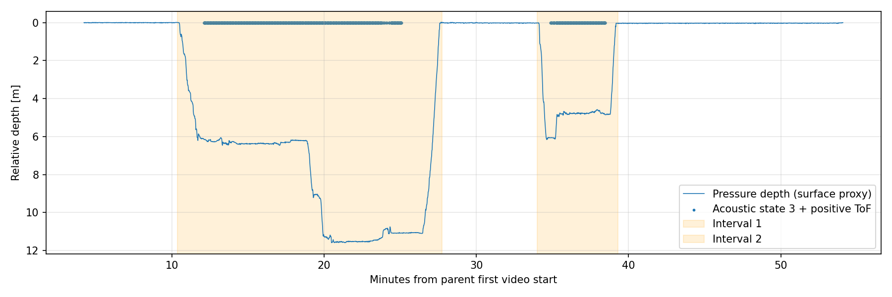

# Nanyo：連結動画と解析区間

水面基準圧 1034.5 mbar（最初の180秒の中央値）。仮定密度1025 kg/m³、5点中央値の相対水深0.2 m超、または子機shotのstate=3かつToF正値を選択。30秒以内の空白を結合し前後10秒を付加。

親機2本を無再圧縮連結。継ぎ目の推定UTC差は 18.7 ms。この微小差の映像補完や再生速度補正は行わず、piecewise時計をsidecarに保持。

[連結親機動画](../../../data/processed/20261031_nanyo_000/videos/parent_joined.mp4)

| 区間 | 切出し時刻 JST | 長さ | 相対最大深度 | 音響候補shot |
|---|---|---:|---:|---:|
| 20261031_nanyo_001 | 14:37:00–14:54:23 | 1043.2 s | 11.59 m | 1870 |
| 20261031_nanyo_002 | 15:00:38–15:05:57 | 319.6 s | 6.16 m | 558 |

水面圧・海水密度は区間選別用の暫定値。state=3は検出候補で、検証済み測位や直接波を保証しない。0.1/0.2/0.3 mの感度比較をmanifestへ保存。

各区間の動画は元解像度・fps・音声を無再圧縮で維持。DJIテレメトリは同期済みCSVに保存。コンテナ作成時刻を計測時刻に使わない。区間は半開区間。未対応時刻の行数はmanifestへ記録。

ログには子機IMU/BNO/health/shot/multipath、親機health/range/time_position、親機100 Hz IMU、DJI同期姿勢を含む。GNSS生観測・960 Hz親機原本は共有raw参照に保持。

## 自動検証

区間数2、全切出しCSVのUTC境界・区間秒・行数を確認。連結前後・切出し先頭付近・中間の計13箇所で、復号フレームのMD5が元動画と一致。詳細は [verification.json](verification.json)。

選別図と親子各2区間の代表フレームを目視確認済み。関連自動試験11件・Ruff・ワークスペース構成検証合格。未知BNOレコードはunknown_16として元情報を保持し未解釈。
