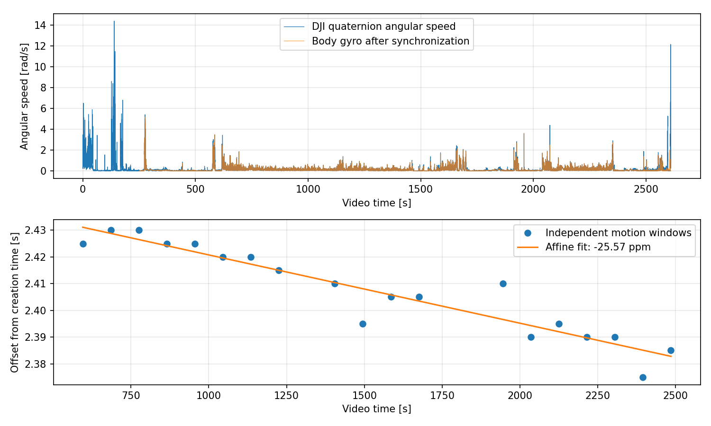
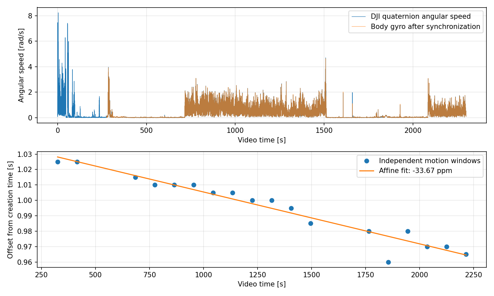
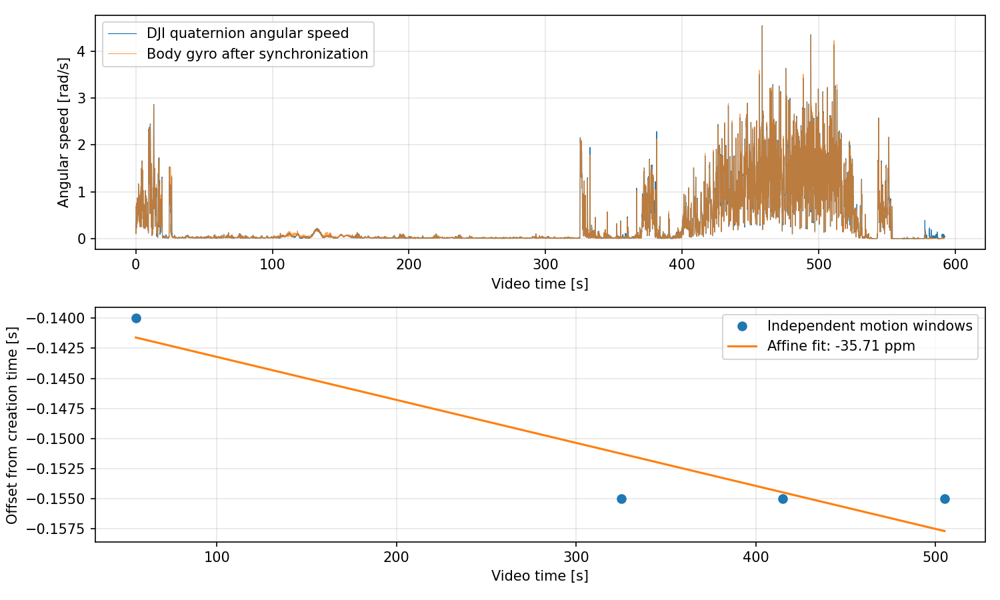

# Nanyo海上実験：姿勢による時刻同期

長田高校と同じDJI四元数の微分角速度と機体ジャイロの照合で、親機2本・子機1本を個別に同期した。原本は移動・変更していない。

## 結果

| 動画 | 推定開始時刻 JST | 作成時刻への補正 s | drift ppm | RMS残差 ms | 最大残差 ms | 採用窓 | 検証範囲（動画秒） |
|---|---|---:|---:|---:|---:|---:|---|
| child_DJI_20261031142636_0026_D | 14:26:39.446319 | +2.446319 | -25.568 | 5.45 | 13.41 | 19 | 550–2530 |
| parent_DJI_20261031142637_0188_D | 14:26:39.039114 | +1.039114 | -33.675 | 4.88 | 16.65 | 18 | 280–2260 |
| parent_DJI_20261031150457_0189_D | 15:04:57.860357 | -0.139643 | -35.714 | 2.45 | 3.75 | 4 | 10–550 |

## 適用方法と限界

`UTC秒 = utc_at_video_zero_s + time_scale × 動画PTS秒`。係数は[manifest.json](manifest.json)を参照。日付は2026-10-31。

親機の時計基準はSpresenseのGPS PPS quality=2の記録UTC。子機は本収録C_MAIN_IMU_100Hz_35545のgps_pps_candidate記録UTC。親子間のUTC伝達の絶対誤差は今回独立に検証していない。IMU配信遅延も経験的補正に含む。

元姿勢の四元数を維持した同期CSVは `data/processed/20261031_nanyo_000/synchronization/*_attitude.csv`。`clock_interpolated=1` は採用窓の最初から最後までの内側である。それ以外は外挿。内部の低相関区間も除外理由とともにmanifestに残した。子機開始550秒より前は同期の検証範囲外として扱う。

残差は内部整合性であり、絶対時刻精度や機体の絶対方位精度ではない。5 ms刻みの探索。leave-one-window-out最大誤差は検証JSONを参照。短い親機2本目のドリフトは4窓のみからの推定。

## 診断図

[SVG](child_DJI_20261031142636_0026_D.svg) / [窓ごとの数値](child_DJI_20261031142636_0026_D_windows.csv)。編集元 `child_DJI_20261031142636_0026_D.figure.pickle` と `.plot.json` も同じフォルダ。

[SVG](parent_DJI_20261031142637_0188_D.svg) / [窓ごとの数値](parent_DJI_20261031142637_0188_D_windows.csv)。編集元 `parent_DJI_20261031142637_0188_D.figure.pickle` と `.plot.json` も同じフォルダ。

[SVG](parent_DJI_20261031150457_0189_D.svg) / [窓ごとの数値](parent_DJI_20261031150457_0189_D_windows.csv)。編集元 `parent_DJI_20261031150457_0189_D.figure.pickle` と `.plot.json` も同じフォルダ。

## 再現と検証

再現コード：`scripts/prepare_nanyo_sync.py`、`scripts/synchronize_nanyo.py`。設定：`config/20261031_nanyo_000/synchronization.json`。CRC検証と機体原本ハッシュはinterimのdecode.jsonとparent_100hz.jsonに保存。LRF原本ハッシュは[verification.json](verification.json)に保存。

自動試験12件、変更したPythonのRuff、ワークスペース構成検証を実行し合格。同期CSVの再計算一致、単調性、外挿フラグ、図の編集元と入力ハッシュを検証。3枚のPNGを目視し、波形の重なり・軸ラベル・凡例・窓の分布を確認した。
