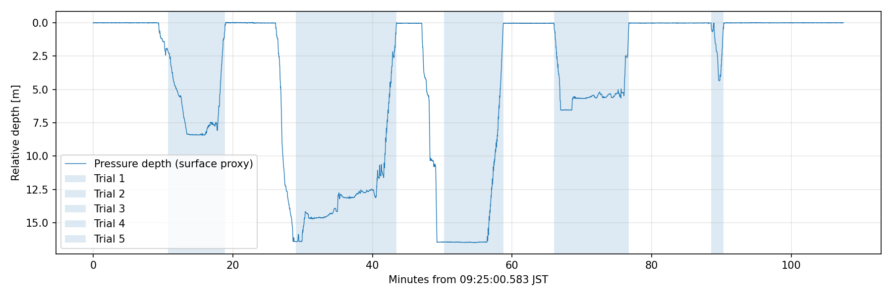

# Nanyo day2：時刻同期・実験分割

開始=max(子機入水, 親機の最初の測距shot)、終了=min(離水, 測距停止)。前後余白なし。
測距成功の有無で除外しない。親機scheduled時刻と子機tx時刻は各機器のアンカーで変換。
水面圧の代理値は最初の180秒の中央値 1037.90 mbar。
0.2 m超の5点中央値を入水とし、30秒以内の水面付近の揺れを結合。水深は未校正。

| 実験 | JST開始 | JST終了 | 秒 | 最大相対水深 m |
|---|---|---|---:|---:|
| [20261101_nanyo_001](../../20261101_nanyo_001/segmentation/report.md) | 09:35:44.994 | 09:43:52.881 | 487.89 | 8.44 |
| [20261101_nanyo_002](../../20261101_nanyo_002/segmentation/report.md) | 09:54:04.051 | 10:08:27.708 | 863.66 | 16.42 |
| [20261101_nanyo_003](../../20261101_nanyo_003/segmentation/report.md) | 10:15:14.104 | 10:23:45.052 | 510.95 | 16.50 |
| [20261101_nanyo_004](../../20261101_nanyo_004/segmentation/report.md) | 10:31:03.593 | 10:41:45.454 | 641.86 | 6.56 |
| [20261101_nanyo_005](../../20261101_nanyo_005/segmentation/report.md) | 10:53:33.226 | 10:55:19.853 | 106.63 | 4.34 |

[同期結果](../synchronization/report.md)。全動画を個別同期し、再起動前後の時計を共有しない。
自動分割された動画は区間内で無再圧縮連結。各部分の時計と欠測はsidecarに保持。
カメラの採用窓の外は外挿フラグ付き。元データは変更していない。

[詳細manifest](manifest.json)

## 最終検証

- 5実験・155 CSVのUTC境界、区間秒、行数、入力ハッシュを検証。
- 親子動画10本、元動画の各部分に対する24箇所の復号フレーム一致を確認。
- 連結時に可視化された先頭prerollを補正済み。単一部分は元の切出しedit listを維持。
- 5実験の親子映像の中央フレームと区間図を目視確認。
- 水深閾値0.1/0.2/0.3 mの全てで5実験。深度値は暫定。
- 原本ログ42ファイルのSHA-256とCRC読出しの完結を確認。

[検証JSON](verification.json) / [親子映像の確認画像](contact_sheet.png) / [テスト記録](../synchronization/checks.md)。

## 時計の適用範囲

再起動後の最後の実験005には親機0197・子機0030の独立時計を使用した。
自動分割の継ぎ目付近、実験004の子機末尾、実験005の子機末尾は同期採用窓の範囲外を含む。
これらは外挿フラグを保持し、検証済み範囲として扱わない。各区間の*.clock.json参照。
実験004の親機ファイル継ぎ目には推定約21 msの空白があり、映像を補間していない。
*_concat_untrimmed.mp4は補正前の派生バックアップ。利用する動画は各区間のparent.mp4/child.mp4。
