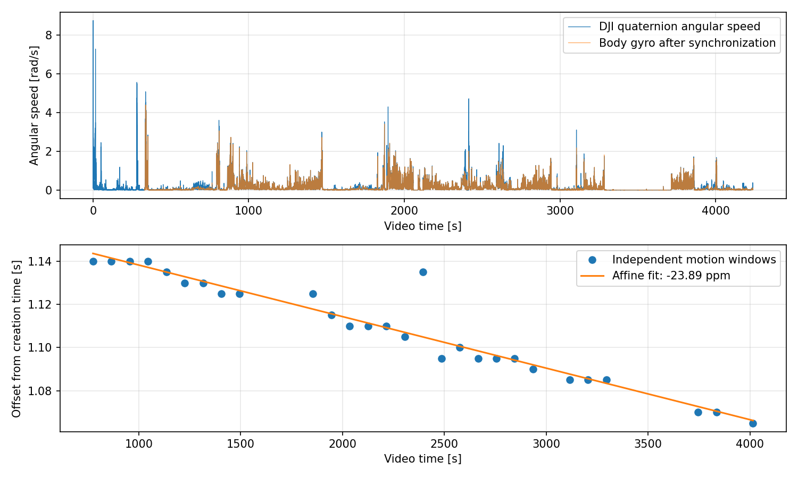
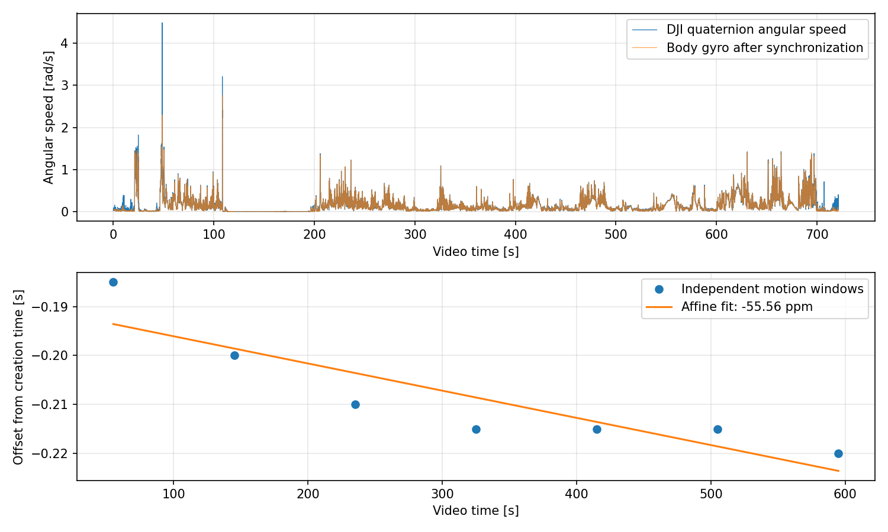
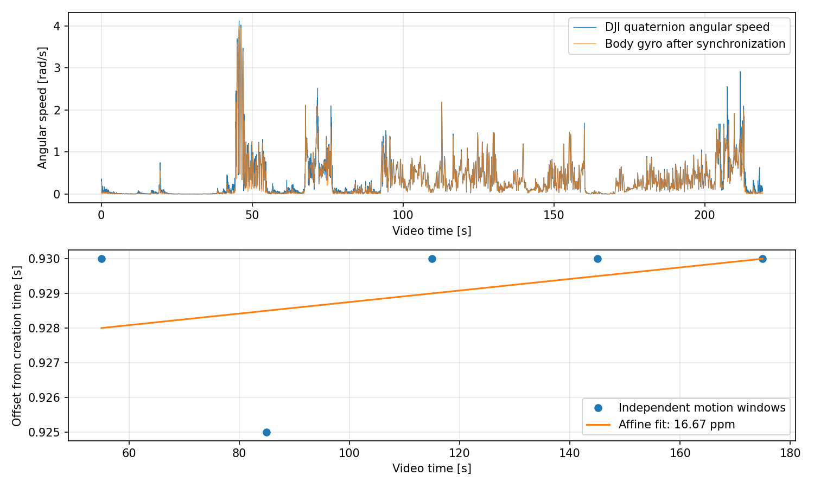
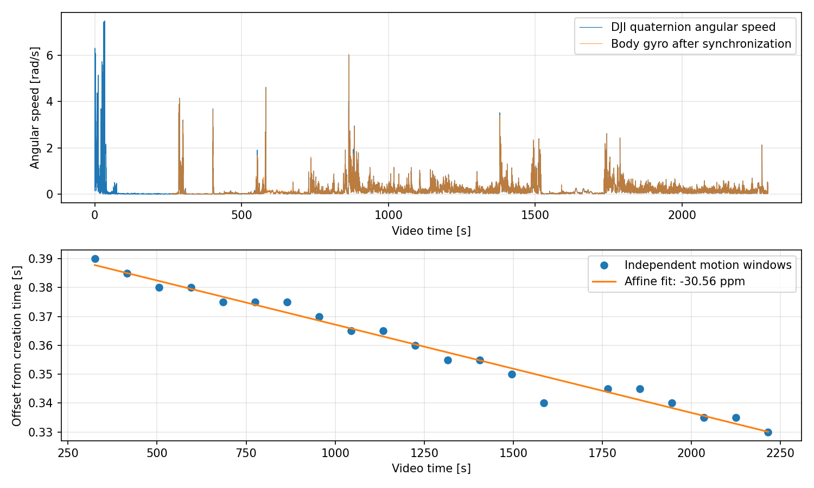
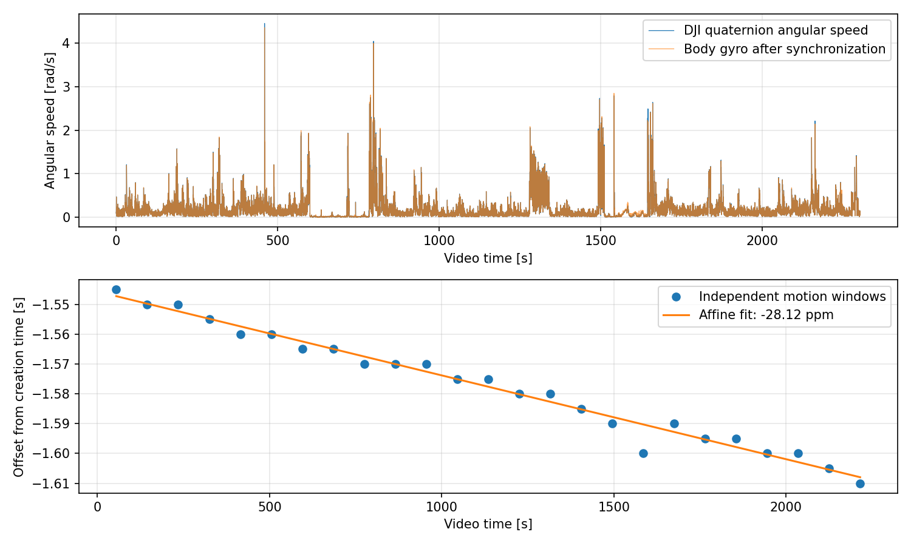
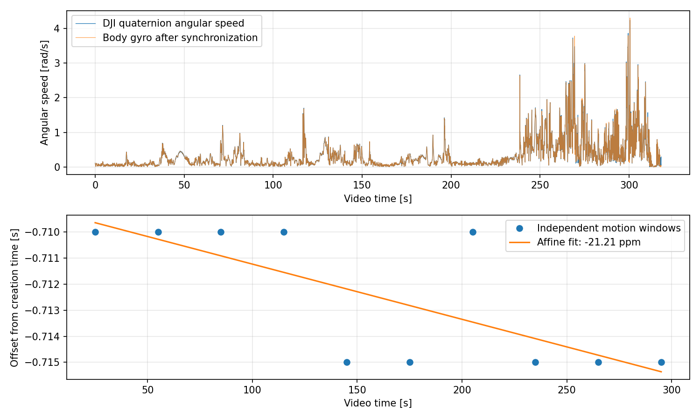
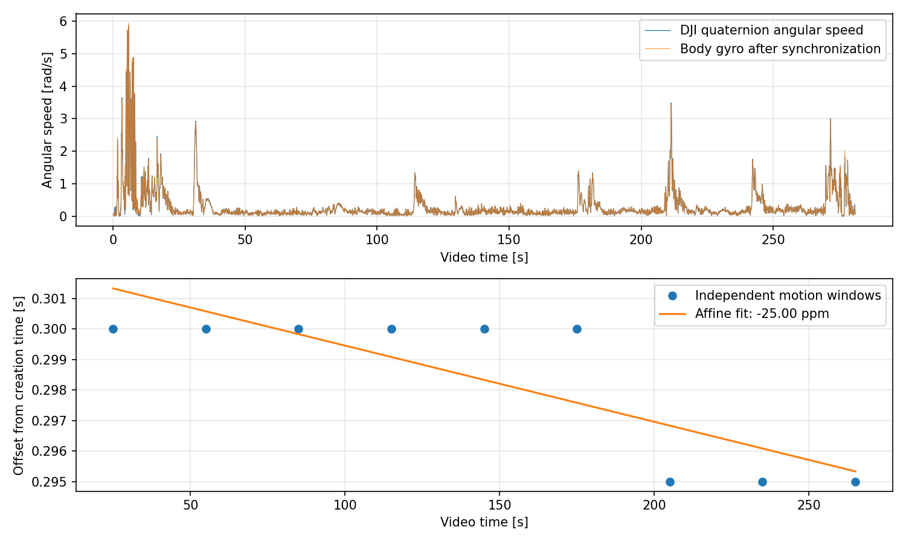

# Nanyo海上実験：姿勢による時刻同期

長田高校と同じDJI四元数の微分角速度と機体ジャイロの照合で、全7本を個別に同期した。原本は移動・変更していない。

## 結果

| 動画 | 推定開始時刻 JST | 作成時刻への補正 s | drift ppm | RMS残差 ms | 最大残差 ms | 採用窓 | 検証範囲（動画秒） |
|---|---|---:|---:|---:|---:|---:|---|
| child_DJI_20261101091928_0028_D | 09:19:30.162117 | +1.162117 | -23.885 | 6.33 | 30.09 | 28 | 730–4060 |
| child_DJI_20261101103009_0029_D | 10:30:09.809484 | -0.190516 | -55.556 | 5.15 | 8.57 | 7 | 10–640 |
| child_DJI_20261101105154_0030_D | 10:51:55.927083 | +0.927083 | 16.667 | 1.87 | 3.50 | 5 | 40–190 |
| parent_DJI_20261101092040_0193_D | 09:20:41.397746 | +0.397746 | -30.560 | 2.74 | 9.31 | 21 | 280–2260 |
| parent_DJI_20261101095854_0194_D | 09:58:54.454316 | -1.545684 | -28.120 | 2.68 | 9.75 | 25 | 10–2260 |
| parent_DJI_20261101103718_0195_D | 10:37:18.290894 | -0.709106 | -21.212 | 1.71 | 3.45 | 10 | 10–310 |
| parent_DJI_20261101105120_0197_D | 10:51:21.301958 | +0.301958 | -25.000 | 1.34 | 2.42 | 9 | 10–280 |

## 適用方法と限界

`UTC秒 = utc_at_video_zero_s + time_scale × 動画PTS秒`。係数は[manifest.json](manifest.json)を参照。実験IDは20261101_nanyo_000。

親機の時計基準はSpresenseのGPS PPS quality=2の記録UTC。子機はC_MAIN_IMUのgps_pps_candidate記録UTC。入力ファイルはmanifestに列挙。親子間のUTC伝達の絶対誤差は今回独立に検証していない。IMU配信遅延も経験的補正に含む。

元姿勢の四元数を維持した同期CSVは `data/processed/20261101_nanyo_000/synchronization/*_attitude.csv`。`clock_interpolated=1` は採用窓の最初から最後までの内側である。それ以外は外挿。内部の低相関区間も除外理由とともにmanifestに残した。検証範囲は動画ごとに上表を参照。再起動の前後へ別動画の時計を流用しない。

残差は内部整合性であり、絶対時刻精度や機体の絶対方位精度ではない。探索刻みはmanifestの設定、leave-one-window-out最大誤差は検証JSONを参照。短い収録のドリフトは限られた窓からの推定。

## 診断図

[SVG](child_DJI_20261101091928_0028_D.svg) / [窓ごとの数値](child_DJI_20261101091928_0028_D_windows.csv)。編集元 `child_DJI_20261101091928_0028_D.figure.pickle` と `.plot.json` も同じフォルダ。

[SVG](child_DJI_20261101103009_0029_D.svg) / [窓ごとの数値](child_DJI_20261101103009_0029_D_windows.csv)。編集元 `child_DJI_20261101103009_0029_D.figure.pickle` と `.plot.json` も同じフォルダ。

[SVG](child_DJI_20261101105154_0030_D.svg) / [窓ごとの数値](child_DJI_20261101105154_0030_D_windows.csv)。編集元 `child_DJI_20261101105154_0030_D.figure.pickle` と `.plot.json` も同じフォルダ。

[SVG](parent_DJI_20261101092040_0193_D.svg) / [窓ごとの数値](parent_DJI_20261101092040_0193_D_windows.csv)。編集元 `parent_DJI_20261101092040_0193_D.figure.pickle` と `.plot.json` も同じフォルダ。

[SVG](parent_DJI_20261101095854_0194_D.svg) / [窓ごとの数値](parent_DJI_20261101095854_0194_D_windows.csv)。編集元 `parent_DJI_20261101095854_0194_D.figure.pickle` と `.plot.json` も同じフォルダ。

[SVG](parent_DJI_20261101103718_0195_D.svg) / [窓ごとの数値](parent_DJI_20261101103718_0195_D_windows.csv)。編集元 `parent_DJI_20261101103718_0195_D.figure.pickle` と `.plot.json` も同じフォルダ。

[SVG](parent_DJI_20261101105120_0197_D.svg) / [窓ごとの数値](parent_DJI_20261101105120_0197_D_windows.csv)。編集元 `parent_DJI_20261101105120_0197_D.figure.pickle` と `.plot.json` も同じフォルダ。

## 再現と検証

再現コード：`scripts/prepare_nanyo_sync.py`、`scripts/synchronize_nanyo.py`。設定：`config/20261101_nanyo_000/synchronization.json`。CRC検証と機体原本ハッシュはinterimのdecode.jsonとparent_100hz.jsonに保存。LRF原本ハッシュは[verification.json](verification.json)に保存。

本スクリプトで同期成果物の数値を検証。同期CSVの再計算一致、単調性、外挿フラグ、図の編集元と入力ハッシュを検証。図の目視確認とコードの試験結果は別途記録する。

## 再起動の確認

親機0193→0194→0195は自動分割（継ぎ目 −13.4/+21.4 ms）、0195→0197は524.94秒の録画休止。
子機0028→0029は自動分割（−21.4 ms）、0029→0030は584.74秒の録画休止。
最後の親機0197と子機0030はそれぞれ独立した同期係数を使用。
細かな負の継ぎ目は推定残差程度の重なりであり、実時計の連続性の確証ではない。
全7枚の診断図を確認し、波形の重なりと採用窓の分布を確認した。
最終子機動画の採用範囲は40〜190秒。これを超える末尾は外挿として保存する。
詳細は[recording_sessions.json](recording_sessions.json)。

親子の共通3,545 shotの送信時計差は中央値−0.031 ms、最大絶対値0.692 ms。UTC転送の内部整合性であり独立した絶対精度ではない。
[検証記録](checks.md) / [親子時計照合](parent_child_shot_clock_check.json)。
